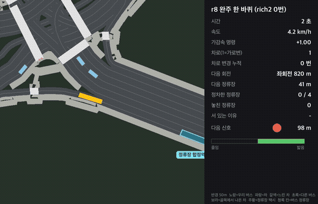
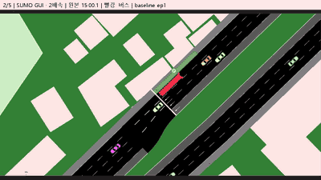
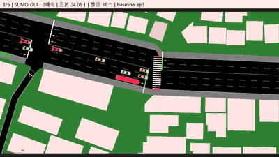
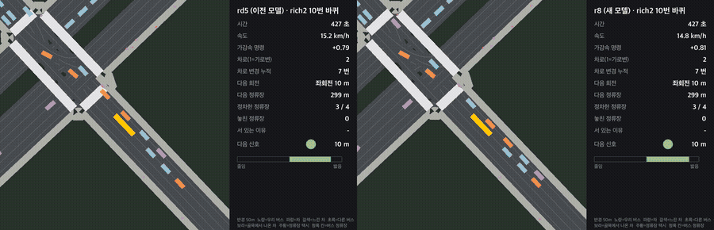

<div align="center">

# 합정역 자율주행버스

**가로변 정류장과 좌회전 차로를 오가는 시내버스를 신경망 하나로 운전한다**

서울 합정역 일대 실제 도로를 SUMO로 옮기고, 규칙 보조 없이 학습한 신경망 하나로 시내버스를 몰아<br>
13,000바퀴 중 95.6%를 완주했으며(충돌 0.66%), 그 주행 1,086만 건을 공개한다.

성균관대학교 「자율주행인공지능및제어」 2026년 2학기 팀 프로젝트 · URBAN:ON (15조)<br>
주현진 · 정기용 · 서예인 · 이건호 · 박신후

[](https://kiyong-jung.github.io/Artificial-Intelligence-and-Control-for-Autonomous-Driving/)
[](https://huggingface.co/datasets/twave17/hapjeong-bus-av-sumo)
[](https://github.com/kiyong-jung/Artificial-Intelligence-and-Control-for-Autonomous-Driving)




<sub>학습한 신경망이 가장 붐비는 복합 교통에서 정류장 4곳에 모두 서며 한 바퀴를 완주한 기록을 줄여 그렸다. 노란 차가 버스다.</sub>

| 충돌률 | 완주율 | 평가한 바퀴 | 공개 데이터 |
|:---:|:---:|:---:|:---:|
| **0.66%** | **95.6%** | **13,000** | **10,864,774건** |
| 수업 기준 5% 미만 | 목적지 도착 | 학습에 쓰지 않은 seed | 0.5초마다 한 건 |

</div>

## 개요

시내버스는 가로변 정류장에 섰다가 차로로 돌아오고, 좌회전하려면 가장 왼쪽 차로까지 옮겨야 한다. 합정역 순환 노선 1,963m에는 정류장 4곳과 좌회전 4곳이 번갈아 있어서 버스는 한 바퀴에 차로를 8~9번 바꾼다. 우리는 이 도로를 SUMO(Simulation of Urban MObility)로 옮기고, 정류장 택시와 골목 차와 보행자가 있는 교통을 만들었다. 신경망은 규칙 운전사의 정답을 따라 배우는 DAgger(Dataset Aggregation)로 학습했고, 주행할 때는 규칙 보조도 SUMO 안전장치도 쓰지 않는다.

## 평가 항목별 안내

수업 평가 기준의 아홉 항목을 이 README의 어느 절이 어떤 근거로 답하는지 정리했다.

| 평가 항목 | 보는 곳 | 근거 |
|---|---|---|
| 도로 구조 구현 | [도로 구현](#도로-구현) | OpenStreetMap 원본을 실제 지도와 대조해 고친 도로망, 실제 지도와 겹친 그림, 살린 실제 골목 여덟 묶음([골목 보고서](docs/road_report/road_report.pdf)) |
| 도로 구조의 의미 | [도로 선정과 문제](#도로-선정과-문제) | 가로변 정류장 4곳과 가장 왼쪽 차로 좌회전 4곳이 번갈아 있어 한 바퀴에 차로 변경 8~9번, 합정역 사거리 앞 167m 안에 세 차로 |
| Vehicle Interaction | [차량 interaction](#차량-interaction) | 13,000바퀴에서 센 바퀴당 장면 횟수, 정류장 앞 택시를 만난 바퀴 240 중 231, 눈치싸움 영상 다섯 개 |
| Simulation 안정성 | [시뮬레이션 안정성](#시뮬레이션-안정성) | 순간이동 0건, 오류로 끝난 바퀴 0, 배경 이상이 있던 바퀴는 데이터에서 뺌 |
| AV 주행 성능 | [평가 결과](#평가-결과) | 충돌률 0.66%(기준 5% 미만), 완주율 95.6%, 끝난 원인별 횟수 |
| Traffic 구성 | [교통 구성](#교통-구성) | 교통 다섯 단계, 시간당 663~1,989대, 버스 150m 안 평균 4.9~18.8대 |
| Dataset 구축 | [데이터셋](#데이터셋) | 공개 10,864,774건(기준 10⁷ 이상), 65묶음 모두 NPZ 행 수와 metadata 건수 일치 |
| 분석 및 설명 | [문제와 해결, 한계](#문제와-해결-한계) | 문제 여섯 개의 해결과 결과, 실패 575바퀴가 난 곳 |
| 최종 결과물 | 맨 위 배지 | [프로젝트 페이지](https://kiyong-jung.github.io/Artificial-Intelligence-and-Control-for-Autonomous-Driving/), [코드](https://github.com/kiyong-jung/Artificial-Intelligence-and-Control-for-Autonomous-Driving), [데이터](https://huggingface.co/datasets/twave17/hapjeong-bus-av-sumo), 30초 넘는 한 바퀴 주행 영상([mp4](web_page/assets/videos/full_lap.mp4)), 발표자료(추가 예정) |

## 목차

1. [도로 선정과 문제](#도로-선정과-문제)
2. [도로 구현](#도로-구현)
3. [교통 구성](#교통-구성)
4. [차량 interaction](#차량-interaction)
5. [AV 학습 설계](#av-학습-설계)
6. [평가 결과](#평가-결과)
7. [데이터셋](#데이터셋)
8. [문제와 해결, 한계](#문제와-해결-한계)
9. [빠른 시작](#빠른-시작)
10. [저장소 구조](#저장소-구조)
11. [팀](#팀)
12. [감사의 글과 출처](#감사의-글과-출처)

## 도로 선정과 문제

버스는 합정역을 출발해 독막로로 상수역까지 가고, 와우산로와 잔다리로를 지나 서교동사거리에서 양화로로 들어와 합정역으로 돌아온다. 시계 반대 방향으로 도는 1,963m 순환 경로(`bus_loop`)다.

<p align="center">
  
  <br>
  <sub>버스 순환 경로(파란 선)와 정류장 구간의 시작과 끝(노란 점). 오른쪽은 합정역 사거리를 확대한 것이다.</sub>
</p>

### 도로 구조의 의미

이 노선에서는 정류장 정차와 좌회전이 번갈아 나온다. 정류장은 가로변 차로에 있고 좌회전은 가장 왼쪽 차로에서만 하므로, 버스는 한 바퀴 내내 가로변과 왼쪽 끝을 오간다.

- 버스가 서는 정류장은 4곳이고, 정류장마다 8초 선다.
- 좌회전 4곳(상수역 사거리, 삼거리포차 앞, 서교동사거리, 합정역 사거리)은 가장 왼쪽 차로에서만 할 수 있다.
- 그래서 버스는 한 바퀴에 차로를 8~9번 바꾼다(실제로 잰 변경은 8.5~9.3번).
- 합정역 사거리 앞에서는 167m 안에 세 차로를 건너야 한다.
- 횡단보도는 9곳이고, 와우산로의 신호 없는 횡단보도도 그중 하나다.

버스는 0.5초마다 옆 차로의 틈을 보고 끼어들지, 속도를 줄여 기다릴지 정한다. 이 판단이 필요한 장면을 여섯 시나리오로 정했다.

| 번호 | 상황 | 버스가 판단할 것 |
|---|---|---|
| S1 | 정류장 출발 후 재합류 | 정차를 마친 뒤 출발할 시점 |
| S2 | 좌회전 전 왼쪽 차로 변경 | 옮길 차로의 틈, 기다릴 때의 속도 |
| S3 | 정류장 접근 오른쪽 차로 변경 | 감속 시점과 차로 변경 순서 |
| S4 | 정류장 앞 택시 | 택시 뒤에서 기다릴지 |
| S5 | 골목 차 끼어들기 | 감속과 양보 |
| S6 | 신호 없는 횡단보도 | 보행자 앞에서 설지 |

## 도로 구현

<p align="center">
  
  <br>
  <sub>왼쪽은 합정역 일대 OpenStreetMap 지도이고, 오른쪽은 같은 범위에 SUMO 도로망(붉은색)을 겹친 것이다.</sub>
</p>

| 항목 | 값 |
|---|---|
| 도로망 | 3.22.0, [`maps/hapjeong/`](maps/hapjeong/) |
| 버스 순환 경로 | `bus_loop` 1,963m, 시계 반대 방향 |
| 버스가 서는 정류장 | 4곳, 각 8초 정차 |
| 좌회전 | 4곳, 가장 왼쪽 차로에서만 |
| 횡단보도 | 9곳(신호 없는 와우산로 횡단보도 포함) |
| 살린 실제 골목 | 여덟 묶음 |
| 제한속도 | 간선 50km/h, 이면도로 30km/h(안전속도 5030) |
| 버스 | 길이 12m, 폭 2.5m, 가속 1.0m/s², 감속 2.0m/s² |

- 원본 도로망은 OpenStreetMap에서 변환했다([`maps/hapjeong/generator/`](maps/hapjeong/generator/)).
- [`scripts/build_hapjeong.py`](scripts/build_hapjeong.py)가 실제 지도와 대조해 고친 내용을 원본에 차례로 적용한다.
- 고친 내용은 모두 스크립트로 적용했고, 주요 수정 여섯 곳의 전후 그림은 [`maps/hapjeong/references/fixes/`](maps/hapjeong/references/fixes/)에 있다.
- 골목이 없으면 버스 앞에 끼어드는 차도 없어서, 버스 경로 안쪽의 실제 골목 여덟 묶음을 살렸다([골목 보고서](docs/road_report/road_report.pdf)).
- 학습, 평가, 수집은 모두 커밋된 도로망 [`maps/hapjeong/source/network.net.xml`](maps/hapjeong/source/network.net.xml)을 그대로 읽는다.
- 도로망의 버전별 수정 이력은 [`maps/hapjeong/README.md`](maps/hapjeong/README.md)에 있다.

## 교통 구성

일반 차는 실행 전에 seed로 정해지는 route/flow 파일대로 나온다. 버스 위치를 보고 넣는 차는 없다. 같은 seed로 버스를 넣고 뺀 두 실행에서 배경 차 467대의 출발 시각과 경로가 모두 같았다([`bus_independence.py`](research/traffic_checks/bus_independence.py)).

| 교통 | 코드 이름 | 시간당 차량 | 버스 150m 안 차(평균) | 버스 150m 안 보행자 | 구성 |
|---|---|---:|---:|---:|---|
| 한산 | `quiet` | 663대 | 4.9대 | 8.9명 | 기준 수요의 0.5배 |
| 보통 | `baseline` | 1,326대 | 10.5대 | 8.9명 | 기준 수요 |
| 혼잡 | `busy` | 1,658대 | 12.4대 | 8.9명 | 1.25배 |
| 매우 혼잡 | `heavy` | 1,989대 | 16.3대 | 9.2명 | 1.5배 |
| 복합 | `rich2` | 1,989대 | 18.8대 | 15.3명 | 1.5배와 같은 총수요 + 정류장 택시 + 골목 차 + 보행자 1.5배 |

차 수만 늘리면 신호 앞 줄만 길어지고 구간 가운데는 빈다. 그래서 복합 교통은 총수요를 1.5배와 같게 두고, 그 일부를 구간 가운데에서 버스와 얽히는 차로 바꿨다.

- 택시는 버스가 서는 정류장 4곳의 정류장 차로에 15~30초씩 서고, 정류장 차로가 택시로 차 있는 시간은 25%다.
- 수요의 10%는 골목 두 곳에서 나와 버스 노선으로 합류한다.
- 보행자는 지도의 보행자 흐름 전부를 1.5배로 늘렸다.
- 골목 차와 택시는 버스 노선에서 50m 넘게 떨어진 곳에서만 처음 나타난다.
- 구간 가운데(신호 정지선에서 60m 넘게)에서 같은 차로 앞 30m 안에 차가 있는 시간은 매우 혼잡 4.4%, 복합 12.7%다.

모든 교통에 공통인 설정은 다음과 같다.

- 차량 추종 모델은 Krauss 35%, IDM(Intelligent Driver Model) 30%, EIDM(Extended IDM) 20%, ACC(Adaptive Cruise Control) 15%를 섞었다.
- 차로 변경은 차로 안의 옆 위치를 0.8m 단위로 계산하는 SL2015 모델이다.
- 순간이동(teleport)은 꺼 두었다(`time-to-teleport -1`).
- 규칙 운전사가 1.75배 교통에서 10바퀴 중 7바퀴만 완주해서, 교통은 1.5배까지만 쓴다.

교통 설정은 [`env/road_config.py`](env/road_config.py)와 [`env/road_builder.py`](env/road_builder.py)에 있다.

## 차량 interaction

평가 13,000바퀴에서 버스가 보는 50m 안에서 다른 차나 보행자와 얽힌 장면을 바퀴당 횟수로 셌다([`count_interactions.py`](research/av_bc_rl/count_interactions.py)).

| 장면 (바퀴당 횟수) | 한산 | 보통 | 혼잡 | 매우 혼잡 | 복합 |
|---|---:|---:|---:|---:|---:|
| 정류장 정차 중 같은 차로 뒤 50m 안에 차 (S1) | 0.27 | 0.53 | 0.67 | 0.79 | 1.56 |
| 왼쪽 변경 요청 때 옮길 차로 뒤 30m 안에 차 (S2) | 0.33 | 0.88 | 1.22 | 1.49 | 2.11 |
| 오른쪽 변경 요청 때 옮길 차로 뒤 30m 안에 차 (S3) | 0.61 | 0.84 | 0.91 | 0.95 | 0.93 |
| 앞으로 끼어든 차 (S5) | 0.33 | 0.67 | 0.86 | 0.99 | 1.50 |
| 보행자가 건너던 횡단보도 접근 (S6) | 2.02 | 1.99 | 1.93 | 1.96 | 2.33 |

- 실제 차로 변경 중 옮길 차로 앞뒤 30m 안에 차가 있던 비율은 한산 16%, 보통 32%, 혼잡 36%, 매우 혼잡 41%, 복합 46%다(교통마다 400바퀴, [`traffic_around_bus.py`](research/av_bc_rl/traffic_around_bus.py)).
- 정류장 앞 택시(S4)는 복합 교통 240바퀴 중 231바퀴에서 만났다(DAgger 21회 모델의 평가 기록, [`cause_table_confirm.txt`](research/traffic_checks/cause_table_confirm.txt)).

### 눈치싸움 장면

숫자로는 보이지 않는 장면을 골랐다. 버스와 주변 차가 서로 속도와 간격을 보며 먼저 갈지 기다릴지 정하는 모습이 사람 운전자끼리의 눈치싸움과 닮았다.

<table>
  <tr>
    <td width="50%" valign="top">
      <br>
      <b>1. 합정역 정류장 진입</b> · 보통 교통<br>
      신호를 기다리며 줄 선 차들 바로 옆의 정류장 차로로 들어가 서고, 정차를 마친 뒤 다시 교차로로 나간다.
    </td>
    <td width="50%" valign="top">
      <br>
      <b>2. 정류장 출발과 재합류</b> · 보통 교통<br>
      정류장을 떠나는 버스 옆으로 차가 붙어 오고, 둘이 나란히 달리며 간격을 맞춰 가는 모습이 보인다.
    </td>
  </tr>
  <tr>
    <td width="50%" valign="top">
      <br>
      <b>3. 독막로 정류장</b> · 보통 교통<br>
      옆 차로를 오가는 차들 사이로 가로변 정류장에 섰다가 다음 교차로로 향한다.
    </td>
    <td width="50%" valign="top">
      <br>
      <b>4. 붐비는 교차로 출발</b> · 혼잡 교통<br>
      긴 대기 줄 앞에서 신호를 기다리다가 녹색이 켜지자 다른 차들과 함께 교차로를 건넌다.
    </td>
  </tr>
  <tr>
    <td width="50%" valign="top">
      <br>
      <b>5. 교차로 앞 차로 변경</b> · 한산 교통<br>
      옆 차와 나란히 정지선에 다가가고, 교차로 안을 지나는 차를 기다린 뒤 차로를 옮겨 출발하는 것으로 보인다.
    </td>
    <td width="50%" valign="top">
      <b>영상 읽는 법</b><br><br>
      SUMO GUI 화면 녹화를 2배속으로 줄였다.<br>
      빨간 차가 버스다.<br>
      설명은 화면을 보고 쓴 것이다.<br>
      원본 영상(mp4)은 <a href="https://kiyong-jung.github.io/Artificial-Intelligence-and-Control-for-Autonomous-Driving/">프로젝트 페이지</a>와 <a href="web_page/assets/videos/"><code>web_page/assets/videos/</code></a>에 있다.
    </td>
  </tr>
</table>

## AV 학습 설계

AV(autonomous vehicle, 자율주행차)는 시내버스 한 대다. 신경망 하나가 0.5초마다 가감속과 차로 변경을 정한다.

| 항목 | 설계 |
|---|---|
| Observation | 46차원 부분 관측(50m 범위). 버스 속도와 가속도, 다섯 차로(내 차로, 좌우 한 칸, 좌우 두 칸)의 앞뒤 차 간격과 상대 속도, 차로 밀도, 차로별 경로 연결 거리, 신호(거리, 적색, 황색, 비보호, 황색 경과 시간), 정류장(거리 두 가지, 남은 정차 시간), 횡단보도(거리, 보행자 건너는 중), 제한속도 |
| Action | [가감속, 차로 변경] 2차원, 0.5초마다. 가감속 +1.0 ~ -2.0m/s², 차로 변경 {-1, 0, +1} |
| 종료 | terminated는 충돌, 보행자 충돌, 적색 통과, 도착, 멈춰 섬. truncated는 1,400 step(700초) |
| 신경망 | MLP(다층 퍼셉트론) 은닉층 256 × 2, ReLU, 가중치 81,514개. 출력 14개(가속도 11칸 점수 + 차로 3가지 점수) |
| 알고리즘 | DAgger. 신경망이 직접 몬 상태마다 규칙 운전사(expert-v7)의 정답을 붙여 합본으로 다시 학습 |

**Reward**

| 항목 | 값 |
|---|---:|
| 속도 | 0.1 × v/vmax |
| 앞차와 6m 미만 | -0.1 |
| 정류장 정차 | +1 |
| 정류장 지나침 | -3 |
| 승차감 한계 넘음(가속 1.5m/s², jerk 2.0m/s³) | -0.02 |
| 충돌 | -5 |
| 적색 통과 | -5 |
| 도착 | +2 |
| 멈춰 섬(200초 동안 5m 못 감) | -2 |
| 시간 초과(1,400 step = 700초) | -2 |

설계에서 지킨 수업 규칙과 그 밖의 결정은 다음과 같다.

- 차로를 지시하는 관측은 없고, 버스는 차로마다 노선으로 이어지는 거리만 보고 갈 차로를 정한다.
- 규칙 운전사([`env/route_policy.py`](env/route_policy.py))는 학습 때 정답을 붙이는 데만 쓰고 주행 때는 쓰지 않는다.
- 버스의 SUMO 안전장치(speedMode, laneChangeMode)는 0으로 끈다.
- 신경망은 관측 46개 중 31개를 쓰고 15개는 0으로 가린다(가려도 검증 손실과 주행이 같았다, [`docs/network_architecture.md`](docs/network_architecture.md)).
- 가속도를 값 하나로 맞히게 하면 서야 할지 가야 할지 모를 때 그 중간값을 내서, 11칸 중 하나를 고르게 바꿨다.
- 가속도는 가장 높은 칸과 양옆 칸의 평균으로 정한다.

### DAgger와 커리큘럼

교통은 쉬운 것에서 붐비는 것으로 넓혔다.

| 단계 | 교통 | 내용 |
|---|---|---|
| 시범 | 한산, 보통, 혼잡 | 규칙 운전사가 300바퀴를 몰고 그 기록으로 처음 모방학습 |
| DAgger 1~12회 | 한산, 보통, 혼잡 | 회마다 교통별 25바퀴를 신경망이 직접 몬다 |
| DAgger 13~16회 | + 매우 혼잡 | 끼어들기와 대기 줄 상황을 늘린다 |
| DAgger 17~21회 | + 택시·골목 차·보행자 | 정류장 앞 택시와 골목 차를 배운다 |
| DAgger 22~24회 | 다섯 교통 전부 | 최종 합본 2,707,818건(학습 2,166,572, 검증 541,246) |

- 회마다 40 epoch, batch 512, 학습률 3e-4, 검증 20%로 학습한다.
- 신호 상태를 바꿔 본 관측으로 데이터를 늘린다([`augment_signals.py`](research/av_bc_rl/augment_signals.py)).
- 학습은 CPU 14코어에서 SUMO 12개를 병렬로 돌렸다.

### 최종 모델 고르기

21~24회 네 모델을 seed 63000에서 교통마다 96바퀴씩 돌리고, 평가 전에 정한 기준으로 골랐다. 기준은 안전 사건(차 충돌 + 보행자 충돌 + 적색 통과)이 가장 적은 것, 같으면 완주가 많은 것이다.

| 모델 | 21회 | 22회 | 23회 | 24회 |
|---|---:|---:|---:|---:|
| 안전 사건 | 8 | 26 | 13 | **6** |

24회 모델을 골랐다([`pick_checkpoint.txt`](research/traffic_checks/pick_checkpoint.txt)). 모델은 [`models/final/model.pt`](models/final/model.pt)(330KB)이고, 학습 설정은 [`config.json`](models/final/config.json), 학습 기록은 [`training_log.csv`](models/final/training_log.csv)에 있다.

## 평가 결과

다섯 교통에서 학습에 쓰지 않은 seed로 2,600바퀴씩, 모두 13,000바퀴를 돌렸다. 버스의 SUMO 안전장치를 끈 채 끝난 원인을 원본 기록에서 셌다.

| 교통 | 바퀴 | 완주 | 차 충돌 | 보행자 충돌 | 적색 통과 | 멈춰 섬 | 시간 초과 |
|---|---:|---:|---:|---:|---:|---:|---:|
| 한산 | 2,600 | 2,594 | 2 | 0 | 1 | 3 | 0 |
| 보통 | 2,600 | 2,544 | 14 | 0 | 1 | 38 | 3 |
| 혼잡 | 2,600 | 2,519 | 10 | 1 | 1 | 59 | 10 |
| 매우 혼잡 | 2,600 | 2,471 | 16 | 1 | 4 | 87 | 21 |
| 복합 | 2,600 | 2,297 | 34 | 8 | 18 | 170 | 73 |
| **합계** | **13,000** | **12,425 (95.6%)** | **76** | **10** | **25** | **357** | **107** |

- 충돌률(Collision Rate)은 0.66%(차 76 + 보행자 10 = 86번)이고, 가장 어려운 복합 교통만 보면 1.6%다.
- 완주율은 95.6%이고, 복합 교통을 뺀 네 교통은 97.4%(10,400 중 10,128), 복합 교통은 88.3%다.
- 적색 통과는 25번(0.19%)이다.
- 차와 버스의 상자가 조금이라도 겹친 바퀴 391개를 모두 충돌로 쳐도 3.7%다.
- 한 바퀴는 평균 444초(한산)에서 501초(복합) 걸렸다.

<p align="center">
  
  <br>
  <sub>정류장 앞 택시(S4). 같은 복합 교통 바퀴에서 왼쪽 이전 모델은 정류장 입구의 택시를 들이받고, 오른쪽 최종 모델은 택시 뒤에서 기다린다. 노란 차가 버스다.</sub>
</p>

### 실패한 곳

| 실패 | 횟수 | 가장 많은 곳 |
|---|---:|---|
| 멈춰 섬 | 357 | 서교동사거리 앞 305번. 정류장에서 정지선까지 약 100m 사이에 좌회전 줄로 끼어들지 못한다 |
| 시간 초과 | 107 | 합정역 사거리 앞뒤 71번 |
| 차 충돌 | 76 | 합정역 사거리 갈림 지점 31번, 서교동사거리 안 18번 |
| 적색 통과 | 25 | 독막로 11번 |
| 보행자 충돌 | 10 | 와우산로 신호 없는 횡단보도 9번 |

### 시뮬레이션 안정성

- 평가 13,000바퀴에서 순간이동은 0건이고, 오류로 끝난 바퀴도 0이다.
- 순간이동을 꺼 두었기 때문에 막힌 경우는 사라지지 않고 위 표의 "멈춰 섬"으로 남는다.
- 버스 150m 안에서 배경 차 충돌이 있던 바퀴는 227개(1.7%)였고, 보행자 위치가 튄 바퀴는 22개였다.
- 이 바퀴들은 제출 데이터에서 뺐다.
- 배경 교통이 자연스러운지 세 번 감사했고, 기록은 [`docs/naturalness_audit/`](docs/naturalness_audit/)에 있다.
- 학습 환경이 배경 차, 보행자, 신호에 명령을 내리지 않는다는 것은 정적 검사([`tests/test_naturalness_static.py`](tests/test_naturalness_static.py), [`scripts/audit_naturalness.py`](scripts/audit_naturalness.py))로 확인한다.

## 데이터셋

[](https://huggingface.co/datasets/twave17/hapjeong-bus-av-sumo)

학습한 신경망(`models/final`)이 탐색 잡음 없이 직접 몬 13,000바퀴를 0.5초마다 한 건씩 기록했다. 모은 12,186,016건에서 실패하거나 시뮬레이션 이상이 있는 1,290바퀴를 바퀴 단위로 빼고, 11,710바퀴 10,864,774건을 공개한다. 한 바퀴 안의 행은 이어진 주행이라 일부만 빼면 다음 관측과 보상이 어긋나므로, 바퀴 단위로 거른다.

| 교통 | 모은 바퀴 | 모은 건수 | 남긴 바퀴 | 남긴 건수 |
|---|---:|---:|---:|---:|
| 한산 | 2,600 | 2,328,315 | 2,540 | 2,273,248 |
| 보통 | 2,600 | 2,381,523 | 2,447 | 2,232,677 |
| 혼잡 | 2,600 | 2,400,338 | 2,373 | 2,170,971 |
| 매우 혼잡 | 2,600 | 2,447,855 | 2,308 | 2,145,496 |
| 복합 | 2,600 | 2,627,985 | 2,042 | 2,042,382 |
| **합계** | **13,000** | **12,186,016** | **11,710** | **10,864,774** |

**파일 구성**

- 묶음(200바퀴)마다 JSONL(전체 항목), NPZ(학습용 배열), `metadata.json`(설정, 컬럼 설명, seed, 걸러 낸 내용)이 있다.
- 교통별 폴더 다섯 개에 65묶음이 있고, 모두 7.4GB다.
- NPZ 배열은 `observation` (N,46), `action_raw` (N,2), `lane_change` (N,), `reward`, `next_observation` (N,46), `terminated`, `truncated`, `episode`, `t`, `detected_xy` (M,2), `detected_offsets` (N+1,)이다.

**컬럼**

- 수업 기본 항목을 모두 담았다.
- 더한 항목은 `sim_time`, `detected_pedestrians`, `event.pedestrian_collision`, `event.red_light_violation`, `event.termination_reason`, `event.background_collisions`, `event.service_event`, `stops_served`, `stops_missed`, `comfort.peak_acceleration`, `peak_jerk`, `acceleration_violation`, `jerk_violation`, `state.navigation`, `state.traffic_light`, `state.pedestrians`다.
- 컬럼 정의는 [`env/data_schema.py`](env/data_schema.py)에 있다.

**검증**

- 65묶음 모두 NPZ 행 수가 metadata의 건수와 같다.
- 세 묶음을 [`check_dataset.py`](research/av_bc_rl/check_dataset.py)로 검사해 오류가 0개였다.
- Hugging Face에 올린 뒤 로그인 없이 받은 파일의 해시가 원본과 같다.

## 문제와 해결, 한계

| 영역 | 문제 | 해결 | 결과 |
|---|---|---|---|
| 도로 | 붙어 있는 교차로에서 급정지와 충돌 | 교차로를 합치고 차로를 한 차로씩 이음 | 급정지 40 → 0번 |
| 교통 | 대기 줄의 선 차가 30~40도 돌아 뒤차와 겹침 | 선 차의 옆 이동을 끔 | 26 → 0대 |
| 교통 | 구간 가운데에 차가 없음 | 정류장 택시와 골목 차를 수요로 넣음 | 앞차 있는 시간 12.7%(매우 혼잡 4.4%) |
| 학습 | 모방학습만으로는 30바퀴 중 26바퀴 완주 | DAgger로 벗어난 상태의 정답을 더함 | 10회 뒤 같은 60바퀴 모두 완주 |
| 학습 | 황색에서 어정쩡하게 줄이다 정지선을 넘음 | 가속도를 11칸 중 고르게 함 | 적색 통과 0.19% |
| 데이터 | 실패·이상 바퀴가 섞임 | 바퀴 단위 걸러내기([`filter_episodes.py`](research/av_bc_rl/filter_episodes.py)) | 1,290바퀴 제외 |

### 한계

- 실패 575바퀴 중 305바퀴가 서교동사거리 앞에서 멈춰 선 것이다.
- 규칙 운전사도 같은 곳에서 멈춰 서서, 따라 배우는 방식으로는 이 실패가 줄지 않았다.
- 정류장에 선 버스를 피하려던 뒤차가 두 차로에 걸쳐 서는 일이 있다.
- 옆 이동 설정 21가지를 견줬지만 이를 완전히 없애는 안은 없었고, 가장 나은 안에서도 버스의 안전 사건 수는 같았다([`lateral_screen.py`](research/traffic_checks/lateral_screen.py)).
- 차로 변경의 88%가 일어나는 구간 가운데는 신호 앞보다 차가 절반도 안 된다.
- 규칙 운전사가 1.75배 교통에서 10바퀴 중 7바퀴만 완주하므로, 그보다 붐비는 교통은 이 방식으로 가르칠 수 없다.
- 도로망 3.16.0~3.18.0과 3.21.0·3.22.0의 모양·신호 수정은 별도 스크립트로 커밋된 도로망에 얹었기 때문에, `build_hapjeong.py`만 다시 돌리면 3.22.0이 그대로 나오지 않는다.

## 빠른 시작

### 설치

Python 3.10과 SUMO 1.27.1에서 확인했다. SUMO는 따로 설치한다(수업 안내 [Windows](project_materials/1_SUMO_Windows_Setup.md), [macOS](project_materials/1_SUMO_macOS_AppleSilicon_Setup.md)).

```bash
git clone https://github.com/kiyong-jung/Artificial-Intelligence-and-Control-for-Autonomous-Driving.git
cd Artificial-Intelligence-and-Control-for-Autonomous-Driving
conda create -n sumo-rl python=3.10 -y
conda activate sumo-rl
pip install -r requirements.txt

export SUMO_HOME=/path/to/sumo-1.27.1   # SUMO를 설치한 폴더
export PYTHONPATH=.
```

- 아래 명령은 모두 저장소 루트에서, 위의 두 환경 변수를 둔 채로 돌린다.
- 도로 로더는 `network.net.xml`의 해시를 `maps/hapjeong/map.json`의 값과 비교해, 다르면 멈춘다.
- [`.gitattributes`](.gitattributes)가 git이 XML 파일의 줄바꿈을 바꾸지 않게 한다.

### 최종 모델로 평가하기

복합 교통에서 4바퀴를 돈다.

```bash
python research/av_bc_rl/evaluate.py --policy bc --model models/final/model.pt \
    --label final --seed 63000 --scenarios rich2 --episodes 4 --workers 4
```

- 주행 기록은 `data/research/eval/final_s63000_rich2.jsonl.gz`, 요약은 `results/metrics/final_s63000.json`에 쓴다.
- 이 4바퀴는 실험 기록과 끝난 원인, 걸음 수가 같았다.
- 다섯 교통을 96바퀴씩 돌리려면 뒤쪽 옵션을 `--scenarios quiet baseline busy heavy rich2 --episodes 96 --workers 12`로 바꾼다.

도로와 교통을 SUMO GUI로 보려면 다음을 돌린다. `--map hapjeong`을 빼면 다른 지도(`maps/paldalmun/`)가 열린다.

```bash
python view_road.py --map hapjeong --scenario rich2
```

### 제출 데이터 모으기

다섯 교통을 돌아가며 200바퀴씩 한 묶음으로 모은다. 끝난 묶음은 건너뛰므로, 끊기면 같은 명령을 다시 돌리면 된다.

```bash
MODEL=models/final/model.pt OUT=data/final TARGET=12000000 \
SCENARIOS="quiet:1 baseline:2 busy:3 heavy:4 rich2:5" \
bash research/av_bc_rl/collect_final.sh
```

묶음마다 실패·이상 바퀴를 거르고, 남긴 바퀴만 새 폴더에 쓴다.

```bash
mkdir -p data/final_filter
for f in data/final/*.jsonl.gz; do
    n=$(basename "$f" .jsonl.gz)
    python research/av_bc_rl/filter_episodes.py "$f" --report "data/final_filter/$n.json"
    python research/av_bc_rl/write_clean_final.py "data/final_filter/$n.json" --src data/final --out data/final_clean
done
```

묶음 하나를 검사하고, 버스가 얽힌 장면을 센다.

```bash
python research/av_bc_rl/check_dataset.py data/final_clean/rich2_s0_000.jsonl.gz
python research/av_bc_rl/count_interactions.py data/final
```

### 처음부터 학습 재현하기

시범 데이터 수집부터 DAgger 24회, 최종 모델 고르기까지 한 번에 돌린다.

```bash
bash research/av_bc_rl/train_final.sh              # 고른 모델 경로는 results/pick_checkpoint.txt 마지막 줄
COLLECT=1 bash research/av_bc_rl/train_final.sh    # 이어서 제출 데이터까지 모은다
```

- 이 스크립트는 최종 모델을 만든 실행의 명령을 그대로 옮긴 것이다.
- 끝난 단계는 건너뛰므로, 끊기면 같은 명령으로 다시 돌린다.
- 처음부터 끝까지 다시 돌려 보지는 않았다(하루 넘게 걸린다).

### 테스트

```bash
python -m pytest tests
```

테스트 390개 중 387개가 통과하고, 2개는 건너뛰고, 1개는 예상된 실패다.

## 저장소 구조

수업이 권장한 네 구분(Environment, Training, Evaluation, Data Collection)으로 묶었다.

| 구분 | 경로 | 하는 일 |
|---|---|---|
| **Environment** | [`env/sumo_env.py`](env/sumo_env.py) | Gymnasium 환경(관측, 행동, 보상) |
| | [`env/road_config.py`](env/road_config.py) | 교통 다섯 단계 |
| | [`env/road_builder.py`](env/road_builder.py) | 경로 파일 만들기 |
| | [`env/route_policy.py`](env/route_policy.py) | 규칙 운전사 expert-v7(학습 때 정답 붙이기에만 사용) |
| | [`env/data_schema.py`](env/data_schema.py) | 데이터 컬럼 정의 |
| | [`maps/hapjeong/`](maps/hapjeong/) | 합정역 도로망 |
| | [`scripts/build_hapjeong.py`](scripts/build_hapjeong.py) | 도로망 빌드 |
| **Training** | [`train_bc.py`](train_bc.py) | 모방학습 |
| | [`algorithms/bc.py`](algorithms/bc.py) | 신경망 |
| | [`research/av_bc_rl/dagger.py`](research/av_bc_rl/dagger.py) | DAgger 반복 |
| | [`research/av_bc_rl/augment_signals.py`](research/av_bc_rl/augment_signals.py) | 신호 상태를 바꿔 데이터 늘리기 |
| | [`research/av_bc_rl/merge_datasets.py`](research/av_bc_rl/merge_datasets.py) | 데이터 합본 |
| | [`research/av_bc_rl/train_final.sh`](research/av_bc_rl/train_final.sh) | 시범부터 DAgger 24회, 모델 고르기, 수집까지 한 번에 |
| **Evaluation** | [`research/av_bc_rl/evaluate.py`](research/av_bc_rl/evaluate.py) | 고정 seed에서 정책 평가 |
| | [`research/traffic_checks/pick_checkpoint.py`](research/traffic_checks/pick_checkpoint.py) | 최종 모델 고르기 |
| | [`research/av_bc_rl/count_interactions.py`](research/av_bc_rl/count_interactions.py) | 바퀴당 얽힘 장면 세기 |
| | [`research/av_bc_rl/traffic_around_bus.py`](research/av_bc_rl/traffic_around_bus.py) | 차로 변경 때 주변 차 세기 |
| | [`research/av_bc_rl/make_lap_video.py`](research/av_bc_rl/make_lap_video.py) | 주행 기록으로 영상 그리기 |
| | [`research/av_bc_rl/render_best_worst.py`](research/av_bc_rl/render_best_worst.py) | 잘한 장면과 실패 장면 그리기 |
| **Data Collection** | [`collect_pomdp_data.py`](collect_pomdp_data.py) | 수업 기본 수집기 |
| | [`research/av_bc_rl/collect_final.sh`](research/av_bc_rl/collect_final.sh) | 제출 데이터 수집 |
| | [`research/av_bc_rl/filter_episodes.py`](research/av_bc_rl/filter_episodes.py) | 실패·이상 바퀴 찾기 |
| | [`research/av_bc_rl/write_clean_final.py`](research/av_bc_rl/write_clean_final.py) | 남길 바퀴만 다시 쓰기 |
| | [`research/av_bc_rl/check_dataset.py`](research/av_bc_rl/check_dataset.py) | 데이터 검사 |

그 밖의 폴더는 다음과 같다.

| 경로 | 내용 |
|---|---|
| [`models/final/`](models/final/) | 최종 모델, 학습 설정, 학습 기록 |
| [`research/traffic_checks/`](research/traffic_checks/) | 교통 점검(버스와 무관한지, 옆 이동 설정 비교, 시나리오 S4~S6 세기) |
| [`docs/`](docs/) | [신경망 구조](docs/network_architecture.md), [관측 설계](docs/observation_design.md), [선행 연구 조사](docs/literature_survey.md), [교통 자연스러움 감사](docs/naturalness_audit/), [골목 보고서](docs/road_report/) |
| [`web_page/`](web_page/) | 프로젝트 페이지(GitHub Pages로 배포) |
| [`tests/`](tests/) | pytest 390개 |
| [`scripts/`](scripts/) | 도로 빌드, 점검, 측정 스크립트 |
| `train.py`, `test.py`, `view_road.py`, [`algorithms/`](algorithms/), [`project_materials/`](project_materials/) | 수업 기본 파일과 수업 안내 |

> [!NOTE]
> 팀원 실험 폴더 두 개는 최종 모델, 평가, 제출 데이터에 쓰지 않았다.
>
> - [`traffic/`](traffic/)는 주현진이 만든 버스 주변 교통 시나리오 도구다([자체 README](traffic/README.md)).
> - [`training/`](training/)는 이건호가 BC(Behavior Cloning, 모방학습), BC→PPO, PPO(Proximal Policy Optimization), Residual PPO를 견준 실험이다.

## 팀

URBAN:ON (15조)

| 이름 | 역할 | 주요 경로 |
|---|---|---|
| 주현진 | 주변 교통과 시나리오 S1~S6 도구, 시나리오 측정 스크립트 | [`traffic/`](traffic/), `scripts/verify_*.py`, `scripts/measure_*.py` |
| 정기용 | 합정역 도로망 정비, 학습 환경, DAgger 학습, 제출 데이터 수집, 프로젝트 페이지 | [`maps/hapjeong/`](maps/hapjeong/), [`scripts/build_hapjeong.py`](scripts/build_hapjeong.py), [`env/`](env/) |
| 서예인 | 합정역 원본 도로망(OpenStreetMap 변환) | [`maps/hapjeong/generator/`](maps/hapjeong/generator/) |
| 이건호 | 학습 방법 비교(BC, BC→PPO, PPO, Residual PPO) | [`training/`](training/) |
| 박신후 | 시나리오(보행자·차량 밀도) 담당 | |

## 감사의 글과 출처

- 수업을 이끌어 주신 교수님과 조교님께 감사드린다.
- 기본 코드와 수업 안내는 수업 저장소 [bmil-ssu/Artificial-Intelligence-and-Control-for-Autonomous-Driving](https://github.com/bmil-ssu/Artificial-Intelligence-and-Control-for-Autonomous-Driving)에서 왔다.
- 교통 시뮬레이션은 Eclipse SUMO 1.27.1로 했다.
- 도로 데이터와 지도 그림은 © OpenStreetMap contributors이며 ODbL 1.0을 따른다.
