<div align="center">

# 합정역 자율주행버스

**가로변 정류장과 좌회전 차로를 오가는 시내버스를 신경망 하나로 운전한다**

성균관대학교 「자율주행인공지능및제어」 2026년 2학기 팀 프로젝트 · URBAN:ON (15조)<br>
주현진 · 정기용 · 서예인 · 이건호 · 박신후

[](https://kiyong-jung.github.io/Artificial-Intelligence-and-Control-for-Autonomous-Driving/)
[](https://huggingface.co/datasets/twave17/hapjeong-bus-av-sumo)
[](https://github.com/kiyong-jung/Artificial-Intelligence-and-Control-for-Autonomous-Driving)


가장 붐비는 복합 교통에서 정류장 4곳에 모두 서며 완주한 한 바퀴를 줄여 그린 영상이다.<br>
노란 차가 버스, 보라 차가 골목 차다. 골목 출구에서 버스는 속도를 줄여 첫 골목 차를 먼저 보내고, 바로 뒤 차는 기다리게 한다(이 구간만 2배속).

| 충돌률 | 완주율 | 평가한 바퀴 | 공개 데이터 |
|:---:|:---:|:---:|:---:|
| **0.66%** | **95.6%** | **13,000** | **10,864,774건** |
| 수업 기준 5% 미만 | 목적지 도착 | 학습에 쓰지 않은 seed | 0.5초마다 한 건 |

</div>

## 개요

서울 합정역 일대 실제 도로를 SUMO(Simulation of Urban MObility)로 옮기고, 정류장 4곳과 좌회전 4곳이 번갈아 있는 1,963m 순환 노선에서 시내버스 한 대를 신경망 하나로 주행했다. 신경망은 규칙 운전사의 정답을 따라 배우는 BC(Behavior Cloning, 모방학습)와 DAgger(Dataset Aggregation) 24회로 학습했고, 주행할 때는 규칙 보조도 SUMO 안전장치도 쓰지 않는다. 학습에 쓰지 않은 13,000바퀴에서 95.6%를 완주했고 충돌률은 0.66%였으며, 이 주행 10,864,774건을 Hugging Face에 공개했다.

<p align="center">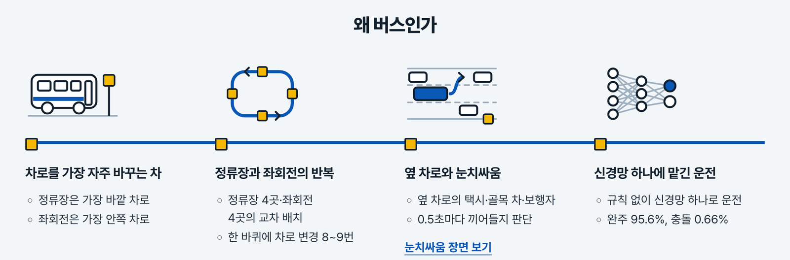</p>

버스를 고른 것은 차로를 가장 자주 바꾸는 차이기 때문이다. 버스는 가로변 정류장에 섰다가 차로로 돌아오고, 좌회전하려면 가장 왼쪽 차로까지 옮겨야 한다. 그래서 버스는 한 바퀴에 차로를 8\~9번 바꾸고, 그때마다 정류장 택시와 골목 차와 보행자가 있는 교통 속에서 끼어들지 기다릴지 정한다.

## 평가 항목별 안내

<p align="center">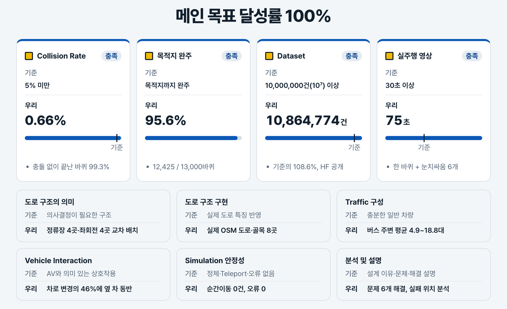</p>

| 채점 항목 | 우리 결과 | 근거 위치 |
|---|---|---|
| Collision Rate 5% 미만 | 0.66% (13,000바퀴 중 차 76번, 보행자 10번) | [평가 결과](#평가-결과) |
| 목적지 완주 | 12,425바퀴 완주(95.6%), 멈춰 섬 357바퀴와 시간 초과 107바퀴는 실패로 셈 | [평가 결과](#평가-결과), [실패한 곳](#실패한-곳) |
| 도로 구조의 의미 | 가로변 정류장 4곳과 가장 왼쪽 차로 좌회전 4곳이 번갈아 있어 한 바퀴에 차로 변경 8\~9번, 합정역 사거리 앞 167m 안에 세 차로 이동 | [도로 선정과 문제](#도로-선정과-문제) |
| 도로 구조 구현 | OpenStreetMap 원본을 실제 지도와 대조해 고친 도로망, 실제 지도와 겹친 그림, 살린 실제 골목 여덟 곳 | [도로 구현](#도로-구현) |
| Traffic 구성 | 교통 다섯 단계, 시간당 663\~1,989대, 버스 150m 안 평균 4.9\~18.8대 | [교통 구성](#교통-구성) |
| Vehicle Interaction | 바퀴당 장면 횟수, 정류장 앞 택시를 만난 바퀴 240 중 231, 골목 출구 만남 499번, 옮길 차로 앞뒤 30m 안에 차가 있던 차로 변경 46%(복합 교통) | [차량 interaction](#차량-interaction), [눈치싸움 장면](#눈치싸움-장면) |
| Simulation 안정성 | 순간이동 0건, 오류로 끝난 바퀴 0, 배경 이상이 있던 바퀴는 데이터에서 뺌 | [시뮬레이션 안정성](#시뮬레이션-안정성) |
| Dataset 10⁷개 이상 | 공개 10,864,774건, 수업 기본 컬럼 전부와 State·Action·Reward 저장, 65묶음 모두 NPZ 행 수와 metadata 건수 일치 | [데이터셋](#데이터셋) |
| 30초 이상 주행 영상 | 75초 한 바퀴 영상([mp4](web_page/assets/videos/full_lap.mp4))과 눈치싸움 영상 여섯 개 | [눈치싸움 장면](#눈치싸움-장면) |
| 분석 및 설명 | 문제 여섯 개의 해결과 결과, 실패 575바퀴가 난 곳 | [문제와 해결, 한계](#문제와-해결-한계) |
| 제출물 | 프로젝트 페이지, 코드, Hugging Face 데이터와 Dataset card(컬럼, 수집 방법), 발표자료(추가 예정) | [제출물](#제출물) |

### 제출물

<p align="center"><a href="https://kiyong-jung.github.io/Artificial-Intelligence-and-Control-for-Autonomous-Driving/">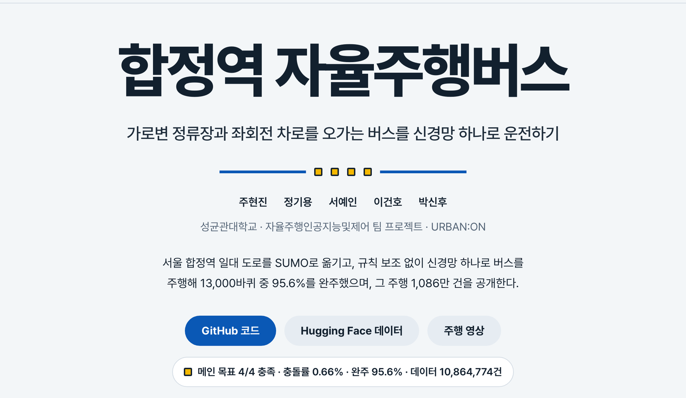</a></p>

- [프로젝트 페이지](https://kiyong-jung.github.io/Artificial-Intelligence-and-Control-for-Autonomous-Driving/)
- [코드](https://github.com/kiyong-jung/Artificial-Intelligence-and-Control-for-Autonomous-Driving)
- [Hugging Face 데이터](https://huggingface.co/datasets/twave17/hapjeong-bus-av-sumo)
- 한 바퀴 주행 영상 [mp4](web_page/assets/videos/full_lap.mp4)
- 발표자료(추가 예정)

## 목차

1. [도로 선정과 문제](#도로-선정과-문제)
2. [도로 구현](#도로-구현)
3. [교통 구성](#교통-구성)
4. [차량 interaction](#차량-interaction)
5. [AV 학습 설계](#av-학습-설계)
6. [평가 결과](#평가-결과)
7. [데이터셋](#데이터셋)
8. [문제와 해결, 한계](#문제와-해결-한계)
9. [빠른 시작](#빠른-시작)
10. [저장소 구조](#저장소-구조)
11. [팀](#팀)
12. [감사의 글과 출처](#감사의-글과-출처)
## 도로 선정과 문제

버스는 합정역에서 출발해 독막로로 상수역까지 간 뒤, 와우산로와 잔다리로를 지나 서교동사거리에서 양화로로 들어와 합정역으로 돌아온다. 시계 반대 방향으로 도는 1,963m 순환 경로(`bus_loop`)다.

<p align="center">
  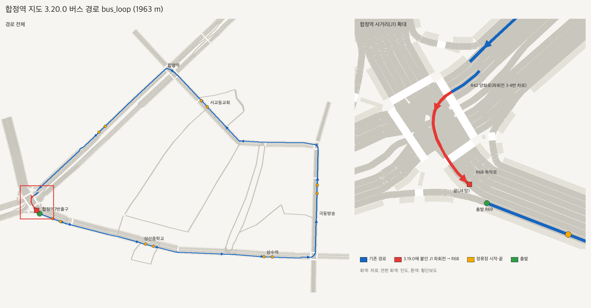
  <br>
  <sub>파란 선은 버스 순환 경로, 노란 점은 정류장 구간의 시작과 끝, 오른쪽은 합정역 사거리 확대</sub>
</p>

### 도로 구조의 의미

이 노선은 가로변 정류장과 가장 왼쪽 차로 좌회전이 번갈아 나와서, 버스가 한 바퀴 내내 차로를 바꾸며 옆 차로의 틈을 판단해야 한다.

- 가로변 차로의 정류장 4곳, 정류장마다 8초 정차
- 좌회전 4곳(상수역 사거리, 삼거리포차 앞, 서교동사거리, 합정역 사거리), 모두 가장 왼쪽 차로에서만 가능
- 한 바퀴 차로 변경 8\~9번(실제로 잰 값은 8.5\~9.3번)
- 합정역 사거리 앞 167m 안에서 세 차로 건너기
- 횡단보도 9곳(신호 없는 와우산로 횡단보도 포함)

버스는 0.5초마다 옆 차로의 틈을 보고 끼어들지, 속도를 줄여 기다릴지 정한다. 이 판단이 필요한 장면을 여섯 시나리오로 정했다.

| 번호 | 상황 | 버스가 판단할 것 |
|---|---|---|
| S1 | 정류장 출발 후 재합류 | 정차를 마친 뒤 출발할 시점 |
| S2 | 좌회전 전 왼쪽 차로 변경 | 옮길 차로의 틈, 기다릴 때의 속도 |
| S3 | 정류장 접근 오른쪽 차로 변경 | 감속 시점과 차로 변경 순서 |
| S4 | 정류장 앞 택시 | 택시 뒤에서 기다릴지 |
| S5 | 골목 차 끼어들기 | 감속과 양보 |
| S6 | 신호 없는 횡단보도 | 보행자 앞에서 설지 |

## 도로 구현

도로는 OpenStreetMap에서 변환한 합정역 일대 도로망을 실제 지도와 대조해 고친 것이다. 고친 내용은 모두 스크립트로 적용했다.

<p align="center">
  
  <br>
  <sub>왼쪽은 합정역 일대 OpenStreetMap 지도, 오른쪽은 같은 범위에 겹친 SUMO 도로망(붉은색)</sub>
</p>

| 항목 | 값 |
|---|---|
| 도로망 | 3.22.0, [`maps/hapjeong/`](maps/hapjeong/) |
| 버스 순환 경로 | `bus_loop` 1,963m, 시계 반대 방향 |
| 버스가 서는 정류장 | 4곳, 각 8초 정차 |
| 좌회전 | 4곳, 가장 왼쪽 차로에서만 |
| 횡단보도 | 9곳(신호 없는 와우산로 횡단보도 포함) |
| 살린 실제 골목 | 여덟 곳 |
| 제한속도 | 간선 50km/h, 이면도로 30km/h(안전속도 5030) |
| 버스 | 길이 12m, 폭 2.5m, 가속 1.0m/s², 감속 2.0m/s² |

도로망은 다음 순서로 만들었다.

1. OpenStreetMap에서 원본 도로망 변환([`maps/hapjeong/generator/`](maps/hapjeong/generator/))
2. [`scripts/build_hapjeong.py`](scripts/build_hapjeong.py)로 실제 지도와 대조해 고친 내용을 원본에 차례로 적용
3. 주요 수정 여섯 곳의 전후 그림을 [`maps/hapjeong/references/fixes/`](maps/hapjeong/references/fixes/)에 보관
4. 학습, 평가, 수집 모두 커밋된 도로망 [`maps/hapjeong/source/network.net.xml`](maps/hapjeong/source/network.net.xml)을 그대로 사용

골목이 없으면 버스 앞에 끼어드는 차도 없다. 그래서 버스 경로 안쪽의 실제 골목 여덟 곳을 살렸다. 도로망의 버전별 수정 이력은 [`maps/hapjeong/README.md`](maps/hapjeong/README.md)에 있다.

## 교통 구성

교통은 한산부터 복합까지 다섯 단계이고, 시간당 663대에서 1,989대까지 나온다. 일반 차는 실행 전에 seed로 정해지는 route/flow 파일대로 나오며, 버스 위치를 보고 넣는 차는 없다. 같은 seed로 버스를 넣은 실행과 뺀 실행에서 배경 차 467대의 출발 시각과 경로가 모두 같았다([`bus_independence.py`](research/traffic_checks/bus_independence.py)).

| 교통 | 코드 이름 | 시간당 차량 | 버스 150m 안 차(평균) | 버스 150m 안 보행자 | 구성 |
|---|---|---:|---:|---:|---|
| 한산 | `quiet` | 663대 | 4.9대 | 8.9명 | 기준 수요의 0.5배 |
| 보통 | `baseline` | 1,326대 | 10.5대 | 8.9명 | 기준 수요 |
| 혼잡 | `busy` | 1,658대 | 12.4대 | 8.9명 | 1.25배 |
| 매우 혼잡 | `heavy` | 1,989대 | 16.3대 | 9.2명 | 1.5배 |
| 복합 | `rich2` | 1,989대 | 18.8대 | 15.3명 | 1.5배와 같은 총수요 + 정류장 택시 + 골목 차 + 보행자 1.5배 |

#### 복합 교통

차 수만 늘리면 신호 앞 줄만 길어지고 구간 가운데는 빈다. 그래서 복합 교통은 총수요를 1.5배와 같게 두고, 그 일부를 구간 가운데에서 버스와 얽히는 차로 바꿨다.

| 바꾼 것 | 내용 |
|---|---|
| 정류장 택시 | 버스가 서는 정류장 4곳의 정류장 차로에 15\~30초씩 정차, 정류장 차로가 택시로 찬 시간 25% |
| 골목 차 | 수요의 10%, 골목 두 곳에서 나와 버스 노선으로 합류 |
| 보행자 | 지도의 보행자 흐름 전부 1.5배 |

골목 차와 택시는 버스 노선에서 50m 넘게 떨어진 곳에서만 처음 나타난다. 구간 가운데(신호 정지선에서 60m 넘게 떨어진 곳)에서 같은 차로 앞 30m 안에 차가 있는 시간은 매우 혼잡 4.4%, 복합 12.7%다.

#### 모든 교통에 공통인 설정

| 설정 | 값 |
|---|---|
| 차량 추종 모델 | Krauss 35%, IDM(Intelligent Driver Model) 30%, EIDM(Extended IDM) 20%, ACC(Adaptive Cruise Control) 15% |
| 차로 변경 모델 | SL2015(차로 안의 옆 위치를 0.8m 단위로 계산) |
| 순간이동(teleport) | 꺼 둔 상태(`time-to-teleport -1`) |
| 가장 붐비는 교통 | 1.5배(규칙 운전사가 1.75배 교통에서 10바퀴 중 7바퀴만 완주) |

교통 설정은 [`env/road_config.py`](env/road_config.py)와 [`env/road_builder.py`](env/road_builder.py)에 있다.

## 차량 interaction

버스는 바퀴마다 다른 차나 보행자와 여러 번 얽히고, 정류장 재합류(S1), 왼쪽 차로 변경(S2), 끼어든 차(S5)는 교통이 붐빌수록 늘었다. 아래 표는 평가 13,000바퀴에서 버스가 보는 50m 안에서 생긴 장면을 바퀴당 횟수로 센 것이다([`count_interactions.py`](research/av_bc_rl/count_interactions.py)).

| 장면 (바퀴당 횟수) | 한산 | 보통 | 혼잡 | 매우 혼잡 | 복합 | 평균 |
|---|---:|---:|---:|---:|---:|---:|
| 정류장 정차 중 같은 차로 뒤 50m 안에 차 (S1) | 0.27 | 0.53 | 0.67 | 0.79 | 1.56 | 0.76 |
| 왼쪽 변경 요청 때 옮길 차로 뒤 30m 안에 차 (S2) | 0.33 | 0.88 | 1.22 | 1.49 | 2.11 | 1.21 |
| 오른쪽 변경 요청 때 옮길 차로 뒤 30m 안에 차 (S3) | 0.61 | 0.84 | 0.91 | 0.95 | 0.93 | 0.85 |
| 앞으로 끼어든 차 (S5) | 0.33 | 0.67 | 0.86 | 0.99 | 1.50 | 0.87 |
| 보행자가 건너던 횡단보도 접근 (S6) | 2.02 | 1.99 | 1.93 | 1.96 | 2.33 | 2.05 |

실제로 차로를 바꾸는 동안 옮길 차로 앞뒤 30m 안에 차가 있던 비율도 교통이 붐빌수록 높았다(교통마다 400바퀴, [`traffic_around_bus.py`](research/av_bc_rl/traffic_around_bus.py)).

| 교통 | 한산 | 보통 | 혼잡 | 매우 혼잡 | 복합 |
|---|---:|---:|---:|---:|---:|
| 차로 변경 중 옮길 차로 앞뒤 30m 안에 차 | 16% | 32% | 36% | 41% | 46% |

정류장 앞 택시(S4)는 복합 교통 240바퀴 중 231바퀴에서 만났다. DAgger 21회 모델의 평가 기록이다([`cause_table_confirm.txt`](research/traffic_checks/cause_table_confirm.txt)).

골목 출구에서 끼어들려는 골목 차(S5)는 복합 교통 수집 2,600바퀴에서 499번 만났다([`alley_merge_events.py`](research/av_bc_rl/alley_merge_events.py)).

| 골목 출구 만남 | 횟수 |
|---|---:|
| 골목 차가 기다리고(중앙값 4.0초) 버스가 먼저 통과 | 423번(84.8%) |
| 버스가 멀리 있을 때 골목 차가 먼저 진입 | 76번 |
| 그중 버스가 속도를 줄여 먼저 보낸 경우 | 1번 |

버스가 속도를 줄여 먼저 보낸 이 1번은 아래 장면 6과 메인 한 바퀴 영상에 나온다.

### 눈치싸움 장면

버스와 주변 차가 서로 속도와 간격을 보며 먼저 갈지 기다릴지 정하는 장면 여섯 개다. 사람 운전자끼리의 눈치싸움과 닮았고, 위 표의 숫자로는 보이지 않는 모습이다.

<table>
  <tr>
    <td width="50%" valign="top">
      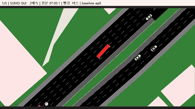<br>
      <b>1. 합정역 정류장 진입</b> · 보통 교통<br>
      신호 대기 줄 바로 옆 정류장 차로로 진입해 정차, 정차를 마친 뒤 다시 교차로로 출발
    </td>
    <td width="50%" valign="top">
      <br>
      <b>2. 정류장 출발과 재합류</b> · 보통 교통<br>
      정류장을 떠나는 버스 옆으로 붙어 오는 차, 나란히 달리며 간격을 맞춰 가는 두 차
    </td>
  </tr>
  <tr>
    <td width="50%" valign="top">
      <br>
      <b>3. 독막로 정류장</b> · 보통 교통<br>
      옆 차로를 오가는 차들 사이로 가로변 정류장에 정차한 뒤 다음 교차로로 출발
    </td>
    <td width="50%" valign="top">
      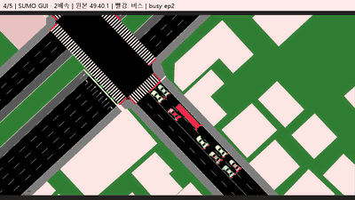<br>
      <b>4. 붐비는 교차로 출발</b> · 혼잡 교통<br>
      긴 대기 줄 앞에서 신호 대기, 녹색 신호에 다른 차들과 함께 교차로 통과
    </td>
  </tr>
  <tr>
    <td width="50%" valign="top">
      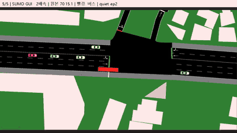<br>
      <b>5. 교차로 앞 차로 변경</b> · 한산 교통<br>
      옆 차와 나란히 정지선 접근, 교차로 안을 지나는 차를 기다린 뒤 차로를 옮겨 출발한 것으로 보이는 장면
    </td>
    <td width="50%" valign="top">
      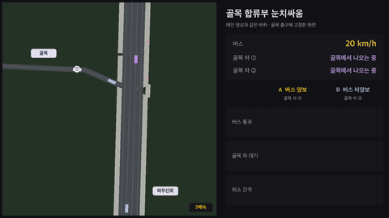<br>
      <b>6. 골목 합류 양보와 비양보</b> · 복합 교통<br>
      같은 골목 출구에서 첫 골목 차에게는 35→18 km/h로 줄여 양보, 바로 뒤 차는 3초 기다리게 한 뒤 먼저 통과. 메인 영상과 같은 바퀴
    </td>
  </tr>
</table>

영상은 모두 2배속이다. 원본 영상(mp4)은 [프로젝트 페이지](https://kiyong-jung.github.io/Artificial-Intelligence-and-Control-for-Autonomous-Driving/)와 [`web_page/assets/videos/`](web_page/assets/videos/)에 있다.

| 장면 | 화면 | 색 |
|---|---|---|
| 1\~5 | SUMO GUI 화면 녹화, 설명은 화면을 보고 쓴 것 | 빨간 차가 버스 |
| 6 | 주행 기록으로 다시 그린 화면 | 노란 차가 버스, 보라 차가 골목 차 |
## AV 학습 설계

<p align="center">
  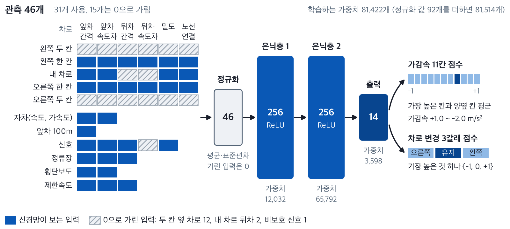
</p>

AV(autonomous vehicle, 자율주행차)는 시내버스 한 대다. 신경망 하나가 0.5초마다 관측을 보고 가감속과 차로 변경을 정한다.

| 항목 | 설계 |
|---|---|
| Observation | 46차원 부분 관측(50m 범위), 신경망은 그중 31개 사용 |
| Action | [가감속, 차로 변경] 2차원, 0.5초마다. 가감속 +1.0 \~ -2.0m/s², 차로 변경 {-1, 0, +1} |
| 종료 | terminated는 충돌, 보행자 충돌, 적색 통과, 도착, 멈춰 섬. truncated는 1,400 step(700초) |
| 신경망 | MLP(다층 퍼셉트론), 은닉층 256 × 2, ReLU, 학습하는 가중치 81,422개(정규화 값 92개를 더하면 81,514개). 출력 14개(가속도 11칸 점수 + 차로 3갈래 점수) |
| 알고리즘 | BC(모방학습) 뒤 DAgger 24회. 신경망이 직접 주행한 상태마다 규칙 운전사(expert-v7)의 정답을 붙여 합본으로 다시 학습 |

관측 46개의 구성은 다음과 같다.

| 묶음 | 관측 |
|---|---|
| 버스 | 속도, 가속도 |
| 주변 차 | 다섯 차로(내 차로, 좌우 한 칸, 좌우 두 칸)의 앞뒤 차 간격과 상대 속도, 차로 밀도 |
| 경로 | 차로별 경로 연결 거리 |
| 신호 | 거리, 적색, 황색, 비보호, 황색 경과 시간 |
| 정류장 | 거리 두 가지, 남은 정차 시간 |
| 횡단보도 | 거리, 보행자 건너는 중 |
| 도로 | 제한속도 |

#### 수업 규칙과 맞춘 점

| 항목 | 이 프로젝트 |
|---|---|
| 주행 중 규칙 보조 | 없음. 규칙 운전사([`env/route_policy.py`](env/route_policy.py))는 학습 때 정답 붙이기에만 사용 |
| 버스의 SUMO 안전장치 | speedMode, laneChangeMode 모두 0으로 끔 |
| 차로를 지시하는 관측 | 없음. 차로마다 노선으로 이어지는 거리만 보고 갈 차로 선택 |
| 차로 변경 안전 검사 | 수업 원본 환경의 검사([`env/mdp_config.py`](env/mdp_config.py)의 `lane_change_safety`)를 같은 값으로 사용 |

이 안전 검사는 옮길 차로의 앞뒤 간격이 3m와 속도에 비례한 여유보다 작거나 출발 60m 안이면 차로 변경 명령을 실행하지 않는다. 조교가 이 검사는 끄지 않아도 된다고 답했다.

#### 그 밖의 설계 결정

- 신경망은 관측 46개 중 31개를 쓰고 15개는 0으로 가린다(가려도 검증 손실과 주행이 같았다, [`docs/network_architecture.md`](docs/network_architecture.md)).
- 가속도를 값 하나로 맞히게 하면 서야 할지 가야 할지 모를 때 그 중간값을 내서, 11칸 중 하나를 고르게 바꿨다.
- 실제 가속도는 점수가 가장 높은 칸과 양옆 칸의 평균이다.

#### Reward

| 항목 | 값 |
|---|---:|
| 속도 | 0.1 × v/vmax |
| 앞차와 6m 미만 | -0.1 |
| 정류장 정차 | +1 |
| 정류장 지나침 | -3 |
| 승차감 한계 넘음(가속 1.5m/s², jerk 2.0m/s³) | -0.02 |
| 충돌 | -5 |
| 적색 통과 | -5 |
| 도착 | +2 |
| 멈춰 섬(200초 동안 5m 못 감) | -2 |
| 시간 초과(1,400 step = 700초) | -2 |

### DAgger와 커리큘럼

<p align="center">
  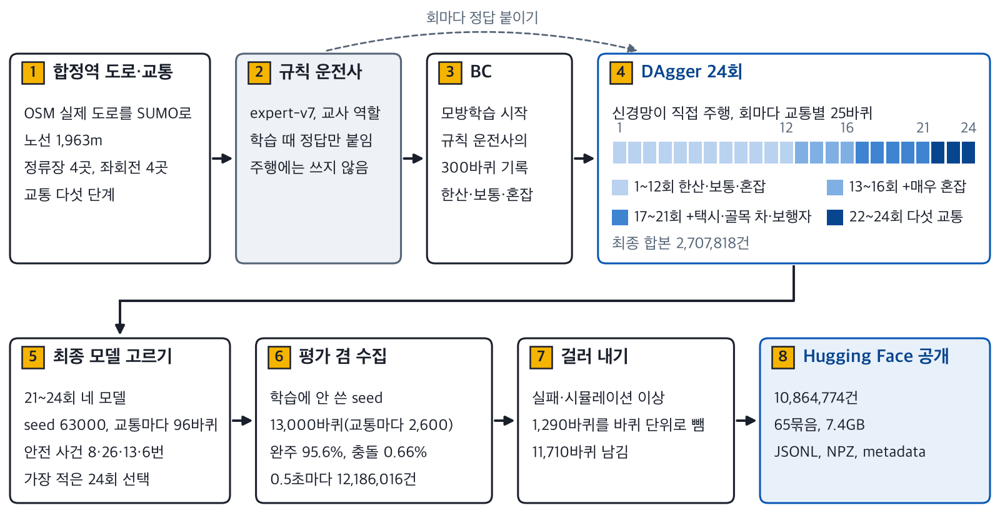
</p>

BC로 시작해 DAgger를 24회 돌렸다. 교통은 한산, 보통, 혼잡에서 시작해 회차가 갈수록 붐비는 교통을 더했다.

| 단계 | 교통 | 내용 |
|---|---|---|
| BC | 한산, 보통, 혼잡 | 규칙 운전사가 주행한 300바퀴 기록으로 학습 |
| DAgger 1\~12회 | 한산, 보통, 혼잡 | 회마다 교통별 25바퀴를 신경망이 직접 주행 |
| DAgger 13\~16회 | + 매우 혼잡 | 끼어들기와 대기 줄 상황 추가 |
| DAgger 17\~21회 | + 택시·골목 차·보행자 | 정류장 앞 택시와 골목 차 학습 |
| DAgger 22\~24회 | 다섯 교통 전부 | 최종 합본 2,707,818건(학습 2,166,572, 검증 541,246) |

회마다 40 epoch, batch 512, 학습률 3e-4로 학습하고 20%는 검증에 쓴다. 신호 상태를 바꿔 본 관측을 더해 데이터를 늘렸다([`augment_signals.py`](research/av_bc_rl/augment_signals.py)). 학습은 CPU 14코어에서 SUMO 12개를 병렬로 돌렸다.

### 최종 모델 고르기

평가 전에 정한 기준으로 24회 모델을 골랐다. 21\~24회 네 모델을 seed 63000에서 다섯 교통마다 96바퀴씩 돌렸고, 안전 사건(차 충돌 + 보행자 충돌 + 적색 통과)이 가장 적은 모델을 고르되 같으면 완주가 많은 쪽을 고르기로 했다.

| 모델 | 21회 | 22회 | 23회 | 24회 (선택) |
|---|---:|---:|---:|---:|
| 안전 사건 | 8 | 26 | 13 | **6** |
| 완주 (480바퀴 중) | 456 | 442 | 450 | 460 |

고른 근거는 [`pick_checkpoint.txt`](research/traffic_checks/pick_checkpoint.txt)에 있다. 모델은 [`models/final/model.pt`](models/final/model.pt)(330KB)이고, 학습 설정은 [`config.json`](models/final/config.json), 학습 기록은 [`training_log.csv`](models/final/training_log.csv)에 있다.

## 평가 결과

<p align="center">
  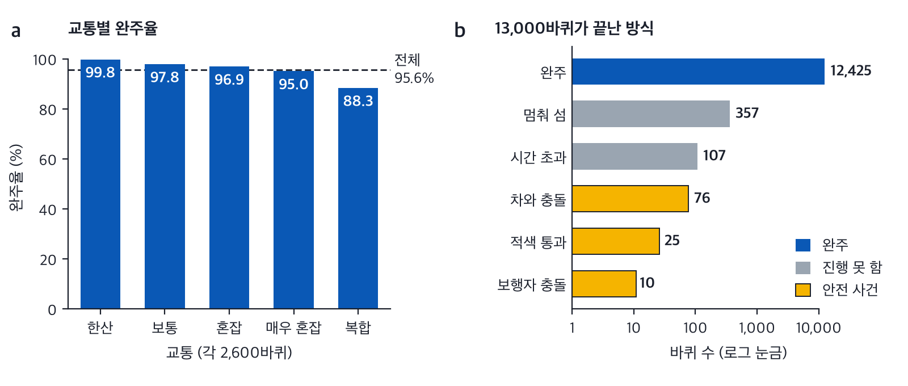
</p>

충돌률은 0.66%로 채점 기준 5% 미만을 지켰고, 완주율은 95.6%다. 다섯 교통에서 학습에 쓰지 않은 seed로 2,600바퀴씩, 모두 13,000바퀴를 돌렸다. 버스의 SUMO 안전장치는 끈 채였고, 끝난 원인은 원본 기록에서 셌다.

| 채점 항목 | 기준 | 우리 값 |
|---|---|---|
| Collision Rate | 5% 미만 | 0.66% (차 76 + 보행자 10 = 86번) |
| 목적지 완주 | 비정상 정지, 잘못된 경로, 무한 대기 없음 | 95.6% 완주 (13,000바퀴 중 12,425), 실패는 [실패한 곳](#실패한-곳) |
| Simulation 안정성 | 정체, Teleport, 오류 없음 | 순간이동 0건, 오류로 끝난 바퀴 0 ([시뮬레이션 안정성](#시뮬레이션-안정성)) |

교통별로 끝난 원인을 센 결과다.

| 교통 | 바퀴 | 완주 | 차 충돌 | 보행자 충돌 | 적색 통과 | 멈춰 섬 | 시간 초과 |
|---|---:|---:|---:|---:|---:|---:|---:|
| 한산 | 2,600 | 2,594 | 2 | 0 | 1 | 3 | 0 |
| 보통 | 2,600 | 2,544 | 14 | 0 | 1 | 38 | 3 |
| 혼잡 | 2,600 | 2,519 | 10 | 1 | 1 | 59 | 10 |
| 매우 혼잡 | 2,600 | 2,471 | 16 | 1 | 4 | 87 | 21 |
| 복합 | 2,600 | 2,297 | 34 | 8 | 18 | 170 | 73 |
| **합계** | **13,000** | **12,425 (95.6%)** | **76** | **10** | **25** | **357** | **107** |

- 가장 어려운 복합 교통만 보면 충돌률은 1.6%다.
- 차와 버스의 상자가 조금이라도 겹친 바퀴 391개를 모두 충돌로 쳐도 충돌률은 3.7%다.
- 완주율은 복합 교통을 뺀 네 교통에서 97.4%(10,400바퀴 중 10,128), 복합 교통에서 88.3%다.
- 적색 통과는 25번(0.19%)이다.
- 한 바퀴는 평균 444초(한산)에서 501초(복합) 걸렸다.

<p align="center">
  
  <br>
  <sub>정류장 앞 택시(S4). 같은 복합 교통 바퀴에서 왼쪽 이전 모델은 정류장 입구의 택시와 충돌, 오른쪽 최종 모델은 택시 뒤에서 대기. 노란 차가 버스.</sub>
</p>

### 실패한 곳

가장 많은 실패는 서교동사거리 앞에서 멈춰 선 경우로, 멈춰 섬 357번 중 305번이다.

| 실패 | 횟수 | 가장 많은 곳 |
|---|---:|---|
| 멈춰 섬 | 357 | 서교동사거리 앞 305번. 정류장에서 정지선까지 약 100m 사이에 좌회전 줄로 끼어들지 못함 |
| 시간 초과 | 107 | 합정역 사거리 앞뒤 71번 |
| 차 충돌 | 76 | 합정역 사거리 갈림 지점 31번, 서교동사거리 안 18번 |
| 적색 통과 | 25 | 독막로 11번 |
| 보행자 충돌 | 10 | 와우산로 신호 없는 횡단보도 9번 |

### 시뮬레이션 안정성

평가 13,000바퀴에서 순간이동(teleport)은 0건이고, 오류로 끝난 바퀴도 0이다.

- 순간이동을 꺼 두었기 때문에 막힌 경우는 사라지지 않고 위 표의 "멈춰 섬"으로 남는다.
- 버스 150m 안에서 배경 차 충돌이 있던 바퀴 227개(1.7%)와 보행자 위치가 튄 바퀴 22개는 제출 데이터에서 뺐다.
- 배경 교통이 자연스러운지 세 번 감사했고, 기록은 [`docs/naturalness_audit/`](docs/naturalness_audit/)에 있다.
- 학습 환경이 배경 차, 보행자, 신호에 명령을 내리지 않는다는 것은 정적 검사([`tests/test_naturalness_static.py`](tests/test_naturalness_static.py), [`scripts/audit_naturalness.py`](scripts/audit_naturalness.py))로 확인한다.
## 데이터셋

[](https://huggingface.co/datasets/twave17/hapjeong-bus-av-sumo)

공개한 데이터는 10,864,774건으로 수업 기준인 10<sup>7</sup>건을 넘고, [Hugging Face](https://huggingface.co/datasets/twave17/hapjeong-bus-av-sumo)에서 받을 수 있다.

<p align="center">
  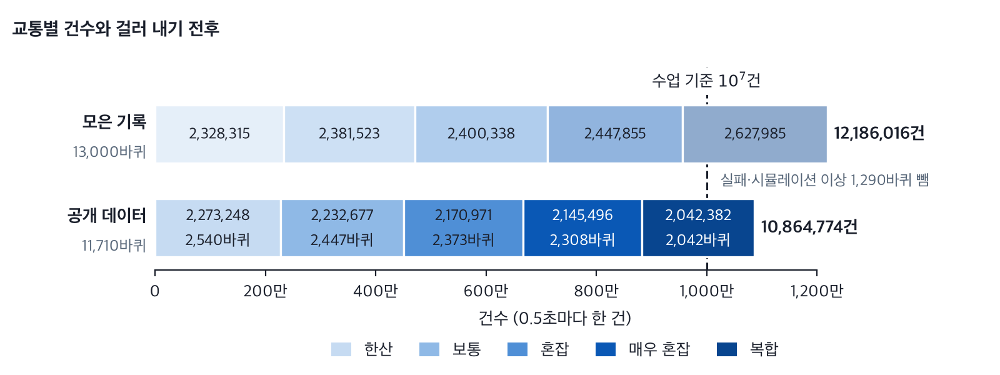
</p>

| 수업 기준 | 이 데이터 |
|---|---|
| 10<sup>7</sup>건 이상 | 10,864,774건 (11,710바퀴) |
| 기본 수집 컬럼 | 수업 기본 수집기의 항목 전부, 팀 추가 항목 포함 |
| State / Action / Reward 저장 | `state`·`next_state` / `action_raw`·`action.*` / `reward` |

학습한 신경망(`models/final`)이 탐색 잡음 없이 직접 주행한 13,000바퀴를 0.5초마다 한 건씩 기록했다. 모은 12,186,016건에서 실패하거나 시뮬레이션 이상이 있는 1,290바퀴를 빼고 11,710바퀴 10,864,774건을 공개한다. 한 바퀴 안의 행은 이어진 주행이라 일부만 빼면 다음 관측과 보상이 어긋난다. 그래서 바퀴 단위로 걸렀다.

| 교통 | 모은 바퀴 | 모은 건수 | 남긴 바퀴 | 남긴 건수 |
|---|---:|---:|---:|---:|
| 한산 | 2,600 | 2,328,315 | 2,540 | 2,273,248 |
| 보통 | 2,600 | 2,381,523 | 2,447 | 2,232,677 |
| 혼잡 | 2,600 | 2,400,338 | 2,373 | 2,170,971 |
| 매우 혼잡 | 2,600 | 2,447,855 | 2,308 | 2,145,496 |
| 복합 | 2,600 | 2,627,985 | 2,042 | 2,042,382 |
| **합계** | **13,000** | **12,186,016** | **11,710** | **10,864,774** |

### 파일 구성

200바퀴를 한 묶음으로 저장했다. 교통별 폴더 다섯 개에 65묶음이 있고, 모두 7.4GB다. 묶음마다 파일 세 개가 있다.

| 파일 | 담은 것 |
|---|---|
| JSONL | 아래 컬럼 표의 전체 항목 |
| NPZ | 학습용 배열 |
| `metadata.json` | 설정, 컬럼 설명, seed, 걸러 낸 내용 |

NPZ 배열은 `observation` (N,46), `action_raw` (N,2), `lane_change` (N,), `reward`, `next_observation` (N,46), `terminated`, `truncated`, `episode`, `t`, `detected_xy` (M,2), `detected_offsets` (N+1,)이다.

### 컬럼

수업 기본 수집기의 항목을 모두 담고, 정류장, 보행자, 신호, 승차감 항목을 더했다. 같은 정의가 데이터의 `metadata.json`과 [`env/data_schema.py`](env/data_schema.py)에 있다. 컬럼은 일곱 묶음으로 나뉜다.

| 묶음 | 담은 것 | 대표 컬럼 |
|---|---|---|
| 상태 | SUMO 내부 상태 sₜ, sₜ₊₁ | `state`, `next_state` |
| 관측 | 신경망이 받는 부분 관측 oₜ와 감지한 주변 차·보행자 | `observation`, `next_observation`, `detected_*` |
| 행동 | 신경망 출력과 실제 적용된 가감속·차로 변경 | `action_raw`, `action.*` |
| 보상·종료 | 보상 rₜ와 종료 여부 | `reward`, `terminated`, `truncated` |
| 식별 | 바퀴 번호와 시점 | `episode`, `t`, `sim_time` |
| 이벤트 | 충돌, 적색 통과, 도착, 차로, 정류장, 종료 원인 | `event.*` |
| 승차감 | 버스 가속도와 jerk 최댓값, 한계 초과 | `comfort.*` |

| 묶음 | 컬럼 | 형태 | 출처 | 뜻 |
|---|---|---|---|---|
| 식별 | `episode` | Integer | 수업 기본 | Episode 번호 |
|  | `t` | Integer | 수업 기본 | Episode 내부 timestep (판단 한 번 = decision_interval초) |
|  | `sim_time` | Float | 팀 추가 | 관측 시점의 SUMO 시뮬레이션 시각(초). t와 실제 시간 구분용 |
| 관측 | `observation` | Vector (46-dim) | 수업 기본 | 시점 t에서 AV Policy가 실제로 입력받는 부분 관측 oₜ. 수업 원본 31개 뒤에 경로 정보 12개와 근접 정보 3개 |
|  | `next_observation` | Vector (46-dim) | 수업 기본 | 다음 시점의 부분 관측 oₜ₊₁ |
|  | `detected_vehicles` | List | 수업 기본 | Observation 시점에 감지된 주변 차량 정보 (관측 차선의 차량과 반경 50m 안의 차량. ego 기준 상대 위치·속도, 방향지시등) |
|  | `detected_pedestrians` | List | 팀 추가 | Observation 시점에 감지된 보행자 (ego 기준 상대 위치·속도) |
| 행동 | `action_raw` | Vector (2-dim) | 수업 기본 | Policy가 출력한 원본 Action [가감속, 차선변경] |
|  | `action.accel_raw` | Float | 수업 기본 | 환경에 적용된 가감속 Action 값 |
|  | `action.lane_change_raw` | Float | 수업 기본 | 환경에 적용된 차선변경 raw 값 |
|  | `action.lane_change` | Integer | 수업 기본 | 실제 명령으로 변환된 차선변경 값 {-1, 0, +1} |
|  | `action.lane_change_applied` | Boolean | 수업 기본 | 차선변경 명령이 실제 적용되었는지 여부 |
| 보상·종료 | `reward` | Float | 수업 기본 | 시점 t에서 받은 Reward rₜ |
|  | `terminated` | Boolean | 수업 기본 | 충돌 / 도착 등 환경 자체의 종료 여부 |
|  | `truncated` | Boolean | 수업 기본 | 최대 Episode Step 등 시간 제한에 의한 종료 여부 |
| 상태 | `state` | Dictionary | 수업 기본 | SUMO 내부의 privileged simulator state sₜ (ego, vehicles, pedestrians, navigation, traffic_light) |
|  | `next_state` | Dictionary | 수업 기본 | 다음 시점의 privileged simulator state sₜ₊₁ |
| 이벤트 | `event.collided` | Boolean | 수업 기본 | 해당 step에서 ego 충돌 발생 여부(차 또는 보행자) |
|  | `event.pedestrian_collision` | Boolean | 팀 추가 | 해당 step에서 ego가 보행자와 충돌했는지. 참이면 event.collided도 참 |
|  | `event.red_light_violation` | Boolean | 팀 추가 | 해당 step에서 ego 앞범퍼가 적색 정지선을 넘었는지 |
|  | `event.arrived` | Boolean | 수업 기본 | 목적지 도착 여부 |
|  | `event.lane_before` | Integer / String | 수업 기본 | Action 적용 전 AV 차선 |
|  | `event.lane_after` | Integer / String | 수업 기본 | Action 적용 후 AV 차선 |
|  | `event.termination_reason` | String | 팀 추가 | 종료 원인 (arrived, collision, pedestrian_collision, red_light, time_limit, teleport, missing, stuck). collision은 차와의 충돌이다. stuck은 ego가 stuck_timeout초 동안 stuck_progress_m도 못 간 것. 종료가 아니면 빈 값 |
|  | `event.background_collisions` | Integer | 팀 추가 | 이 step 동안 ego가 끼지 않은 충돌 수(배경 차량끼리, 배경 차량과 보행자) |
|  | `event.service_event` | String | 팀 추가 | 이 step에 정차할 정류장을 마쳤으면 served, 서지 않고 지나쳤으면 missed, 아니면 빈 값 |
|  | `event.stops_served` | Integer | 팀 추가 | 에피소드에서 지금까지 정차를 마친 정류장 수 |
|  | `event.stops_missed` | Integer | 팀 추가 | 에피소드에서 지금까지 서지 않고 지나친 정차 정류장 수 |
| 승차감 | `comfort.peak_acceleration` | Float | 팀 추가 | 이 step 동안 버스 가속도 크기의 최댓값 (m/s²). 승객 승차감 |
|  | `comfort.peak_jerk` | Float | 팀 추가 | 이 step 동안 버스 jerk(가속도 변화율) 크기의 최댓값 (m/s³). 승객 승차감 |
|  | `comfort.acceleration_violation` | Boolean | 팀 추가 | 가속도가 승차감 한계를 넘었는지 |
|  | `comfort.jerk_violation` | Boolean | 팀 추가 | jerk가 승차감 한계를 넘었는지 |

<details>
<summary><code>state</code>와 <code>detected_*</code> 안의 항목</summary>

`state`와 `next_state` 안의 키는 다음과 같다. 위치는 m, 속도는 m/s, 방향은 북쪽 0도에서 시계 방향(도)이다.

| 키 | 담은 것 | 하위 항목 |
|---|---|---|
| `state.ego` | 버스 | `id`, `alive`, `x`, `y`, `speed`, `acceleration`, `jerk`, `heading`, `road_id`, `lane_id`, `lane_index`, `lane_position`, `lateral_position`, `lateral_speed`, `signals` |
| `state.vehicles` | 버스 150m 안의 차 | `id`, `x`, `y`, `speed`, `heading`, `road_id`, `lane_id`, `lane_index`, `lane_position`, `lateral_position`, `lateral_speed`, `signals` |
| `state.pedestrians` | 버스 150m 안의 보행자 | `id`, `x`, `y`, `speed`, `heading`, `road_id` |
| `state.navigation` | 노선 정보 | `route_id`, `route_edge_index`, `drivable_lane_ids`, `target_lane_ids`, `next_turn`, `distance_to_turn`, `crossing_id`, `distance_to_crossing`, `next_stop_id`, `distance_to_stop`, `distance_to_destination` |
| `state.traffic_light` | 앞 신호 | `id`, `link_index`, `state`, `distance_to_stop_line` |

`detected_vehicles`의 항목은 `id`, `x`, `y`, `relative_longitudinal_position`, `relative_lateral_position`, `relative_longitudinal_speed`, `relative_lateral_speed`, `relative_heading`, `route_distance`, `lane_relation`, `left_signal`, `right_signal`이고, `detected_pedestrians`의 항목은 `id`, `relative_longitudinal_position`, `relative_lateral_position`, `relative_longitudinal_speed`, `relative_lateral_speed`이다. relative_*는 버스 차체 기준이며 진행 방향과 버스의 왼쪽이 +다.

</details>

<details>
<summary>관측 46개 (observation, next_observation)</summary>

모든 값은 -1에서 1 사이다. 거리는 50m, 속도는 제한속도로 나누고, 노선 연결 거리만 200m로 나눈다. 차가 없으면 앞차 간격은 1, 뒤차 간격은 -1이다. 신경망은 아래에서 "가림"으로 표시한 15개를 0으로 가리고 31개를 쓴다.

| 번호 | 이름 | 뜻 | 구분 | 신경망 |
|---:|---|---|---|---|
| 0 | `ego_speed` | 버스 속도 | 수업 원본 | 씀 |
| 1 | `left2_leader_gap` | 왼쪽 두 칸 차로 앞차 간격 | 수업 원본 | 가림 |
| 2 | `left2_leader_relative_speed` | 왼쪽 두 칸 차로 앞차 상대 속도 | 수업 원본 | 가림 |
| 3 | `left2_follower_gap` | 왼쪽 두 칸 차로 뒤차 간격 | 수업 원본 | 가림 |
| 4 | `left2_follower_relative_speed` | 왼쪽 두 칸 차로 뒤차 상대 속도 | 수업 원본 | 가림 |
| 5 | `left1_leader_gap` | 왼쪽 한 칸 차로 앞차 간격 | 수업 원본 | 씀 |
| 6 | `left1_leader_relative_speed` | 왼쪽 한 칸 차로 앞차 상대 속도 | 수업 원본 | 씀 |
| 7 | `left1_follower_gap` | 왼쪽 한 칸 차로 뒤차 간격 | 수업 원본 | 씀 |
| 8 | `left1_follower_relative_speed` | 왼쪽 한 칸 차로 뒤차 상대 속도 | 수업 원본 | 씀 |
| 9 | `current_leader_gap` | 내 차로 앞차 간격 | 수업 원본 | 씀 |
| 10 | `current_leader_relative_speed` | 내 차로 앞차 상대 속도 | 수업 원본 | 씀 |
| 11 | `current_follower_gap` | 내 차로 뒤차 간격 | 수업 원본 | 가림 |
| 12 | `current_follower_relative_speed` | 내 차로 뒤차 상대 속도 | 수업 원본 | 가림 |
| 13 | `right1_leader_gap` | 오른쪽 한 칸 차로 앞차 간격 | 수업 원본 | 씀 |
| 14 | `right1_leader_relative_speed` | 오른쪽 한 칸 차로 앞차 상대 속도 | 수업 원본 | 씀 |
| 15 | `right1_follower_gap` | 오른쪽 한 칸 차로 뒤차 간격 | 수업 원본 | 씀 |
| 16 | `right1_follower_relative_speed` | 오른쪽 한 칸 차로 뒤차 상대 속도 | 수업 원본 | 씀 |
| 17 | `right2_leader_gap` | 오른쪽 두 칸 차로 앞차 간격 | 수업 원본 | 가림 |
| 18 | `right2_leader_relative_speed` | 오른쪽 두 칸 차로 앞차 상대 속도 | 수업 원본 | 가림 |
| 19 | `right2_follower_gap` | 오른쪽 두 칸 차로 뒤차 간격 | 수업 원본 | 가림 |
| 20 | `right2_follower_relative_speed` | 오른쪽 두 칸 차로 뒤차 상대 속도 | 수업 원본 | 가림 |
| 21 | `left2_route_connectivity` | 왼쪽 두 칸 차로 노선으로 이어지는 거리 | 수업 원본 | 가림 |
| 22 | `left1_route_connectivity` | 왼쪽 한 칸 차로 노선으로 이어지는 거리 | 수업 원본 | 씀 |
| 23 | `current_route_connectivity` | 내 차로 노선으로 이어지는 거리 | 수업 원본 | 씀 |
| 24 | `right1_route_connectivity` | 오른쪽 한 칸 차로 노선으로 이어지는 거리 | 수업 원본 | 씀 |
| 25 | `right2_route_connectivity` | 오른쪽 두 칸 차로 노선으로 이어지는 거리 | 수업 원본 | 가림 |
| 26 | `left2_density` | 왼쪽 두 칸 차로 50m 안 차 밀도 | 수업 원본 | 가림 |
| 27 | `left1_density` | 왼쪽 한 칸 차로 50m 안 차 밀도 | 수업 원본 | 씀 |
| 28 | `current_density` | 내 차로 50m 안 차 밀도 | 수업 원본 | 씀 |
| 29 | `right1_density` | 오른쪽 한 칸 차로 50m 안 차 밀도 | 수업 원본 | 씀 |
| 30 | `right2_density` | 오른쪽 두 칸 차로 50m 안 차 밀도 | 수업 원본 | 가림 |
| 31 | `tl_distance` | 다음 신호 정지선까지 거리 | 경로 정보 | 씀 |
| 32 | `tl_red` | 그 신호가 적색인지 | 경로 정보 | 씀 |
| 33 | `tl_yellow` | 황색인지 | 경로 정보 | 씀 |
| 34 | `tl_yield` | 비보호(양보) 녹색인지 | 경로 정보 | 가림 |
| 35 | `stop_distance` | 다음 정류장까지 거리 | 경로 정보 | 씀 |
| 36 | `stop_dwell_remaining` | 남은 정차 시간 | 경로 정보 | 씀 |
| 37 | `crosswalk_distance` | 다음 횡단보도까지 거리 | 경로 정보 | 씀 |
| 38 | `crosswalk_occupied` | 보행자가 건너는 중인지 | 경로 정보 | 씀 |
| 39 | `speed_limit` | 지금 제한속도 | 경로 정보 | 씀 |
| 40 | `next_speed_limit` | 다음 제한속도 | 경로 정보 | 씀 |
| 41 | `next_speed_limit_distance` | 다음 제한속도까지 거리 | 경로 정보 | 씀 |
| 42 | `ego_acceleration` | 버스 가속도 | 경로 정보 | 씀 |
| 43 | `stop_distance_near` | 다음 정류장까지 거리(가까운 범위) | 근접 정보 | 씀 |
| 44 | `current_leader_gap_far` | 내 차로 앞차 간격(먼 범위) | 근접 정보 | 씀 |
| 45 | `tl_yellow_elapsed` | 황색이 켜진 뒤 지난 시간 | 근접 정보 | 씀 |

</details>

### 검증

- 65묶음 모두 NPZ 행 수가 metadata의 건수와 같다.
- 세 묶음을 [`check_dataset.py`](research/av_bc_rl/check_dataset.py)로 검사해 오류가 0개였다.
- Hugging Face에 올린 뒤 로그인 없이 받은 파일의 해시가 원본과 같다.

## 문제와 해결, 한계

| 영역 | 문제 | 해결 | 결과 |
|---|---|---|---|
| 도로 | 붙어 있는 교차로에서 급정지와 충돌 | 교차로를 합치고 차로를 한 차로씩 이음 | 급정지 40번에서 0번 |
| 교통 | 대기 줄의 선 차가 30\~40도 돌아 뒤차와 겹침 | 선 차의 옆 이동을 끔 | 26대에서 0대 |
| 교통 | 구간 가운데에 차가 없음 | 정류장 택시와 골목 차를 수요로 넣음 | 구간 가운데 앞차 있는 시간 복합 12.7%, 매우 혼잡 4.4% |
| 학습 | BC만으로는 30바퀴 중 26바퀴 완주 | DAgger로 벗어난 상태의 정답을 더함 | 10회 뒤 같은 60바퀴 모두 완주 |
| 학습 | 황색에서 어정쩡하게 줄이다 정지선을 넘음 | 가속도를 11칸 중 고르게 함 | 적색 통과 0.19% |
| 데이터 | 실패·이상 바퀴가 섞임 | 바퀴 단위 걸러내기([`filter_episodes.py`](research/av_bc_rl/filter_episodes.py)) | 1,290바퀴 제외 |

### 한계

- 실패 575바퀴 중 305바퀴는 서교동사거리 앞에서 멈춰 선 것이다.
- 규칙 운전사도 같은 곳에서 멈춰 서서, 따라 배우는 방식으로는 이 실패가 줄지 않았다.
- 정류장에 선 버스를 피하려던 뒤차가 두 차로에 걸쳐 서는 일이 있다.
- 옆 이동 설정 21가지를 견줬지만 걸쳐 서는 일을 완전히 없앤 안은 없었고, 가장 나은 안에서도 버스의 안전 사건 수는 같았다([`lateral_screen.py`](research/traffic_checks/lateral_screen.py)).
- 차로 변경의 88%가 일어나는 구간 가운데는 신호 앞보다 차가 절반도 안 된다.
- 규칙 운전사가 1.75배 교통에서 10바퀴 중 7바퀴만 완주하므로, 그보다 붐비는 교통은 이 방식으로 가르칠 수 없다.
- 도로망 3.16.0\~3.18.0과 3.21.0·3.22.0의 모양·신호 수정은 별도 스크립트로 커밋된 도로망에 얹었기 때문에, `build_hapjeong.py`만 다시 돌리면 3.22.0이 그대로 나오지 않는다.
## 빠른 시작

모든 명령은 저장소 루트에서 돌린다. 설치만 끝나면 최종 모델 평가와 테스트를 바로 돌릴 수 있다.

| 하려는 일 | 절 | 결과 |
|---|---|---|
| 실행 환경 준비 | [설치](#설치) | conda 환경 `sumo-rl`과 환경 변수 두 개 |
| 최종 모델 평가 | [최종 모델로 평가하기](#최종-모델로-평가하기) | `results/metrics/final_s63000.json` |
| 제출 데이터 다시 모으기 | [제출 데이터 모으기](#제출-데이터-모으기) | `data/final_clean/` |
| 학습 처음부터 재현 | [처음부터 학습 재현하기](#처음부터-학습-재현하기) | `results/pick_checkpoint.txt`에 적힌 모델 |
| 코드 점검 | [테스트](#테스트) | 테스트 387개 통과 |

### 설치

필요한 것은 Python 3.10과 SUMO 1.27.1이다. 이 두 판에서 확인했다. SUMO는 따로 설치한다(수업 안내 [Windows](project_materials/1_SUMO_Windows_Setup.md), [macOS](project_materials/1_SUMO_macOS_AppleSilicon_Setup.md)).

```bash
git clone https://github.com/kiyong-jung/Artificial-Intelligence-and-Control-for-Autonomous-Driving.git
cd Artificial-Intelligence-and-Control-for-Autonomous-Driving
conda create -n sumo-rl python=3.10 -y
conda activate sumo-rl
pip install -r requirements.txt

export SUMO_HOME=/path/to/sumo-1.27.1   # SUMO를 설치한 폴더
export PYTHONPATH=.
```

아래 명령은 모두 위의 두 환경 변수를 둔 채로 돌린다.

도로 로더는 [`maps/hapjeong/source/network.net.xml`](maps/hapjeong/source/network.net.xml)의 해시를 [`maps/hapjeong/map.json`](maps/hapjeong/map.json)에 적힌 값과 비교하고, 다르면 멈춘다. 그래서 [`.gitattributes`](.gitattributes)로 git이 XML 파일의 줄바꿈을 바꾸지 않게 했다.

### 최종 모델로 평가하기

학습이 끝난 모델 [`models/final/model.pt`](models/final/model.pt)로 복합 교통(`rich2`)을 4바퀴 돈다.

```bash
python research/av_bc_rl/evaluate.py --policy bc --model models/final/model.pt \
    --label final --seed 63000 --scenarios rich2 --episodes 4 --workers 4
```

끝나면 터미널에 교통별 요약 한 줄과 요약 파일 경로가 나온다. 확인 실행에서는 4바퀴 모두 도착(`arrived`)했고, 충돌과 순간이동은 0이었다.

```text
           final rich2    n=4 {'arrived': 4} collision=0% pedestrian=0% red=0% teleports=0 lap=507s ...
.../results/metrics/final_s63000.json
```

| 결과 | 경로 |
|---|---|
| 주행 기록 | `data/research/eval/final_s63000_rich2.jsonl.gz` |
| 요약 | `results/metrics/final_s63000.json` |

이 4바퀴는 실험 기록과 끝난 원인, 걸음 수가 같았다.

다섯 교통을 96바퀴씩 돌리려면 뒤쪽 옵션을 `--scenarios quiet baseline busy heavy rich2 --episodes 96 --workers 12`로 바꾼다. 교통 이름의 뜻은 [교통 구성](#교통-구성) 표에 있다.

```bash
python research/av_bc_rl/evaluate.py --policy bc --model models/final/model.pt \
    --label final --seed 63000 --scenarios quiet baseline busy heavy rich2 --episodes 96 --workers 12
```

#### 도로와 교통만 보기

학습 없이 도로와 교통을 SUMO GUI로 연다. `--map hapjeong`을 빼면 다른 지도([`maps/paldalmun/`](maps/paldalmun/))가 열린다.

```bash
python view_road.py --map hapjeong --scenario rich2
```

### 제출 데이터 모으기

#### 1. 모으기

다섯 교통을 돌아가며 200바퀴씩 한 묶음으로, 전이 수가 `TARGET`을 넘을 때까지 모은다. 끝난 묶음은 건너뛰므로, 끊기면 같은 명령을 다시 돌리면 된다.

```bash
MODEL=models/final/model.pt OUT=data/final TARGET=12000000 \
SCENARIOS="quiet:1 baseline:2 busy:3 heavy:4 rich2:5" \
bash research/av_bc_rl/collect_final.sh
```

묶음 하나가 끝날 때마다 누적 건수가 한 줄씩 찍힌다. `data/final/`에는 `rich2_s0_000`처럼 교통 이름과 묶음 번호가 붙은 `.jsonl.gz`, `.npz`, `.metadata.json` 파일이 쌓인다.

#### 2. 거르기

묶음마다 실패·이상 바퀴를 찾고, 남긴 바퀴만 새 폴더 `data/final_clean/`에 쓴다.

```bash
mkdir -p data/final_filter
for f in data/final/*.jsonl.gz; do
    n=$(basename "$f" .jsonl.gz)
    python research/av_bc_rl/filter_episodes.py "$f" --report "data/final_filter/$n.json"
    python research/av_bc_rl/write_clean_final.py "data/final_filter/$n.json" --src data/final --out data/final_clean
done
```

묶음마다 남긴 바퀴 수와 행 수가 찍히고, 바퀴별 표시는 `data/final_filter/`에 JSON으로 남는다.

#### 3. 검사

묶음 하나를 검사하고, 버스가 얽힌 장면을 센다.

```bash
python research/av_bc_rl/check_dataset.py data/final_clean/rich2_s0_000.jsonl.gz
python research/av_bc_rl/count_interactions.py data/final
```

- `check_dataset.py`는 컬럼, NaN, 값 범위, JSONL과 NPZ의 행 수를 보고 마지막 줄에 `오류 0개`를 찍는다.
- 하나라도 어긋나면 종료 코드 1로 끝난다.
- `count_interactions.py`는 교통마다 한 줄씩 바퀴당 장면 횟수를 찍는다.

### 처음부터 학습 재현하기

BC 데이터 수집부터 DAgger 24회, 최종 모델 고르기까지 한 번에 돌린다.

```bash
bash research/av_bc_rl/train_final.sh              # 고른 모델 경로는 results/pick_checkpoint.txt 마지막 줄
COLLECT=1 bash research/av_bc_rl/train_final.sh    # 이어서 제출 데이터까지 모은다
```

단계마다 결과가 쌓이는 곳은 다음과 같다.

| 단계 | 결과 폴더 |
|---|---|
| BC | `results/bc/` |
| DAgger 1\~16회 | `results/dagger_1_16/` |
| DAgger 17\~21회 | `results/dagger_17_21/` |
| DAgger 22\~24회 | `results/dagger_22_24/` |
| 최종 모델 고르기 | `results/pick_checkpoint.txt` |
| 제출 데이터 수집(`COLLECT=1`) | `data/final/` |

- 이 스크립트는 최종 모델을 만든 실행의 명령을 그대로 옮긴 것이다.
- 끝난 단계는 건너뛰므로, 끊기면 같은 명령으로 다시 돌린다.
- 처음부터 끝까지 다시 돌려 보지는 않았다(하루 넘게 걸린다).

### 테스트

```bash
python -m pytest tests
```

테스트 390개 중 387개가 통과하고, 2개는 건너뛰고, 1개는 예상된 실패다. pytest 마지막 줄에 `387 passed, 2 skipped, 1 xfailed`가 나오면 정상이다.

## 저장소 구조

수업이 권장한 네 구분(Environment, Training, Evaluation, Data Collection)으로 묶었다.

#### Environment

| 경로 | 하는 일 |
|---|---|
| [`env/sumo_env.py`](env/sumo_env.py) | Gymnasium 환경(관측, 행동, 보상) |
| [`env/road_config.py`](env/road_config.py) | 교통 다섯 단계 |
| [`env/road_builder.py`](env/road_builder.py) | 경로 파일 만들기 |
| [`env/route_policy.py`](env/route_policy.py) | 규칙 운전사 expert-v7(학습 때 정답 붙이기에만 사용) |
| [`env/data_schema.py`](env/data_schema.py) | 데이터 컬럼 정의 |
| [`maps/hapjeong/`](maps/hapjeong/) | 합정역 도로망 |
| [`scripts/build_hapjeong.py`](scripts/build_hapjeong.py) | 도로망 빌드 |

#### Training

| 경로 | 하는 일 |
|---|---|
| [`train_bc.py`](train_bc.py) | 모방학습 |
| [`algorithms/bc.py`](algorithms/bc.py) | 신경망 |
| [`research/av_bc_rl/dagger.py`](research/av_bc_rl/dagger.py) | DAgger 반복 |
| [`research/av_bc_rl/augment_signals.py`](research/av_bc_rl/augment_signals.py) | 신호 상태를 바꿔 데이터 늘리기 |
| [`research/av_bc_rl/merge_datasets.py`](research/av_bc_rl/merge_datasets.py) | 데이터 합본 |
| [`research/av_bc_rl/train_final.sh`](research/av_bc_rl/train_final.sh) | BC부터 DAgger 24회, 모델 고르기, 수집까지 한 번에 |

#### Evaluation

| 경로 | 하는 일 |
|---|---|
| [`research/av_bc_rl/evaluate.py`](research/av_bc_rl/evaluate.py) | 고정 seed에서 정책 평가 |
| [`research/traffic_checks/pick_checkpoint.py`](research/traffic_checks/pick_checkpoint.py) | 최종 모델 고르기 |
| [`research/av_bc_rl/count_interactions.py`](research/av_bc_rl/count_interactions.py) | 바퀴당 얽힘 장면 세기 |
| [`research/av_bc_rl/traffic_around_bus.py`](research/av_bc_rl/traffic_around_bus.py) | 차로 변경 때 주변 차 세기 |
| [`research/av_bc_rl/make_lap_video.py`](research/av_bc_rl/make_lap_video.py) | 주행 기록으로 영상 그리기 |
| [`research/av_bc_rl/render_best_worst.py`](research/av_bc_rl/render_best_worst.py) | 잘한 장면과 실패 장면 그리기 |

#### Data Collection

| 경로 | 하는 일 |
|---|---|
| [`collect_pomdp_data.py`](collect_pomdp_data.py) | 수업 기본 수집기 |
| [`research/av_bc_rl/collect_final.sh`](research/av_bc_rl/collect_final.sh) | 제출 데이터 수집 |
| [`research/av_bc_rl/filter_episodes.py`](research/av_bc_rl/filter_episodes.py) | 실패·이상 바퀴 찾기 |
| [`research/av_bc_rl/write_clean_final.py`](research/av_bc_rl/write_clean_final.py) | 남길 바퀴만 다시 쓰기 |
| [`research/av_bc_rl/check_dataset.py`](research/av_bc_rl/check_dataset.py) | 데이터 검사 |

#### 그 밖의 폴더

| 경로 | 내용 |
|---|---|
| [`models/final/`](models/final/) | 최종 모델, 학습 설정, 학습 기록 |
| [`research/traffic_checks/`](research/traffic_checks/) | 교통 점검(버스와 무관한지, 옆 이동 설정 비교, 시나리오 S4\~S6 세기) |
| [`docs/`](docs/) | [신경망 구조](docs/network_architecture.md), [관측 설계](docs/observation_design.md), [선행 연구 조사](docs/literature_survey.md), [교통 자연스러움 감사](docs/naturalness_audit/) |
| [`web_page/`](web_page/) | 프로젝트 페이지(GitHub Pages로 배포) |
| [`tests/`](tests/) | pytest 390개 |
| [`scripts/`](scripts/) | 도로 빌드, 점검, 측정 스크립트 |
| `train.py`, `test.py`, `view_road.py`, [`algorithms/`](algorithms/), [`project_materials/`](project_materials/) | 수업 기본 파일과 수업 안내 |

> [!NOTE]
> 팀원 실험 폴더 두 개는 최종 모델, 평가, 제출 데이터에 쓰지 않았다.
>
> - [`traffic/`](traffic/)는 주현진이 만든 버스 주변 교통 시나리오 도구다([자체 README](traffic/README.md)).
> - [`training/`](training/)는 이건호가 BC(Behavior Cloning, 모방학습), BC→PPO, PPO(Proximal Policy Optimization), Residual PPO를 견준 실험이다.

## 팀

URBAN:ON (15조)

| 이름 | 역할 | 주요 경로 |
|---|---|---|
| 주현진 | 주변 교통과 시나리오 S1\~S6 도구, 시나리오 측정 스크립트 | [`traffic/`](traffic/), `scripts/verify_*.py`, `scripts/measure_*.py` |
| 정기용 | 합정역 도로망 정비, 학습 환경, DAgger 학습, 제출 데이터 수집, 프로젝트 페이지 | [`maps/hapjeong/`](maps/hapjeong/), [`scripts/build_hapjeong.py`](scripts/build_hapjeong.py), [`env/`](env/) |
| 서예인 | 합정역 원본 도로망(OpenStreetMap 변환) | [`maps/hapjeong/generator/`](maps/hapjeong/generator/) |
| 이건호 | 학습 방법 비교(BC, BC→PPO, PPO, Residual PPO) | [`training/`](training/) |
| 박신후 | 시나리오(보행자·차량 밀도) 담당 | |

## 감사의 글과 출처

- 수업을 이끌어 주신 교수님과 조교님께 감사드린다.
- 기본 코드와 수업 안내는 수업 저장소 [bmil-ssu/Artificial-Intelligence-and-Control-for-Autonomous-Driving](https://github.com/bmil-ssu/Artificial-Intelligence-and-Control-for-Autonomous-Driving)에서 왔다.
- 교통 시뮬레이션은 Eclipse SUMO 1.27.1로 했다.
- 도로 데이터와 지도 그림은 © OpenStreetMap contributors이며 ODbL 1.0을 따른다.
