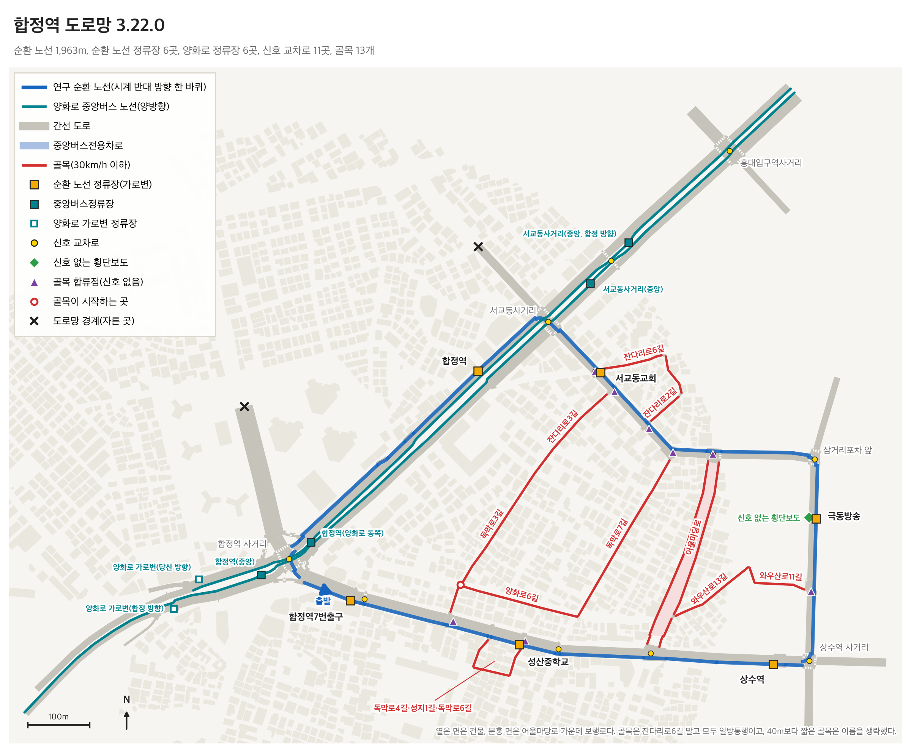

# 합정역 도로

합정역 일대 실제 도로를 SUMO로 옮긴 도로망이다. 원본 도로망은 서예인이 OSM을 바탕으로 만들었고(`seogyo-hongdae` 브랜치 `066e5b1`), `scripts/build_hapjeong.py`가 실제 지도와 대조해 고친 내용을 적용해 실행 도로망을 만든다. 서예인의 브랜치는 `main` 위에 쌓여 있다. 원본이 바뀌면 그 브랜치 위에서 `python scripts/build_hapjeong.py`를 다시 돌린다. 3.7.0~3.13.0의 수정은 이 스크립트의 설정이다. 단, 지금 커밋된 도로망(3.22.0)에는 이 스크립트가 모르는 패치(경계 유턴 제거, J42 좌회전 곡선, 우회전 모서리 횡단보도 이동, 안쪽 차로 좌회전의 모양과 신호)가 얹혀 있어 다시 만들면 일부가 사라진다. 패치를 스크립트에 흡수하는 일은 나중에 한다(자세한 내용은 루트 README의 "알려진 한계").

## 연구 시나리오와 도로

연구 경로 `bus_loop`(1,949m)는 서예인이 제안한 순환 경로다. 합정역에서 독막로를 따라 상수역까지 가서 와우산로로 좌회전하고, 잔다리로를 지나 서교동사거리(`J42`)에서 양화로로 좌회전해 합정역으로 돌아온다. 지금 도로망(3.6.0) 전체는 [references/hapjeong_map.png](references/hapjeong_map.png)에 있다. 아래 두 그림은 2.0.0 도로망으로 그렸다.

| 시나리오 | 도로에 있는 것 | 위치 |
|---|---|---|
| S1 정류장 출발 후 재합류 | 가로변 정류장 합정역7번출구(14-119) | 독막로 동행 `R69` |
| S2 정류장 직후 좌회전 연속 차선변경 | 정류장 상수역을 지나 상수역 사거리(`J82`)에서 좌회전하려면 왼쪽 차로로 옮겨야 한다. 독막로 `R111b`는 차도 3차로이고 가장 안쪽 3번 차로만 와우산로 안쪽 2번 차로로 좌회전한다(3.21.0). 가로변 1번 차로는 직진과 우회전, 2번 차로는 직진만 된다. 좌회전 뒤에는 극동방송 정류장을 위해 오른쪽으로 다시 옮긴다 | 독막로 `R111b` 3번 차로 → `R112` 2번 차로 |
| S3 정류장 접근 연속 차선변경 | 가로변 정류장 성산중학교, 극동방송, 서교동교회, 합정역(14-219) | `R71`, `R112`, `-R96`, `R54a` |
| S5 골목 차량 끼어들기 | 골목 여덟 곳에서 나온 차가 버스 경로에 신호 없이 합류한다. busy에서 합쳐서 시간당 약 218대다 | 합류점 `X_dongmak3`, `X_dongmak6`, `X_wausan11`, `J74`, `X_jandari7`, `X_jandari2`, `X_jandari3`, `J48` |
| S6 신호 없는 횡단보도 | 와우산로 중간 횡단보도. 차가 보행자에게 양보한다 | 극동방송 정류장 44m 뒤 |
| S4 정류장 앞 정차 차량 | 도로에는 따로 없다. 시나리오 쪽 이벤트다 | |

정류장은 Overpass(OSM)에서 받은 실제 정류장 점을 가장 바깥 차도 차로에 25m 길이로 놓았다. 점과 차로의 거리는 0.6~4.8m이고, 상수역만 14.1m다(인도 위 승강장 점). `map.json`의 `bus_stops`에 OSM 노드 id와 거리가 있다. 양화로 중앙버스차로 정류장 4곳(`source/stops.add.xml`)은 원본 그대로다.

## 골목

골목은 OSM 좌표 그대로 1차로이고, 이름이 "~길"인 골목은 30km/h, 서비스도로는 20km/h다. 모두 일방통행이고, 차가 실제로 다니는 방향만 있다. 골목의 안쪽 끝은 건물과 주차장에서 차가 나오는 출발점이다(`ALLEY_ORIGINS`와 `SHORTCUTS`의 `origins`). 독막로6길 고리만은 출발점이 없다. 3.5.0~3.13.0은 배경 차량 일부에 경유 도로(`via`)를 적어 이 고리를 거쳐 가게 했다(`THROUGH_ALLEYS`). 3.14.0에서 이 경유를 없앴지만, 도착지가 출발지 뒤에 있는 흐름이 이 고리를 유턴 대신 써서 실행마다 2~10대가 지났다. 3.15.0에서 그런 흐름을 지워 지금은 고리로 다니는 차가 없다("되돌아가는 차와 건너뛰는 보행자 없애기 (3.15.0)" 절).

| 골목(OSM 길 id) | 도로 id | 어디서 어디로 |
|---|---|---|
| 독막로3길(`172603989`) | `G3` | 양화로6길과 만나는 점 `Y2` → 독막로 합류점 `X_dongmak3` |
| 독막로4길(`312368845`), 성지1길(`223433265`), 독막로6길(`223433270`) | `G30`, `G11`, `G12` | 독막로 `X_dongmak4`(성산중학교 정류장 15m 앞) → `D4` → `S2` → 독막로 합류점 `X_dongmak6`(정류장 끝). 출발점 없는 고리다 |
| 양화로6길 서쪽(`172603991`), 독막로7길(`172115945`) | `G4`, `G16` | `Y2` → `Y3` → 잔다리로 합류점 `X_jandari7` |
| 독막로3길 북쪽, 잔다리로3길(`172603995`) | `G17`, `G18` | `Y2` → 잔다리로 합류점 `X_jandari3`(서교동교회 정류장 바로 앞) |
| 어울마당로 | `R122`, `G31`, `G19` | 독막로(어울마당로 교차로) → 잔다리로 신호 횡단보도 `J74`. 차는 `G31`에서 출발한다 |
| 어울마당로(`168229931`) | `G20`, `G21`, `G8`, `R120` | `J74` → 독막로(어울마당로 교차로). 잔다리로에서 독막로로 질러가는 길이다 |
| 와우산로13길(`172243759`), 독막로15길(`172245594`), 와우산로11길(`172245595`) | `G26`, `G27`, `G24` | `Y5` → 와우산로 합류점 `X_wausan11`(극동방송 정류장 63m 앞) |
| 잔다리로6길(`172111342`) | `G25`, `-G25`, `G22` | 잔다리로2길과 만나는 `N2` ↔ `N6` → 잔다리로 신호 횡단보도 `J48` |
| 잔다리로2길 | `G23` | `N2` → 잔다리로 합류점 `X_jandari2` |

3.4.0에서 차가 다니지 않는 차도를 지웠다. 지운 것은 "가지치기와 신호 정비 (3.4.0)" 절에 있다.

### 어울마당로를 독막로까지 잇기 (3.6.0)

3.5.0의 어울마당로 북행 `G19`는 독막로에서 60m 떨어진 `Y5`에서 갑자기 시작했다. 실제 길은 독막로까지 이어진다. 3.6.0은 원본 토막 `R122`를 되살리고 `G31`(`J94` → `Y5`)을 더해 독막로와 잇는다. 골목 차는 `G19` 대신 `G31`에서 출발하고, 양은 그대로다.

잇기만 하면 버스가 느려졌다. 독막로·어울마당로 교차로(`cluster_J52_J56_J58`)는 원본 신호가 없어 netconvert가 만든 신호를 썼는데, `R122`가 붙자 보행 전용 5초 단계가 생겨 주기가 90초에서 100초가 됐다. 상수역 사거리 `J82`와 맞던 녹색 시점이 어긋나, 버스가 `R111b`에서 서 있는 시간의 중앙값이 4초에서 35초가 됐다. 3.6.0은 이 교차로 신호를 `JOINED_PHASES`로 직접 적어 3.5.0의 90초 단계를 그대로 쓴다. `R122`로 가는 연결은 같은 방향 녹색에 끼우고, 독막로 동행에서 `R122`로 들어가는 좌회전은 양보 녹색이다.

| 지표(300회 점검 seed 0~99, 규칙 버스 busy 80회 seed 500·600) | 3.5.0 | 잇기만 함 | 3.6.0 |
|---|---|---|---|
| 사건이 난 실행 | 11 | 10 | 6 |
| 점검 버스 평균 주행 시간 | 444.2초 | 460.8초 | 444.1초 |
| 규칙 버스 완주 | 78·79 | 73·76 | 76·79 |
| 지도에서 끊긴 길·허공에서 시작하는 골목 | 9 | 6 | 6 |

seed 500의 76회 가운데 실패 2회(`R42` 시간 초과)는 3.5.0의 seed 500에서도 같은 자리에서 났다. 3.5.0도 seed 700·800에서는 77·78회다. 미관·시나리오·통행 분포 후보 12개를 비교한 결과는 [docs/road_report/sota_report.pdf](../../docs/road_report/sota_report.pdf)에 있다.

### 독막로6길을 고리로 잇기 (3.5.0)

3.4.0의 독막로6길 `G12`는 46m짜리 막다른 길이었고, 차는 그 남쪽 끝 `S2`에서 출발했다. 3.5.0은 실제 지도의 독막로4길과 성지1길로 이 길을 독막로와 잇는다. 버스와 같은 방향으로 독막로를 가던 차가 성산중학교 정류장 15m 앞에서 독막로4길로 우회전해, 성지1길과 독막로6길을 지나 정류장 끝에서 다시 독막로로 나온다. 고리 안에서 출발하는 차는 없다. 배경 차량은 가장 빠른 길만 고르므로, 이 구간을 지나는 흐름 가운데 시간당 40.8대(busy 기준 77대)에 경유 도로를 적었다.

| 잇는 방법(300회 점검, seed 0~99) | 사건이 난 실행 | 결과 |
|---|---|---|
| 잇지 않음(3.4.0, `S2`에서 출발) | 7 | 같은 점검을 seed 100~199로 하면 6 |
| 신호 교차로 `J8`의 독막로2길로 들어가 성지1길로 | 16 | `J8`에서 독막로2길로 우회전하던 차가 횡단보도에 남은 보행자와 11번 부딪혔다. 기각 |
| 정류장 앞 독막로4길로 들어가 성지1길로(3.5.0) | 11 | seed 100~199로 하면 6. 사건 17건 가운데 고리나 고리를 도는 차가 낀 것은 0건이다 |

규칙 버스 80회(busy, seed 500)로 견주면 다음과 같다.

| 지표 | 3.4.0 | 3.5.0 |
|---|---|---|
| 골목에서 버스 방향으로 합류하는 차 | 217.7대/시간 | 245.0대/시간 |
| 그중 독막로6길 `X_dongmak6` | 16.0대/시간 | 47.3대/시간 |
| 버스 앞에 끼어든 차(S5), 그중 같은 차로 | 33번, 4번 | 42번, 12번(seed 600으로 다시 재면 33번, 7번) |
| 좌회전 차로 변경(S2), 그때 옆 차로에 차 | 47회, 5회 | 63회, 6회 |
| 정류장에서 옆에 차 | 210 / 474 | 202 / 480 |
| 규칙 버스 완주 | 77 / 80 | 78 / 80 |
| 500초 넘게 걸린 주행 | 5 | 0 |
| 가장 한산한 구간의 교통량 | 135대/시간 | 105대/시간 |

가장 한산한 구간은 성산중학교 정류장 앞 46m(`R71.206`)다. 고리로 빠진 차가 이 구간을 건너뛰고 정류장 끝에서 다시 합류하기 때문이다. 그 대신 정류장을 떠나는 버스 앞으로 골목 차가 나오는 일이 잦아진다. G12에서 출발하던 차가 없어져 독막로 동쪽(`R73`~`R111b`)의 교통량은 시간당 약 30대 줄었고, 상수역 앞 `R111b`에서 버스가 서 있던 시간은 평균 21.8초에서 14.8초로 줄었다.

### 극동방송 정류장 앞 샛길 시험 (3.5.0, 넣지 않음)

극동방송 정류장 바로 앞에 와우산로로 나오는 실제 길이 둘 있다. 셋으로 시험했고 하나도 넣지 않았다(300회 점검과 규칙 버스 80회, 독막로6길 고리를 넣은 도로 위).

| 시험 | 사건이 난 실행 | 새 합류점의 끼어들기 | 결정 |
|---|---|---|---|
| 독막로19길(정류장 40m 앞)로 들어가게. 실제 일방통행 방향이다 | 98 | 해당 없음 | 기각. 남쪽으로 가던 차가 신호 없이 북쪽 두 차로를 가로질러 좌회전해 들어가다 입구에서 112번 부딪혔다 |
| 독막로19길에서 나오게. 실제와 반대 방향이다 | 16 | 80회에 6번 | 기각. 입구 사건은 0이지만 실제 방향과 다르고 이득이 작다 |
| 이름 없는 출입로(OSM `1442563730`, 정류장 90m 앞)에서 나오게 | 9 | seed 500·600에 2번씩 | 기각. 시간당 42.7대가 나오는데 끼어들기로 이어지지 않았다. 와우산로11길 합류점과 18m 거리라 효과가 겹친다(추정) |

출입로 설정은 `SHORTCUTS`의 `febc_drive`로 꺼 둔 채 남겼다. `ACTIVE_SHORTCUTS`에 더하면 켜진다.

### 성산중학교 앞에서 독막로7길이 독막로에 닿지 않는 이유

실제 독막로7길은 성산중학교 앞 신호 횡단보도 `J23`에서 독막로와 만난다. 도로망의 독막로7길 `G16`은 그 54m 앞 `Y3`에서 시작한다. `Y3`에서 양화로6길 `G4`를 받아 잔다리로로만 나간다. 남쪽 54m를 잇는 방법 네 가지를 쟀다. 어느 것도 잇지 않은 지금보다 낫지 않았다.

| 남쪽 54m를 잇는 방법 | 잰 도로망 | 사건이 난 실행(300회 점검) | 그 밖의 측정 |
|---|---|---|---|
| 골목에서 `J23`으로 나가고, 좌회전과 우회전 모두 | 3.3.0 | 26 | `J23`에서 골목 차와 독막로 차 충돌 11번 |
| `J23`에서 골목으로 들어가는 방향만 | 3.3.0 | 17 | 한 시간 동안 지나간 차 0대. 3.4.0 가지치기에서 지웠다 |
| 잇지 않음 | 3.4.0 | 7 | 합류 217.7대/시간, 규칙 버스 완주 77 / 80 |
| 골목에서 `J23`으로 나가고 우회전만 | 3.4.0 | 12 | `J23` 횡단보도에서 골목 차와 보행자 충돌 5번 |
| 우회전만, 보행 신호 동안 골목 차는 적색 | 3.4.0 | 9 | `J23` 보행자 충돌 1번. 합류 206.7대/시간, 완주 76 / 80 |

우회전한 차는 독막로를 서쪽으로 간다. 버스와 반대 방향이라 버스와 만나지 않는다. 이 차들은 잇지 않았을 때 잔다리로 `X_jandari7`로 나와 버스 앞에 합류하던 차다. 그래서 이으면 합류가 시간당 11대 줄고 사건이 는다.

### 길의 끝점

이웃 교차로가 하나뿐인 막다른 끝은 13곳이고, 모두 배경 차량이 드나드는 도로망 경계다. 3.4.0에는 독막로6길의 남쪽 끝 `S2`까지 14곳이었다. 골목이 시작하는 곳은 `Y2`, `Y5` 두 곳이다. 둘 다 골목 여러 개가 갈라지는 점이라 막다른 끝이 아니다. 끝에서 나갈 연결이 없는 차로는 0개이고, 골목 차도 20개는 모두 busy 교통에서 시간당 37대 이상이 지난다(`references/road_usage.json`).

## 원본에서 고친 것

| 고친 것 | 이유 | 근거 |
|---|---|---|
| 제한속도 100·80km/h → 간선 50, 연결로와 이름이 "~길"인 이면도로 30km/h | 원본은 양화로·월드컵로·독막로 일부가 100km/h였다. 50km/h 골목 토막 끝에서 출발한 차가 바로 앞 횡단보도에서 보행자를 쳤다 | 안전속도 5030, OSM 독막로 maxspeed 50, `maps/paldalmun/source/speed_defaults.json` |
| J52·J56·J58(어울마당로·레드로드)을 한 교차로로 합치고 횡단보도 6개를 다시 놓음 | 11m 간격 세 교차로 사이 4m 구간에 차가 들어가지 못하고 교차로 안에 서 있다가 부딪혔다. 원본 충돌이 J58에 몰렸다 | 합친 뒤 이곳 충돌 0 |
| J56 신호 프로그램을 빼고 합친 교차로는 기본 신호 | 합치면서 연결 번호가 바뀌었다 | |
| J1 신호에서 중앙버스차로가 일반 차로로 합류하는 연결 2개를 양보 녹색(g)으로 | 같은 차로로 우선 녹색 두 개가 동시에 들어갔다 | SUMO 경고 "Unsafe green phase" |
| J3(연결로 R66이 양화로에 합류) 지퍼 합류 → 연결로 양보 | busy에서 합류부 정체가 풀리지 않아 순간이동이 났다 | 바꾼 뒤 순간이동 0 |
| 배경 차량 baseline 합계 900대/시간, 진입은 간선 도로 끝과 합류 골목 두 곳 | 50km/h에서 1,320대(팔달문 규칙 그대로)는 평균 주행 대수가 두 배가 되며 교차로 안까지 정체가 이어졌다 | 원본 생성기 설정의 `vehs_per_hour` 900 |
| 보행자 경로 다시 생성(시간당 600명, 최소 150m, seed 42) | 교차로를 합치면 원본 보행자 경로가 지나던 도로가 사라진다 | 원본 생성기 설정과 같은 값 |
| 서교동사거리(`J42`)에서 양화로를 건너는 횡단보도 두 곳을 보행자 전용 단계(34초, 앞뒤로 전적색 5초)로 옮김 | 이 횡단보도는 잔다리로 차량 신호와 같이 켜졌다. 잔다리로에서 좌회전한 버스가 교차로를 빠져나가는 자리에서 보행자와 부딪혔다 | 옮기기 전 버스 충돌 5번, 옮긴 뒤 0번(`scripts/audit_road.py`, 9회 실행). 전용 단계 앞에 전적색이 없을 때는 교차로 안에서 기다리던 좌회전 차가 보행자와 1번 부딪혔다 |
| 합정역 사거리(`J1`)에서 `R42` 1번 차로의 직진 연결을 지움(3.0.0). 지금은 빌드에서 하지 않는다 | `R42`의 1번·2번 차로가 둘 다 `R40` 1번 차로로 직진해 교차로 안에서 옆으로 부딪혔다. 서예인이 새 원본(`066e5b1`)에서 `R40`을 일반 3차로로 넓혀 세 차로를 1:1로 이었다 | 지우기 전 측면 충돌 1번과 `:J1_18_0` 급제동 8번, 지운 뒤 0번 |
| 경계 진입로 `-R97`을 10m에서 50m로 늘림(3.0.0) | 투입된 차가 10m 앞 빨간불에서 비상 정지했다. 3.1.0에서 이 구역을 잘라내 지금 도로망에는 없다 | 비상 정지 19번 → 0번 |
| 서교동사거리(`J42`)의 잔다리로 신호를 방향별로 나눔(이전 원본의 3.2.0). 지금은 빌드에서 하지 않는다 | 양방향이 같은 녹색일 때 교차로 안에서 기다리는 좌회전 차를 맞은편 직진 차가 들이받았다. 서예인이 새 원본에서 잔다리로 2번 차로를 좌회전 전용으로 바꾸고 좌회전 전용 신호 20초를 넣어 원본에서 막는다. 빌드의 나누기를 남겨 두면 그 20초가 10초로 깎인다 | 나누기를 뺀 최종 도로망에서 이 충돌은 300회 점검 중 0번 |
| 신호 없는 횡단보도(S6)를 건너는 보행자를 시간당 60명 따로 넣음(3.2.0) | 무작위 보행자 경로는 도로망이 바뀔 때마다 달라져, 지름길을 넣자 S6를 건너는 사람이 없어졌다 | 인원은 가정값이다 |
| 독막로를 나눌 때 사라지던 `J23` 서쪽 횡단보도를 다시 놓음 | 도로를 나누면 조각의 id가 바뀌어(`R71` → `R71.256`) netconvert가 그 도로를 건너던 횡단보도를 버린다 | 원본 신호 프로그램 20칸과 연결 수가 다시 맞는다 |
| 신호 프로그램을 쓰는 교차로는 연결 번호가 원본과 같은 연결을 가리키는지 빌드에서 검사 | 신호 프로그램은 연결 번호 순서로 적혀 있다. 원본이 바뀌자 `J1`의 양보 녹색 11번이 좌회전 연결을 가리켰다 | 칸마다 원본에서 같은 연결이 받던 신호를 옮겨 적고, 양보 녹색은 도로 이름(`B1`→`R41`, `B2`→`R40`)으로 찾는다 |

3.0.0에서 고친 여섯 곳은 기존과 수정 후를 나란히 그린 그림이 있다. 그림 아래에 문제, 수정, 결과를 세 줄로 적었다. `python scripts/render_fix_figures.py`로 다시 만든다.

| 구간 | 그림 |
|---|---|
| 서교동사거리(`J42`) 교차로 합치기 | [01_seogyo_junction.png](references/fixes/01_seogyo_junction.png) |
| 상수역 좌회전(`J82`) | [02_sangsu_left_turn.png](references/fixes/02_sangsu_left_turn.png) |
| 서교동사거리 보행자 전용 단계 | [03_seogyo_pedestrian_phase.png](references/fixes/03_seogyo_pedestrian_phase.png) |
| 합정역 사거리(`J1`) 차로 연결 | [04_hapjeong_junction_merge.png](references/fixes/04_hapjeong_junction_merge.png) |
| 경계 진입로 `-R97` | [05_entry_stub.png](references/fixes/05_entry_stub.png) |
| 독막로 `J23` 횡단보도 | [06_dongmak_crossing.png](references/fixes/06_dongmak_crossing.png) |

시도했다가 되돌린 것도 있다. 도착지를 도로 크기에 비례해 고르면 충돌 46번, 순간이동 24번이 났다. J8 좌회전 대기 위치(contPos)를 바꿔도 충돌 수가 같았다. 결정 과정은 로컬 기록 `.audit/hapjeong-road.tsv`에 있다.

## 북서쪽 자르기와 지름길 (3.1.0, 3.2.0)

그림(`scripts/render_map.py`)에서 빨간 선은 대로가 아닌 길(제한속도 30km/h 이하인 골목)이다. 빨간 테두리의 흰 동그라미는 골목이 시작하는 곳, 보라 세모는 골목이 버스 경로에 닿는 합류점, 검은 X는 도로망을 자른 경계다. 옅은 면은 OSM 건물 외곽선(`source/context.add.xml`)이다.

3.1.0에서 도로망의 북서쪽을 잘라냈다. 월드컵로 `R61`은 합정역 사거리에서 200m, 잔다리로 `R92`는 서교동사거리에서 130m 지점(`CUT_worldcup`, `CUT_jandari`)에서 자르고 그 너머(`J49`, `J64` 일대)를 버렸다. 자른 점은 배경 차량이 드나드는 경계다. 도로는 138개에서 128개가 됐다. 버린 구역에 있던 `-R97` 진입로 연장은 함께 없어졌다.

3.2.0에서 버스 경로가 둘러싼 구역 안의 실제 골목(OSM) 두 개를 지름길로 살렸다. 골목과 같이 신호가 없다.

| 지름길 | 길(OSM 길 id) | 도로 id | 잇는 곳 |
|---|---|---|---|
| 독막로7길 | 독막로7길(`172115945`) | `G16` | 양화로6길(`Y3`) ↔ 잔다리로 합류점 `X_jandari7` |
| 잔다리로3길 | 독막로3길 북쪽(`172603989`), 잔다리로3길(`172603995`) | `G17`, `G18` | 양화로6길(`Y2`) ↔ 잔다리로 합류점 `X_jandari3`(서교동교회 정류장 바로 앞) |

고른 근거는 측정이다. 후보 세 개를 하나씩, 그리고 묶어서 임시 지도로 만들어 `scripts/shortcut_experiment.py`로 쟀다(교통량 busy, 규칙 버스 80회). 서예인의 새 원본(`066e5b1`) 위에서 다시 잰 값이다.

| 후보 | 골목에서 버스 방향으로 합류하는 차 | 버스 앞에 끼어든 차(S5) | 정류장을 지날 때 같은·옆 차로에 차 | 사건이 난 실행(300회 점검) | 결정 |
|---|---|---|---|---|---|
| 없음(3.1.0) | 10.0대/시간 | 0번 / 80회 | 94 / 479 | 11 / 300 | |
| 독막로7길 | 28.3대/시간 | 4번 / 80회 | 96 / 477 | | 채택. 합류가 가장 많이 는다 |
| 잔다리로3길 | 21.7대/시간 | 5번 / 80회 | 91 / 477 | | 채택. 서교동교회 정류장 바로 앞으로 합류한다 |
| 어울마당로 | 21.0대/시간 | 15번 / 80회 | 144 / 476 | | 보류 |
| 최종 도로망(독막로7길 + 잔다리로3길) | 34.0대/시간 | 6번 / 80회 | 101 / 476 | 6 / 300 | |
| 독막로7길 + 어울마당로 | 32.7대/시간 | 27번 / 80회 | 140 / 480 | 20 / 300 | |
| 셋 모두 | 43.7대/시간 | 28번 / 80회 | 164 / 480 | 10 / 300 | |

- 지름길이 없어도 합류가 시간당 10대다. 새 원본에 상수역 쪽 경계가 생겨 독막로 골목 차가 버스 방향으로 나온다(`X_dongmak3`, `X_dongmak6` 각 5대). 이전 원본에서는 0대였다.
- 독막로7길은 잔다리로 `X_jandari7`로 시간당 약 13대, 잔다리로3길은 `X_jandari3`로 약 11대를 더한다. 최종 도로망에서 끼어든 차 6번은 `X_jandari3` 4번, `X_jandari7` 2번이다.
- 어울마당로는 끼어들기와 정류장 주변 차량이 가장 많이 는다. 그래도 보류했다. 붙이려면 잔다리로의 신호 횡단보도 `J74`를 신호 없는 교차로로 바꿔야 하고, 그 자리에서 골목 차가 횡단보도에 내려선 보행자와 부딪혔다(300회 중 `J74` 충돌 9번, 셋 모두일 때 5번). 점검 버스의 평균 주행 시간도 458초에서 477초로 늘었다. `scripts/build_hapjeong.py`의 `ACTIVE_SHORTCUTS`에 `"eoulmadang"`을 더하면 켜진다.
- 끼어든 횟수는 표본이 작다. 어울마당로의 합류량이 같은 시간당 11대인 세 측정에서 15번, 25번, 25번이 나왔다. 합류하는 차의 수는 배경 교통만 한 시간씩 세 번 돌려 센 값이라 더 믿을 만하다.
- 끼어들기의 양을 정하는 것은 골목 유입량이다. 최종 도로망에서 골목에서 출발하는 차는 baseline 기준 합계 시간당 약 48대다(`ALLEY` 규칙). 더 자주 일어나게 하려면 유입량을 늘리거나 버스 접근에 맞춰 차를 넣어야 한다.

측정기 두 곳을 이번에 고쳤다. `scripts/scenario_occurrence.py`가 골목을 거치지 않고 합류점 교차로를 지나간 앞차를 끼어들기로 세고 있었다(고치기 전에는 지름길 없이도 12번). 그리고 S2를 서교동교회 쪽 도로 이름으로 판정하고 있었다. 새 원본에서는 버스가 상수역 직후에 차로를 바꾸므로, 다음 회전이 좌회전인 구간의 왼쪽 차로 변경으로 판정한다.

OSM 자료(`source/area.osm.xml`)는 와우산로 서쪽 130m까지만 있다. 와우산로 쪽 골목은 후보에 넣지 못했다.

## 시나리오를 늘리는 길과 교통 설정 (3.3.0)

3.3.0의 목표는 여섯 시나리오가 최대한 많이 나오는 도로다. 구간별로 교통량과 시나리오를 재고(`scripts/scenario_sections.py`), 가장 약한 구간을 고치고, 다시 재는 일을 다섯 번 되풀이했다. 길은 모두 OSM에 있는 실제 길이다.

| 더한 것 | 내용 | 측정한 효과 |
|---|---|---|
| 어울마당로 `G31`·`G19`~`G21` | 독막로에서 잔다리로의 신호 횡단보도 `J74`까지. 방향별 일방통행 | 빼면 합류가 시간당 11.7대 준다 |
| 잔다리로6길 `G22` | 버스 경로 북동쪽에서 신호 횡단보도 `J48`로 들어온다. 서교동사거리 좌회전 대기 구간 앞이고 우회전만 한다 | 빼면 14.7대 준다 |
| 잔다리로2길 `G23` | 독막로7길과 잔다리로3길 합류점 사이로 나온다 | 빼면 23.0대 줄고, 좌회전 차로 변경 때 옆 차로에 차가 있는 경우가 25회에서 3회가 된다 |
| 와우산로11길 `G24` | 극동방송 정류장 63m 앞, 신호 없는 횡단보도 107m 앞으로 나온다. 나오는 방향만 있다 | 합류 +14.0대 |
| 잔다리로6길 남쪽 `G25`, 와우산로13길 `G26`, 독막로15길 `G27` | 막다른 끝으로 남던 잔다리로2길·6길·와우산로11길을 서로, 그리고 안쪽 골목망과 잇는다 | 막다른 지름길 0개. 시나리오 수치는 그대로 |
| 골목 유입 3배 | 간선 유입은 그대로 두고 골목에서 출발하는 차만 3배 | 합류 93.7 → 242.7대/시간 |
| 배경 차량 무작위 투입 | 고정 간격 대신 무작위 간격(`map.json`의 `flow_arrivals`) | 고정 간격은 seed가 달라도 같은 차를 만난다. 무작위는 끼어들기가 구간에 고루 퍼진다 |
| 신호 없는 횡단보도 보행자 4배 | 시간당 60명 → 240명 | 횡단보도 앞에서 보행자를 만난 에피소드 45/80 → 78/80 |
| 상수역·삼거리포차 앞으로 나가는 차의 몫 2배 | `R128`, `R129`, `R130`으로 가는 흐름 | 가장 한산한 구간 95 → 124대/시간 |

신호 횡단보도 `J74`, `J48`에는 신호를 그대로 둔 채 골목을 붙였다. 골목 차는 간선이 녹색일 때 양보하며 나오고, 황색 동안 황색, 보행 신호와 그 뒤 전적색 동안 적색이다. 신호를 없애고 붙였을 때는 `J74`에서 골목 차와 보행자가 300회 점검 중 5~9번 부딪혔고, 신호를 남긴 뒤로는 0번이다.

최종 도로망의 구간별 결과다(busy, 규칙 버스 80회, seed 500). 80회 모두 완주했다.

| 구간 | 버스 옆·같은 차로에 차가 있던 시간 | 정류장에서 옆에 차 | 시나리오 |
|---|---|---|---|
| 독막로 서쪽(합정역7번출구, 성산중학교) | 28% | 57 / 160 | 끼어들기 2번 |
| 독막로 동쪽(상수역) | 56% | 19 / 80 | S2 70회, 그중 옆 차로에 차 27회 |
| 와우산로(극동방송, 횡단보도) | 17% | 13 / 80 | 끼어들기 2번, 횡단보도 앞 보행자 78회, 건너는 중 3회 |
| 잔다리로 동쪽 | 26% | 정류장 없음 | |
| 잔다리로(서교동교회) | 23% | 43 / 80 | 끼어들기 13번 |
| 좌회전 대기(서교동사거리 앞) | 99% | 정류장 없음 | 끼어들기 17번 |
| 양화로(합정역) | 67% | 51 / 80 | |

3.2.0과 견주면 골목에서 버스 방향으로 합류하는 차가 시간당 34대에서 222대, 끼어들기가 80회에 6번에서 36~43번, 정류장에서 옆에 차가 있던 경우가 101/476에서 183/480이 됐다. 끼어든 차 43~46번 가운데 버스와 같은 차로로 들어온 것은 8번이다.

시험하고 넣지 않은 것은 다음과 같다. 버스전용차로를 일반 차에 열면 서교동사거리와 홍대입구역사거리에서 충돌이 났다(점검 6회에 18번). 신호가 버스차로 전용 단계를 전제로 짜여 있다. 전체 교통량 1.5배와 동서 골목(양화로6길) 출발은 정체가 생겼다(순간이동 38번, 12번). 독막로 남쪽 골목망에서 차를 출발시키면 `J8`, `J23`에서 골목 차와 버스가 부딪혔다. 와우산로13길의 나머지 구간은 극동방송 정류장과 횡단보도를 지난 뒤에 와우산로에 닿아 넣지 않았다.

3.3.0에는 차가 한 대도 다니지 않는 차도가 37개 있었다. 3.4.0에서 버스전용차로 6개만 남기고 지웠다.

## 가지치기와 신호 정비 (3.4.0)

3.3.0에는 문제가 넷 있었다. 차가 다니지 않는 차도가 37개였다. 300회 점검에서 사건이 난 실행이 17회였다. 버스가 서교동사거리 좌회전을 평균 92초 기다렸다. 규칙 버스가 제한 시간 500초를 9회 중 2회 넘겼다. 3.4.0은 길을 줄이고 신호와 차로를 고쳐 넷을 함께 다룬다.

| 고친 것 | 원인 | 측정 |
|---|---|---|
| 차가 0대인 차도 31개와 시간당 1대 미만인 2개 삭제. 골목은 모두 일방통행 | busy 교통을 한 시간 흘려 한 대도 지나지 않은 차도다. 골목의 반대 방향, 독막로 남쪽 골목망, 양화로6길 동쪽 구간, 원본의 30m 토막이다 | 차도 150개 → 114개. 0대 차도는 버스전용차로 6개만 남는다(`references/road_usage.json`). 합류하는 차는 시간당 222대 → 218대로 그대로다 |
| `J8`의 골목 진입로(`R116`, `G1`, `G2`) 삭제 | 독막로 동쪽 방향 차가 이 골목으로 좌회전해 되돌아 나왔다. 토막을 지워 교차로가 작아지자 이 좌회전 차의 대기 위치가 횡단보도 위가 됐다 | 300회 점검에서 `J8` 보행자 충돌 28번 → 0번 |
| 상수역 사거리 `J82`: 황색 뒤 전적색(3초, 남북 방향 뒤는 5초) | 황색 3초 뒤 바로 다음 방향이 출발했다. 교차로 안에서 맞은편을 기다리던 비보호 좌회전 차가 빠져나가기 전에 독막로 좌회전(버스 경로)이 들어왔다. 3.3.0의 충돌 5번이 모두 독막로 녹색 뒤 1.8~4.9초였다 | 이 교차로의 차 대 차 충돌 5번 → 0번(300회 점검) |
| `J82` 앞 27m 구간 `R111b`를 차도 2차로에서 3차로로 | 정지선 27m 앞에서 3차로가 2차로로 줄었다. 두 차가 한 차로에 나란히 끼인 채 우회전하다 교차로 안에서 서로를 막았고, 300초 뒤 순간이동했다. 한 장면을 재현해 뒤차를 지우면 앞차가 지나가는 것을 확인했다 | `J82` 우회전 순간이동: 가지치기만 했을 때 12번 → 0번 |
| `J82` 독막로 동행 녹색 25초 → 35초 | 줄이 길면 가로변 차로의 버스가 좌회전 차로로 옮기지 못한다 | 규칙 버스 완주 76 / 80 → 77 / 80. 차이가 작아 효과는 확인하지 못했다 |
| 서교동사거리 `J42`: 잔다리로 `R94`가 40초 동안 모든 방향으로 나가고, 맞은편 `-R92`가 15초를 따로 쓴다 | 직진·우회전 39초 뒤 좌회전 20초였다. `R94`는 1차로의 우회전과 2차로의 좌회전이 모두 많아, 줄이 88m 구간을 채우고 횡단보도 `J48`과 골목 `G22`까지 막았다 | 점검 버스 평균 주행 479초 → 444초. 규칙 버스의 좌회전 대기 92초 → 61초. `G22` 순간이동 2회 → 1회 |
| 삼거리포차 앞 `J83`과 `J42`에서 가로변 차로도 좌회전 | 좌회전이 2차로에서만 됐다. 가로변 차로를 달리는 버스가 좌회전 줄에 끼어들지 못하고 300초를 서 있었다(규칙 버스 12회 중 1회) | 버스가 가로변 차로로 달려, 골목 차가 버스와 같은 차로로 끼어든 횟수가 80회 주행에 2번 → 4~13번 |
| 횡단보도 신호 `J106`, `J48`: 보행 녹색 뒤 전적색을 8초, 10초로 | 보행 녹색 뒤 바로 차량 녹색이라 늦게 들어선 보행자가 남아 있었다 | 두 곳 보행자 충돌 4번 → 0번 |

결과를 3.3.0과 견준다. 시나리오는 busy 교통의 규칙 버스 80회(seed 500, 제한 600초), 점검은 quiet·baseline·busy × seed 0~99의 300회다.

| 지표 | 3.3.0 | 3.4.0 |
|---|---|---|
| 차도 수 | 150 | 114 |
| 차가 0대인 차도(버스전용차로 6개 포함) | 37 | 6 |
| 사건이 난 실행(300회 점검) | 17 | 7 |
| 순간이동이 난 실행(300회 점검) | 5 | 3 |
| 점검 버스 평균 주행 시간 | 479초 | 444초 |
| 규칙 버스 검증(`validate_road.py`, 제한 500초) | 7 / 9 완주 | 9 / 9 완주(380~433초) |
| 규칙 버스 80회 주행 완주 | 80 | 77 |
| 골목에서 버스 방향으로 합류하는 차 | 222대/시간 | 218대/시간 |
| 버스 앞 50m 안으로 끼어든 차(S5) | 36번 | 33번 |
| 좌회전 차로 변경(S2), 그때 옆 차로에 차 | 70회, 27회 | 47회, 5회 |
| 정류장에서 옆에 차 | 183 / 480 | 210 / 474 |
| 신호 없는 횡단보도 앞에 보행자(S6~) | 78회 | 72회 |
| 가장 한산한 구간의 교통량 | 122대/시간 | 135대/시간 |
| 가장 한산한 구간에서 버스 옆에 차가 있던 시간 | 17% | 30% |

나빠진 것이 둘 있다. 규칙 버스 80회 주행에서 3회가 끝까지 가지 못했다. 2회는 `R111b` 가로변 차로에서 좌회전 차로로 옮기지 못해 300초를 서 있었고, 1회는 제한 시간 600초를 넘겼다. `J8`의 골목 진입로를 지우자 되돌아가던 차가 상수역 사거리 좌회전으로 몰려 좌회전 차로가 붐빈다. 그리고 S2에서 옆 차로에 차가 있던 경우가 27회에서 5회로 줄었다. 버스가 `R111b`에 들어서며 교차로 `J107` 안에서 차로를 바꾸는 경우가 늘었고, 측정기는 도로 위의 차로 변경만 센다.

시험하고 넣지 않은 것은 다음과 같다. `J42`에서 단계 길이만 바꾸면(잔다리로 직진 20초, 좌회전 30초) 점검 버스가 486초에서 543초로 느려지고 골목 순간이동이 21번 났다. `R111b` 2번 차로를 좌회전 전용으로 두면 `J82`에서 정체가 났다(300회 점검 중 순간이동 3회). `R111b`를 2차로로 두고 차로가 줄어드는 `J107`을 지퍼 합류로 바꾸면 독막로에 정체가 생겼다. 골목 차가 간선의 모든 차로로 들어가게 해도 같은 차로 끼어들기는 늘지 않았다.

## 수요를 자연스럽게 (3.14.0)

3.14.0은 수요 두 가지만 고쳤다. 도로망 파일은 3.13.0과 같다(`network.net.xml`의 sha256이 그대로다). 근거는 교통 자연스러움 감사 1회차([docs/naturalness_audit/round1.md](../../docs/naturalness_audit/round1.md))의 발견 M2와 M8이다. M3, M4, M5, M6은 재어 본 뒤 그대로 뒀다.

| 고친 것 | 3.13.0 | 3.14.0 | 이유 |
|---|---|---|---|
| 보행자 도착(M2) | `<person depart="…">` 696명. 일반 456명은 6초 간격, S6 횡단보도만 건너는 240명은 15초마다 한 명 | `<personFlow period="exp(…)">` 419개. 같은 길을 걷던 사람을 한 흐름으로 묶었다. 길마다 시간당 평균 인원은 같다 | 출발 시각이 파일에 박혀 있어 seed를 바꿔도 같은 사람이 같은 시각에 나왔다. 이제 SUMO seed가 도착 간격을 지수 분포에서 뽑는다 |
| 간선 차의 골목 경유(M8) | 흐름 15개(baseline 40.8대/시간)가 `via="G30 G11 G12"`를 받아 독막로6길 고리를 돌고 성산중학교 정류장 끝으로 다시 나왔다 | 15개를 출발·도착이 같은 직행 흐름에 합쳤다. 배경 차량 합계는 1,061대/시간 그대로다 | 지나가는 차는 간선에 머문다. 골목에서 나오는 차는 골목에서 출발한 차뿐이다 |

보행자 파일은 `python scripts/randomize_pedestrians.py`로 바꿨다. `scripts/build_hapjeong.py`도 같은 결과를 내게 고쳤다(`build_pedestrians`가 같은 함수를 부르고 `THROUGH_ALLEYS`가 비었다).

보행자만 넣고 한 시간을 돌려 seed 다섯 개를 견줬다.

| 지도 | 일반 보행자 | S6 보행자 | S6 도착 간격 |
|---|---|---|---|
| 3.13.0 (seed 1, 2) | 456명, 456명 | 240명, 240명 | 모두 15.0초 |
| 3.14.0 (seed 1~5) | 457~472명 | 231~262명 | 평균 13.7~15.6초, 최대 73~114초 |

독막로6길 고리(`G30`, `G11`, `G12`)에는 이제 차가 다니지 않는다. 고리 안에 출발점이 없기 때문이다. 3.15.0에서 다시 재 보니 출발지 뒤로 가는 흐름이 고리를 유턴 대신 써서 실행마다 2~10대가 지났다. 3.15.0이 그 흐름을 지웠다. 고리 안 건물·주차장에서 차를 출발시킬지(3.4.0은 `S2`에서 출발시켰고 `X_dongmak6` 합류가 시간당 16대였다), 고리를 지울지는 정하지 않았다.

### 고치기 전과 후

학습 환경에서 전문가 정책을 dev seed로 교통량마다 10회씩 달렸다(`research/av_bc_rl/evaluate.py`).

| 지표(quiet / baseline / busy, 각 10회) | 3.13.0 | 3.14.0 |
|---|---|---|
| 완주 | 10 / 10 / 10 | 10 / 10 / 10 |
| 한 바퀴 시간 평균 | 381.2 / 372.1 / 401.1초 | 381.8 / 372.9 / 401.0초 |
| 정류장 정차(에피소드당 4곳) | 40 / 40 / 40 | 40 / 40 / 40 |
| 갇힘, 급제동 | 0, 0 | 0, 0 |
| SUMO가 버스 속도를 바꾼 스텝 | 0.54 / 0.58 / 1.22% | 0.59 / 0.92 / 1.27% |
| 횡단보도 앞에 선 시간(10회 합) | 0 / 0 / 0초 | 0 / 0 / 3.5초 |

검사기(`scripts/audit_naturalness.py --dynamic --seeds 3 --traffic-scenarios busy --traffic-seeds 0 1 2`)의 학습 환경 9회(교통량 3종 × seed 3)는 다음과 같다.

| 지표(9회 합) | 3.13.0 | 3.14.0 |
|---|---|---|
| 순간이동, 충돌, 버스 50m 안 차량 출현 | 0, 0, 0 | 0, 0, 0 |
| 182초(가장 긴 신호 주기) 넘게 선 차 | 0 | 0 |
| 배경 차 비상 제동(버스는 0) | 23 | 33 |
| 120초 넘게 선 차 | 77 | 81 |
| 120초 넘게 선 사람(모두 `J42` 모서리, 최대) | 15명(150초) | 24명(153초) |
| 버스 50m 안 보행자 출현 | 28 | 33 |

비상 제동이 23번에서 33번으로 늘어 보여, 같은 검사를 교통량마다 10회씩 30회로 늘려 다시 쟀다(`--seeds 10 --traffic-scenarios`). 에피소드당 평균은 3.13.0이 3.20번(표준편차 2.34), 3.14.0이 3.77번(2.51)이다. 차이 0.57은 30회 평균끼리의 표준오차 0.63보다 작아 늘었다고 말할 수 없다. 두 지도 모두 신호로 다가가는 차로(`-R126_1` 14번과 15번, `R53d_1`, `-R127_2`, `-R113_1`)에 몰렸고 버스는 0번이다. 황색이 켜지는 순간의 급제동이다(감사의 E4). 이 30회에서도 두 지도 모두 순간이동 0, 충돌 0, 182초 넘게 선 차 0, 완주 30/30, 정차 120/120이다.

주변 교통 경로(`scripts/measure_s1_s6.py busy`, seed 0~2, 시험용 버스 3바퀴)는 다음과 같다. 값은 바퀴당 횟수이고 괄호는 seed별 값이다.

| 지표 | 3.13.0 | 3.14.0 |
|---|---|---|
| 끝낸 바퀴 | 3, 3, 2 | 3, 3, 3 |
| 충돌, 순간이동 | 3(seed 2, `J1`에서 차와 보행자), 0 | 0, 0 |
| S1 정차 때 뒤에 차 | 2.39 (2.67, 2.00, 2.50) | 2.67 (2.33, 2.67, 3.00) |
| S2 좌회전 차로 변경 때 옆 차로에 차 | 0.61 (0.33, 1.00, 0.50) | 0.56 (1.00, 0.33, 0.33) |
| S4 정류장 앞 정차 차량 | 0.39 (0.67, 0, 0.50) | 0 (0, 0, 0) |
| S5 골목 차 끼어들기 | 0.50 (1.00, 0, 0.50) | 0.78 (0.67, 1.00, 0.67) |
| S6 횡단보도 앞에서 보행자가 건넘 | 0.83 (1.00, 1.00, 0.50) | 0.56 (0.67, 0.33, 0.67) |
| 182초 넘게 선 차 | 0, 0, 218대 | 0, 0, 0 |

seed 세 개, 바퀴 여덟아홉 번의 값이다. 바퀴당 0.3 안팎의 차이는 표본으로 가릴 수 없다. 3.13.0의 seed 2는 `J1` 충돌 뒤 교통이 막혀 두 바퀴만 돌았다.

주변 교통 경로에는 고칠 곳이 하나 남았다. `traffic/hapjeong.py`의 `_type_persons`는 `<person>`만 찾아 보행자 분포(`pedDist`)를 준다. 3.14.0의 보행자는 `<personFlow>`라 이 경로의 보행자가 SUMO 기본 보행자 유형으로 걷는다. 위 표의 3.14.0 값은 그 상태로 쟀다. `_type_persons`가 `personFlow`도 돌게 고치면 `tests/test_hapjeong_integration.py`의 `xfail` 표시를 지운다. 학습 환경은 원래 기본 유형을 써서 영향이 없다.

### 배율은 팀이 정한다

빌드는 수요 세 가지를 손으로 키운다(3.3.0). 골목에서 출발하는 차 3배(`alley_inflow_x3`), S6 보행자 4배(`s6_walkers_x4`, 시간당 60명 → 240명), 상수역 쪽 진출로 `R128`·`R129`·`R130`의 몫 2배(`sangsu_exits_x2`)다. 3.14.0은 이 배율을 그대로 뒀다. 얼마나 붐비게 할지는 밀도 설정이라 맡은 사람(박신후)이 정한다. 아래는 3.14.0 지도에서 배율을 끄고 같은 방법(`measure_s1_s6.py busy`, seed 0~2)으로 잰 값이다.

| 설정 | 배경 차량 합계(baseline) | 골목 출발 | S6 보행자 | 상수역 쪽 진출 | S1 정차 때 뒤에 차 | S2 옆 차로에 차 | S5 골목 차 끼어들기 | S6 보행자가 건넘 | 충돌 |
|---|---|---|---|---|---|---|---|---|---|
| 3.14.0(셋 다 켬) | 1,061대/시간 | 242대/시간 | 240명/시간 | 478대/시간 | 2.67 | 0.56 | 0.78 (7번) | 0.56 (5번) | 0 |
| 골목 3배만 끔 | 900 | 81 | 240 | 403 | 1.11 | 0.22 | 0.00 (0번) | 0.89 (8번) | 1 |
| S6 보행자 4배만 끔 | 1,061 | 242 | 60 | 478 | 2.11 | 0.89 | 0.33 (3번) | 0.33 (3번) | 2 |
| 상수역 출구 2배만 끔 | 1,061 | 242 | 240 | 310 | 2.56 | 0.44 | 0.44 (4번) | 0.56 (5번) | 1 |
| 셋 다 끔 | 900 | 81 | 60 | 261 | 1.67 | 0.89 | 0.22 (2번) | 0.22 (2번) | 0 |

S1~S6 값은 바퀴당 횟수이고 괄호는 9바퀴(seed 3개 × 3바퀴)의 합이다. 다섯 설정 모두 3바퀴를 돌았고 순간이동은 0이다. 충돌 4건은 신호 교차로 `J96`(3건)과 `J42`(1건)에서 났고 골목 합류점이나 S6 횡단보도가 아니다.

읽는 법은 다음과 같다.

- 9바퀴로는 바퀴당 0.4 안팎의 차이를 가릴 수 없다. 골목 유입이 같은 두 설정(3.14.0과 S6 보행자만 끔)의 S5가 7번과 3번이다.
- 골목 3배는 S5를 만든다. 켠 세 설정은 9바퀴에 3~7번, 끈 두 설정은 0~2번이다. 켜면 배경 차량 합계가 900대에서 1,061대로 는다.
- S6 보행자 4배는 S6를 늘린다. 켠 세 설정은 5~8번, 끈 두 설정은 2~3번이다. 인원이 4배여도 횟수는 2배 안팎이다. 시간당 60명과 240명 모두 가정값이고 실측이 없다.
- 상수역 출구 2배는 S1~S6에서 차이가 보이지 않는다. 3.3.0이 이 배율을 넣은 이유는 가장 한산한 구간의 교통량(95 → 124대/시간)이었고 이번에는 그 값을 재지 않았다.

| 배율 | 끄면 | 켜 두면 | 정할 것 |
|---|---|---|---|
| 골목 3배 | 골목에서 나오는 차가 시간당 81대(busy 101대)로 줄고 S5가 9바퀴에 0~2번이 된다 | 근거 없는 3배가 남는다. S5는 3~7번이다 | S5를 학습·평가에 쓸 만큼 보려면 얼마가 필요한가. 실제 골목 통행량을 구할 수 있는가 |
| S6 보행자 4배 | S6가 9바퀴에 2~3번이 된다 | 15초에 한 명꼴로 이 횡단보도만 건너는 사람이 남는다 | 일반 보행자 경로가 S6를 지나게 해서 전용 수요를 없앨 것인가. S6 우선권 결정과 함께 본다 |
| 상수역 출구 2배 | S1~S6는 그대로다(이번 측정) | 상수역 쪽으로 가는 차의 몫이 손으로 정한 값으로 남는다 | 한산한 구간 교통량을 다시 재고 정한다 |

### 재어 보고 그대로 둔 것

- `J48`의 골목 연결 `G22 → R94`(M3). 신호 교차로에서 이 연결만 신호를 받지 않는다(`uncontrolled`). 그래도 비우선 연결(`state="m"`)이라 잔다리로 차에게 양보한다. 이 연결만 떼어 30분씩 돌리면 골목 차의 평균 대기는 잔다리로 0대/시간일 때 0.0초, 600대일 때 0.3초, 1,400대일 때 4.2초였고 충돌과 비상 제동은 0이었다. 우회전 길은 횡단보도 `c0`와 겹치지 않는다. 실제 골목 어귀에도 신호등이 없다. 그래서 도로망을 고치지 않았다. 합정역 도로망에 `uncontrolled` 연결은 이것 하나다. "시나리오를 늘리는 길과 교통 설정 (3.3.0)" 절은 `J48`의 골목 차가 양보 녹색·황색·적색을 받는다고 적었는데, 그 설명은 `J74`에만 맞는다.
- 짧은데 차로마다 가는 길이 다른 도로 `R111b`(27m), `R42`(16m), `-R59`(17m), `R45`(13m), `-R68`(10m)(M5). 학습 환경 78회(3.13.0과 3.14.0 각 39회)에서 이 다섯 도로에 선 차는 가장 오래 82초를 섰고(신호 대기), 다음 도로로 못 가는 차로에 선 차는 0대였다. 주변 교통 경로 busy에서는 틀린 차로에 선 차가 3.13.0에서 7대(`R111b` 5대 최대 69초, `R45` 1대 61초, `-R68` 1대 859초), 3.14.0에서 5대(`R111b` 4대 최대 37초, `-R68` 1대 75초)였다. 859초는 교통이 막힌 실행이 있던 3.13.0에서만 나왔다. 학습 환경에서 막힘을 만들지 않았고 작고 안전한 수정이 없어 도로망을 그대로 뒀다. 검사기의 동적 결과 `short_split_edges`가 이 수를 적는다.
- 도로 시작·끝에 붙은 정류장 서교동교회(`-R96.201_1` 0.5~25.5m), 합정역(`R54a_1` 245.5~270.5m)(M4). 환경은 버스가 정류장 끝 + 1m를 넘거나 정류장 도로를 벗어나면 놓침으로 센다(커밋 `645ed74`). 서교동교회는 정류장 끝 뒤로 차로가 4.3m 남아 앞의 조건에 먼저 걸린다. 전문가 60회(두 지도 각 30회)에서 240곳을 모두 정차했다.
- 골목 안쪽 출발점 `G26`, `G31`(M6). 건물·주차장에서 나오는 차로 보고 뒀다. 도로 시작점에서 생긴다. 버스 50m 안에서 생긴 차는 학습 환경 78회에 2대, 주변 교통 경로 6회에 2대이고 모두 `G31` 시작점, 버스에서 40~50m 거리였다.

`scripts/remove_crosswalk_pedestrians.py`와 `scripts/remove_cluster_crosswalks.py`는 `<person id=…>`을 찾아 지우는 예전 패치 도구다. 3.14.0의 보행자 파일에는 맞지 않는다.

## 되돌아가는 차와 건너뛰는 보행자 없애기 (3.15.0)

3.15.0도 수요만 고쳤다. 도로망 파일은 3.13.0과 같다(`network.net.xml`의 sha256이 그대로다). 근거는 학습 환경 검토다. 전문가 v5 버스로 train seed 일곱 번(baseline 2300~2302, busy 2600~2602, quiet 2000)을 돌린 SUMO 출력에서 보행자가 한 번에 3~41m를 뛰었고(실행마다 2~7번), 배경 차가 지도 경계에서 유턴하거나(1~4대) 출발한 문으로 돌아가거나 독막로6길 고리를 유턴 대신 썼다(2~10대).

| 고친 것 | 3.14.0 | 3.15.0 | 이유 |
|---|---|---|---|
| 출발지 뒤로 가는 배경 흐름 | 흐름 163개. 그중 17개(81.9대/시간)는 SUMO가 고르는 가장 빠른 길이 지도 경계 유턴(`G26`→`R128`·`R129`는 `J110`, `R125`→`R124`는 `J99`), 독막로6길 고리를 도는 유턴(`R51`·`R114`→`R48`·`R115`, `G25`→`R124`·`R126`·`R127`), 직선 거리 4배가 넘는 에돎(`G25`→`R130` 1,898m 7.4배, `-R130`·`-G25`→`R124`·`R126`·`R127`)이었다 | 17개를 지우고 그 양을 같은 진입로에 남은 흐름에 비율대로 나눴다. 흐름 146개. 진입로마다의 유입량과 합계 1,061대/시간은 그대로다 | 빌드가 진입로마다 모든 진출로로 흐름을 만들었다(`scaled_flows`). 도착지가 뒤에 있으면 실제 운전자는 지도 밖에서 돈다. 한 블록을 세 변으로 돌아가는 길이 직선의 3배라 4배를 넘으면 에돎으로 봤다. `scripts/drop_turnaround_flows.py` |
| 끊긴 인도를 지나는 걸음 | `ped199`(`-R111 -R77 R73`)와 `ped369`(`… -R77 -R73 …`)가 `cluster_J52_J56_J58` 북쪽을 지났다. 3.9.0이 횡단보도를 없앤 뒤 북쪽 인도 둘 사이에는 대기 구역이 없다. SUMO는 경고 없이 다음 도로로 옮겨 36~41m를 건너뛰었다 | 출발 도로에서 도착 도로까지 지금 도로망에서 다시 찾았다. 둘 다 `J82`에서 건너 남쪽 인도로 간다 | 3.9.0의 `remove_cluster_crosswalks.py`는 SUMO 경고로 못 가는 사람을 찾았다. 이 끊김은 경고를 내지 않는다 |
| 교차로를 대각선으로 건너는 걸음 | 85개가 한 교차로에서 횡단보도 둘을 건넌다. 첫 횡단보도가 적색이면 SUMO가 다른 횡단보도로 바꾸는데, 대기 구역 안의 걸음 모양은 옛 횡단보도 끝에 둔 채 새 횡단보도로 옮긴다. 두 횡단보도 끝 사이만큼 뛴다(`J1` `w1`→`c2` 10m, `J96` `w2`→`c3` 11m, 나머지 2.8~6.6m) | 짧은 쪽 횡단보도 둘을 걸음에 적어 고정했다(예: `R45 :J1_c2 :J1_c3 R42`). 3.13.0에서 건너는 사람을 뺀 `J1_c1`은 고정 경로에 쓰지 않는다. 횡단보도를 하나만 건너는 걸음(S6 포함)은 그대로다 | SUMO 1.27.1 `MSPModel_Striping`의 적색 재경로다. 소스에 "@todo actually another path would be needed starting at the current position"이 있다. `scripts/fix_pedestrian_walks.py` |

대기 구역에서 횡단보도로 넘어갈 때의 3.3~5.8m 점프는 fcd 간격(0.5초) 탓이 아니다. 걸음 하나를 0.1초 계산 스텝으로 따라가면 `J82` 대기 구역의 `c1` 끝에서 적색을 기다리던 사람이 한 스텝 만에 `c0` 시작점으로 3.84m 옮긴다. 환경의 보행자 관측(`traci.person.getPosition`)도 이 좌표를 읽는다. 그래서 `J1`의 10m 점프와 같은 순간이동으로 보고 같은 방법으로 고쳤다.

두 스크립트는 다시 돌려도 아무것도 바꾸지 않는다. `scripts/build_hapjeong.py`도 같은 함수(`keep_natural`, `fix_walks`)를 부른다. 검사기(`scripts/audit_naturalness.py`)의 지도 검사에 `flow-turnaround`, `walk-disconnected`, `walk-crossing-unpinned`를 더했다. 허용표에 줄이 없어 하나라도 나오면 `tests/test_naturalness_static.py`가 실패한다. 3.14.0의 수요에 돌리면 17개, 2개, 85개를 찾는다. 자기 점검에도 3.14.0의 흐름 둘과 걸음 둘을 심었다.

### 고치기 전과 후

검토와 같은 일곱 실행이다(`collect_pomdp_data.py`, 전문가 v5, SUMO 출력을 검토 스크립트로 셌다). 3.14.0 값은 검토 실행, 3.15.0 값은 같은 seed로 다시 돌린 실행이다.

| 지표(7회 합) | 3.14.0 | 3.15.0 |
|---|---|---|
| 배경 차량, 보행자 | 1,412대, 897명 | 1,444대, 920명 |
| 보행자 점프(0.5초에 2.5m 넘게) | 30번(최대 40.7m) | 0 |
| 배경 차 유턴(`a` → `-a`) | 16대 | 2대 |
| 같은 도로를 두 방향으로 지나거나 같은 교차로를 두 번 지난 차 | 51대 | 2대(위 유턴 둘) |
| 출발한 문으로 돌아간 차(문 사이 80m 안) | 13대 | 0 |
| 독막로6길 고리를 지난 차 | 35대 | 0 |
| 직선 거리 4배 넘게 달린 차 | 96대(최대 39.3배) | 2대(4.0배, 위 유턴 둘) |
| 차 순간이동, 충돌, 도로 한가운데 출현·사라짐, 차 위치 점프 | 0, 0, 0, 0 | 0, 0, 0, 0 |
| 배경 차 비상 제동 | 25번 | 26번 |
| ego 없이 같은 seed로 돌린 실행과 같은 경로(baseline 2300) | 196/196 | 200/200 |

ego 없는 실행과 출발 시각은 200대 중 199대가 같다. 나머지 한 대(`f_-R126_to_R115.1`)는 줄 선 진입로 `-R126`에서 0.2초 늦게 들어갔다(출발 지연 9.6초와 9.8초).

흐름을 나눈 탓에 버스 경로의 계획 교통량(가장 빠른 길 기준, baseline)이 조금 바뀌었다. `R69`~`R71`은 시간당 112대에서 93대로, 잔다리로 `R113`~`-R96.201`은 66~100대에서 86~120대로, `R94`는 135대에서 154대로 바뀌었다. 지운 흐름이 고리를 돌려고 독막로 동쪽으로 가던 차와, 와우산로에서 양화로 북쪽으로 지도를 거의 한 바퀴 돌던 차였기 때문이다.

보행자만 넣고 걸음 419개를 세 번씩 출발시킨 실행(신호 포함, 0.5초 fcd)에서 2.5m 넘는 점프는 100번에서 10번으로 줄었다. 남은 10번은 모두 한 대기 구역 안(`J83_w0`, `J1_w0`, `J1_w1`)에서 났고, 걸음 속도만큼을 빼면 1.86~2.01m다. 0.1초로 따라가면 차로 위치는 매 스텝 0.13m씩 이어지는데 좌표만 1.35~1.43m 뛴다. 대기 구역 걸음 모양은 꺾인 선이고, 옆으로 비켜 선 거리를 꼭짓점 앞뒤에서 다른 방향으로 적용하기 때문이다. `--pedestrian.striping.walkingarea-detail 16`(곡선으로 다듬기)으로 돌리면 이 10번은 없어지지만 `C4` 횡단보도 끝에서 2.9m 점프 2번이 새로 생겨 쓰지 않았다. 학습 환경 일곱 실행에서는 0번이다.

학습 환경에서 전문가 v5를 dev seed로 교통량마다 10회씩 달렸다(`research/av_bc_rl/evaluate.py --policy expert-v5 --split dev --episodes 10`).

| 지표(quiet / baseline / busy, 각 10회) | 3.14.0 | 3.15.0 |
|---|---|---|
| 완주 | 10 / 10 / 10 | 10 / 10 / 10 |
| 한 바퀴 시간 평균 | 382.0 / 372.6 / 399.5초 | 383.4 / 372.6 / 399.9초 |
| 정류장 정차(에피소드당 4곳) | 40 / 40 / 40 | 40 / 40 / 40 |
| 갇힘, 급제동 | 0, 0 | 0, 0 |
| SUMO가 버스 속도를 바꾼 스텝 | 1.00 / 0.72 / 0.99% | 0.65 / 0.97 / 0.96% |
| 횡단보도 앞에 선 시간(10회 합) | 0 / 0 / 3.5초 | 0 / 0 / 3.5초 |

### 남은 것: 지도 경계 유턴 (3.16.0에서 고침)

3.15.0의 일곱 실행에서 `f_G31_to_R129` 두 대(baseline 2302, busy 2600)가 `J110`에서 유턴했다. 이 흐름의 가장 빠른 길(825m, `G31 G19 -R113 -R112 … R129`)에는 유턴이 없다. 차가 들어갈 때 SUMO는 최근 교통으로 고친 도로별 시간으로 길을 고른다. `G19` 쪽이 막히면 `G26`으로 와우산로에 나가 `J110`에서 돌아오는 길(1,116m)이 더 빨라진다. 지도 경계 `J99`, `J100`, `J108`, `J109`, `J110`의 유턴 연결 다섯 개 때문이다. 흐름 146개 중 90개는 이 유턴을 하나 끼운 길이 가장 빠른 길보다 30% 안쪽으로만 느리다(도로 길이와 제한속도로 잰 시간). 막히는 곳에 따라 어느 흐름이든 유턴할 수 있어 수요로는 막을 수 없다. 이 연결은 우선 연결(`state="M"`)이라 `--weights.turnaround-penalty`도 적용되지 않는다.

3.16.0이 이 연결 다섯 개를 지웠다("지도 경계 유턴 없애기 (3.16.0)" 절).

## 지도 경계 유턴 없애기 (3.16.0)

3.16.0은 도로망만 고쳤다. 수요(`map.json`의 흐름 146개, 보행자 파일)와 신호는 3.15.0과 같다.

| 고친 것 | 3.15.0 | 3.16.0 | 이유 |
|---|---|---|---|
| 지도 경계 `J99`, `J100`, `J108`, `J109`, `J110` | 나가는 도로 `R126`~`R130`이 끝점에서 같은 도로의 반대 방향(`-R126`~`-R130`)으로만 이어졌다(우선 연결 `state="M"`, 교차로 type `priority`) | 유턴 연결 다섯 개와 그 교차로 안 도로를 지웠다. 다섯 점은 `CUT_worldcup`, `J26` 같은 다른 경계처럼 `dead_end`이고 차는 여기서 도착만 한다 | 안쪽 길이 막히면 배경 차가 지도 끝까지 와서 유턴했다. 실제 운전자는 지도 밖에서 돈다. 수요로는 막을 수 없다(위 절). `scripts/remove_fringe_turnarounds.py` |

연결을 netconvert로 지우면(`--sumo-net-file … --connection-files …`) 교차로를 다시 계산하면서 횡단보도 여섯 개(`:C3_c0`, `:C4_c0`, `:J1_c2`, `:J8_c0`, `:J96_c4`, `:S6_wausanro_c0`)의 윤곽이 바뀌고 3.12.0의 `J1` `c2` 시작점 수정이 되돌아간다. 3.15.0 절에 적은 "연결 10줄과 교차로 안 도로 5개만 빠졌다"는 이 바뀜을 놓쳤다. 그래서 스크립트는 도로망 파일에서 연결 다섯 개, 교차로 안 도로 다섯 개와 그 연결 다섯 개를 직접 지우고 다섯 교차로를 `dead_end`로 바꾼다. 요소 단위로 견주면 이 결과는 netconvert로 지운 도로망과 다섯 교차로·지운 요소가 같고, 나머지는 3.15.0과 같다. 원래 파일의 줄바꿈(CRLF)을 지켜 바뀐 줄은 45줄이다. 다시 돌리면 아무것도 바꾸지 않는다.

검사기(`scripts/audit_naturalness.py`)의 지도 검사에 `fringe-turnaround`를 더했다. 나가는 도로가 끝점에서 자기 반대 방향으로만 이어지면 잡는다. 3.15.0 도로망에서는 다섯 곳을, 3.16.0에서는 0곳을 찾는다. 허용표에 줄이 없어 다시 생기면 `tests/test_naturalness_static.py`가 실패한다.

### 고치기 전과 후

3.15.0 검토와 같은 일곱 실행이다(`collect_pomdp_data.py --policy expert-v5`, baseline 2300~2302, busy 2600~2602, quiet 2000, SUMO 출력을 검토 스크립트로 셌다). 두 열 모두 지금 코드(`cb9f5bd` 위)에서 다시 돌렸다.

| 지표(7회 합) | 3.15.0 | 3.16.0 |
|---|---|---|
| 배경 차량, 보행자 | 1,501대, 938명 | 1,445대, 917명 |
| 배경 차 유턴(`a` → `-a`) | 1대(busy 2600 `f_G31_to_R129.0`, `J110`) | 0 |
| 같은 도로를 두 방향으로 지난 차, 직선 거리 4배 넘게 달린 차 | 1대, 1대(위 유턴) | 0, 0 |
| 차 순간이동, 충돌, 도로 한가운데 출현·사라짐, 차 위치 점프 | 0, 0, 0, 0 | 0, 0, 0, 0 |
| 보행자 점프(0.5초에 2.5m 넘게) | 0 | 1번(busy 2601, `J83_w0` 안 2.59m) |
| 배경 차 비상 제동 | 29번 | 29번 |
| ego 없이 같은 seed로 돌린 실행과 같은 경로 | | baseline 2300 203/203, busy 2600 297/297 |
| SUMO 경고 중 길 찾기 실패·순간이동 | 0 | 0 |

배경 차량 수가 준 것은 busy 2601의 에피소드가 짧아서다. 이 실행에서 버스는 3.15.0에서 `J42` 앞 `R94`에 150초 섰고(신호 주기 182초), 3.16.0에서는 한 번에 지나 한 바퀴가 160초 빨랐다. 교차로 안 도로가 줄면 같은 seed라도 교통이 똑같이 재현되지 않는다(같은 seed 두 도로망의 경로 비교에서 busy 2600은 298대 중 288대가 같다). 보행자 점프 1번은 3.15.0 절이 적은 대기 구역 꺾인 걸음 모양(`J83_w0`, 보행자만 돌린 실행에서 1.86~2.01m)과 같은 곳이고 경계와 떨어져 있다.

`J110` 유턴이 드문 일이라(3.15.0 검토에서 7회에 2대, 이번 3.15.0 실행에서 1대) 일곱 실행의 0은 약한 증거다. 지운 연결이 없으면 이 다섯 점에서 유턴할 길 자체가 없다. 이것은 검사기의 `fringe-turnaround`가 0인 것으로 확인한다. 도로망의 유턴 연결은 이제 신호 교차로 `cluster_J52_J56_J58`의 `R120 -> R122`(어울마당로) 하나다.

## 서교동사거리 좌회전을 곡선으로 (3.17.0)

3.17.0은 `J42`의 좌회전 연결 다섯 개의 모양과 속도만 고쳤다. 수요와 신호는 3.16.0과 같다.

| 고친 것 | 3.16.0 | 3.17.0 | 이유 |
|---|---|---|---|
| 잔다리로 `R94` → 양화로 `R54a`(버스 경로, 차로 1→1, 2→2, 2→4), 맞은편 `-R92.163` → `R53`(2→2, 2→4) | 교차로 안 차로가 회전을 다 마치기 전에 다음 도로에 닿아 이음매에서 방향이 25~30도 꺾였다. 속도는 netconvert가 평균 반지름으로 정한 11.9~13.9 m/s | 앞 차로 끝과 뒤 차로 시작을 잇고 두 끝 방향에 접하는 2차 베지어 곡선(점 13개). 속도는 곡선의 최소 반지름(6.8~9.5 m)에서 `sqrt(5.5 × 반지름)` = 6.1~7.2 m/s | 배경 차가 이음매에서 0.5초에 56~58도 돌았다. 12 m 버스는 `R54a` 시작에서 차체 뒤쪽이 옆 차로로 쓸려 옆 차와 겹쳤다. `scripts/smooth_j42_left_turns.py` |

netconvert로 연결 모양을 주면 J42와 무관한 횡단보도 여섯 개도 다시 계산되므로(3.16.0 절), 스크립트는 netconvert 결과에서 J42의 교차로·교차로 안 도로·연결만 가져와 원래 도로망에 끼운다. 바뀐 요소는 15개(연결 5, 교차로 안 도로 4, 교차로 안 교차로 5, `J42`)이고 신호 연결 번호는 그대로다. 충돌 관계에서 바뀐 것은 두 좌회전 무리가 서로 겹치게 된 것 하나다. 맞은편 좌회전(`-R92.163`)이 `R94` 좌회전에 양보한다. 두 무리는 신호에서 같이 녹색이 되지 않는다. 보행자 횡단보도와의 관계는 바뀌지 않았다.

| 지표(검토와 같은 일곱 실행 합) | 3.16.0 | 3.17.0 |
|---|---|---|
| J42 좌회전 이음매(`:J42_24_*` → `R54a`, `:J42_28_0` → `R53`)에서 v·각속도 > 10 m/s²인 배경 차 | 179대(최대 57.5도/0.5초) | 0 |
| 일곱 실행 전체에서 같은 기준을 넘은 배경 차-자리 | 1,156 | 992 |
| 버스 차체가 `R54a` 시작에서 옆 차와 겹친 실행 | 4회(최대 1.73 m) | 2회(0.46 m, 0.35 m) |
| 순간이동, 충돌, 출현·사라짐, 차 위치 점프 | 0, 0, 0, 0 | 0, 0, 0, 0 |
| 배경 차 비상 제동 | 29 | 27 |

전문가 v5 dev 각 10회(`expert_v5_map317_dev_check_dev.json`)는 완주 30/30, 정차 4.00, 급제동 0, 한 바퀴 394 / 381 / 411초로 3.16.0(394 / 381 / 411초)과 같다.

## 우회전 모서리 횡단보도를 바깥으로 (3.18.0)

3.18.0은 도로망만 고쳤다. 수요와 신호는 3.17.0과 같다. 아래 수치는 모두 수업 규칙 환경(`0d50a92`, 버스의 SUMO 안전 보조 끔) 위에서 쟀다.

| 고친 것 | 3.17.0 | 3.18.0 | 이유 |
|---|---|---|---|
| 우회전이 들어오는 쪽 횡단보도 `J42_c2`·`J42_c3`·`J82_c0`·`J82_c1` | 횡단보도 바깥 끝이 정지선과 맞닿았다 | 바깥쪽(교차로 중심에서 먼 쪽)으로 0.5 m 옮기고, 건너는 들어오는 도로 `R50`·`-R92.163`·`-R112.193`·`-R128`의 정지선을 1 m 물렸다(`endOffset`). 정지선은 횡단보도 0.5 m 앞이다 | 신호를 기다리는 보행자가 모서리를 도는 우회전 차체 안에 들었다(대기 자리와 차로 중심선 0.17~0.66 m). 사람이 든 자리는 모두 우회전이 들어오는 쪽 횡단보도 끝이었다. `scripts/move_crosswalks_outward.py` |

netconvert는 이미 있는 횡단보도의 모양을 바꾸지 못해 한 번 지우고(`discard`) 옮긴 모양으로 다시 만든다. 결과에서 두 교차로(`J42`, `J82`)와 네 도로만 원래 도로망에 끼운다. 바뀐 요소는 51개다. 신호 연결 번호와 두 교차로의 충돌 관계(`request`)는 그대로다. 검사기에 `stop-line-under-crossing`을 더했다. 정지선을 물리지 않고 횡단보도만 옮기면(들어오는 차로 끝이 횡단보도 띠 안이면) 잡는다. 지금 도로망에서는 0곳, 정지선을 그대로 두고 일곱 개를 1 m 옮긴 시험 도로망에서는 19개 차로를 찾는다. 자기 점검에도 심었다.

옮긴 거리와 대상은 재서 골랐다. 배경만 돌린 실행(버스 없음, baseline·busy, seed 5000~5199 각 100회, 900초)과 fcd로 사람이 차체 안에 든 횟수를 센 실행(busy 12회)이다.

| 도로망 | 차체 안 보행자(다섯 우회전, 12회) | 가장 깊이 | 옮긴 교차로의 새 보행자·차 충돌(400회) |
|---|---|---|---|
| 3.17.0 | 56 | 1.10 m | |
| 여섯 개 1 m, `J96_c2` 1.5 m | 21 | 0.63 m | `:J42_11_0`·`:J82_8_0`·`:J42_0_0`에서 서 있는 차 앞 모서리에 보행자(200회에 4번)와 `:J42_8_1` 차끼리 1번 |
| 여섯 개 0.5 m(버스 경로 `R94`·`R111b` 정지선 0.5 m 포함) | 37 | 1.10 m(`J96`) | 0. 다만 dev 평가에서 `J82` 좌회전 횡가속도 2.51 m/s², `R111b` 황색 판단이 뒤바뀌어 적색 통과 1회 |
| 3.18.0(네 개 0.5 m, 정지선 1 m) | 41 | 1.10 m(`J96`), 나머지 0.84 m | 0 |

한 횡단보도는 한 모서리 우회전에는 들어오는 쪽이고 옆 모서리 우회전에는 나가는 쪽이다. 나가는 쪽 횡단보도를 1 m 옮기면 netconvert가 옆 우회전의 대기 위치(교차로 안 교차점)를 곡선 뒤로 밀어, 기다리는 차의 앞 모서리가 횡단보도 시작 부분에 걸린다. SUMO는 그 차에 걸어 들어온 보행자를 충돌로 센다(차 속도 0, 횡단보도 위치 0.3~0.4 m). 0.5 m에서는 이 충돌이 나오지 않았다. 버스가 들어오는 `R94`(`J42_c1`)와 `R111b`(`J82_c3`)는 정지선을 물리면 `J42` 좌회전 차끼리 충돌하거나 `J82` 좌회전 안쪽 차로 앞에 0.5 m 토막이 붙어 환경의 곡선 속도 제한(1 m 간격 표본)이 급한 곳을 건너뛰었다. 두 횡단보도는 나가는 쪽으로만 쓰여 차체 안 보행자와 관계가 없으므로 두지 않았다. `J96_c2`는 0.5 m만 옮겨도 `R127`로 합류하는 우회전 `:J96_14_0`의 차끼리 충돌이 늘어 그대로 뒀다.

배경 충돌 수는 seed 묶음에 따라 크게 흔들린다. 3.17.0도 seed 5000~5099에서는 200회에 1번, 5100~5199에서는 9번이다(`J42`·`J96` 교차로 안 차끼리). 그래서 옮긴 교차로에서 새로 생긴 충돌 종류로 판단했다. 3.18.0의 400회 합은 8번으로 3.17.0의 10번과 같은 자리(`J23` 횡단보도, `J42`·`J96`·`J82` 교차로 안)다.

남은 것: 차체 안 보행자는 27% 줄었을 뿐 0이 되지 않았다. `J96_7`(0.17 m)과 `J42_18`(대기 자리 0.84 m)이 남는다. 대기 자리를 더 떼려면 횡단보도 대신 우회전 차로 모양(모서리 반지름)을 바꾸거나 대기 구역(walkingarea) 모양을 바꿔야 한다.

## 버스 경로를 합정역 사거리에서 닫기 (3.19.0)

3.19.0은 버스 경로만 고쳤다. `bus_loop`의 경유 도로에 `R68`을 더해 버스가 `J1`에서 좌회전해 출발 도로 `R69` 바로 앞 `J4`(신호 없음)에서 끝난다. 경로 길이는 1,949.44 m에서 1,962.86 m다. `scripts/close_bus_loop.py`가 빌드와 같은 방법(`build_road.shortest_route`)으로 경로와 길이를 다시 계산하고, `scripts/build_hapjeong.py`의 `ROUTES`도 같은 경유 도로를 쓴다.

- 시험용 버스(`traffic/test_bus.py`)와 `close_loop`(`traffic/alleys.py`)는 닫힌 노선을 그대로 받는다. `lap_route`가 내는 한 바퀴는 앞과 같다.
- 환경의 `end_signals`(`env/route_map.py`)는 경로 끝 도로의 신호를 직접 읽는 우회로다. SUMO의 `getNextTLS`가 경로 끝 너머 신호(`J1`)를 알려 주지 않아서 있었다. 이제 `J1`은 경로 안이고 끝 도로 `R68`의 차로(`J4`)에는 신호가 없어 `end_signals`는 `{'R68_1': [], 'R68_2': []}`다. 이 경로에서는 쓰이지 않는다. 지우는 것은 환경 담당이 정한다.
- 그림: `docs/img/bus_loop_route.png`(경로 전체와 `J1` 확대, `scripts/render_bus_route.py`).

## 배경 교통 1.25배 (3.20.0)

3.20.0은 수요만 고쳤다. 흐름 146개 모두에 1.25를 곱했다(baseline 1,061 → 1,326대/시간). quiet·baseline·busy의 비율(0.5·1·1.25, `env/road_config.py`)과 진입로·진출로 비율은 그대로다. `scripts/scale_demand.py`가 `map.json`을 고치고 `scripts/build_hapjeong.py`의 `DEMAND_SCALE`이 같은 값을 쓴다. 검사기는 `DEMAND_SCALE`을 손으로 키운 수요(`demand-multiplier`)로 적고 허용표에 이유를 남긴다.

### 배율 고르기

조건은 배경 충돌·순간이동 0, 비정상 정체 없음(신호 대기가 아닌 곳에서 300초 넘게 선 차 없음, 모든 진입로 도착), 전문가 v5의 완주 100%·정차 4/4·급제동 0·차·보행자 충돌 0·적색 통과 0이다. 3.18.0·3.19.0 위에서 배율마다 dev 교통량별 10회와 train 여덟 실행(baseline 2300~2302, busy 2600~2602, quiet 2000·2001)을 돌렸다.

| 배율 | 전문가 v5 dev 30회 | 바퀴(quiet / baseline / busy) | train 여덟 실행 배경 | 배경만 400회 충돌(버스 없음) |
|---|---|---|---|---|
| 1.0 | 30/30, 정차 4.00, 충돌·적색 0 | 434 / 429 / 480초 | 충돌 0, 신호 밖 60초 넘게 선 차 0 | 8 |
| 1.25 | 30/30, 정차 4.00, 충돌·적색 0 | 416 / 438 / 489초 | 충돌 0, 0 | 6 |
| 1.5 | 30/30, 정차 4.00, 충돌·적색 0, busy에서 배경 충돌 1번(`J96`) | 425 / 447 / 454초 | 충돌 0, 신호 밖 최장 120초(`R55t` 양보) | 7(5번이 `J96`) |
| 1.75 | 30/30, 정차 4.00, 충돌·적색 0 | 444 / 456 / 498초 | 충돌 0, `J4` 안 75초(`J1` 대기열이 넘침) | 28 |

배경만 돌린 400회(seed 5000~5199, baseline과 busy, 900초)는 3.18.0 도로망에 각 배율의 경로 파일을 넣어 돌렸다. 1.0~1.5배는 400회에 6~8번으로 같은 수준이고 자리도 3.17.0부터 있던 곳(`J23` 횡단보도, `J42`·`J82`·`J96` 교차로 안)이다. 1.75배에서 28번으로 뛴다. 1.5배는 dev busy에서 배경 충돌이 1번 나서 조건을 어기고, 충돌이 `J96`의 `:J96_14_0`(`R53d` 우회전과 `R125` 좌회전이 한 차로 `R127`로 합류)에 몰리기 시작한다. 그래서 조건을 모두 지킨 가장 큰 배율 1.25배를 골랐다. 1.5배가 경계이고 1.75배는 넘는다. 이전 점검이 권한 2~2.5배는 이번 작업 초반에 안전 보조를 켠 예전 환경으로 2배를 돌렸을 때 dev busy 20회 중 1회 버스가 `R42`에서 갇히고 배경 충돌이 2번 났다(참고 값).

### 고치기 전과 후

전(3.17.0, 수요 1배)과 후(3.20.0)를 같은 수업 규칙 환경에서 쟀다.

전문가 v5 dev 교통량마다 20회(`evaluate.py --split dev --episodes 20 --policy expert-v5`, `metrics/dlc_map317_dev.json`, `metrics/dlc_map320_dev.json`).

| 지표(quiet / baseline / busy) | 3.17.0 | 3.20.0 |
|---|---|---|
| 완주, 정차 | 60/60, 4.00 | 60/60, 4.00 |
| 차·보행자 충돌, 적색 통과, 순간이동, 급제동 | 0, 0, 0, 0, 0 | 0, 0, 0, 0, 0 |
| SUMO 개입 | 0.00% | 0.00% |
| 횡가속도 최댓값 | 2.03 m/s² | 2.03 m/s² |
| 한 바퀴 | 442 / 426 / 435초 | 445 / 453 / 482초 |

한 바퀴에는 `J1` 좌회전과 `R68`(3.19.0)이 더해졌다.

train 여덟 실행(전문가 v5, SUMO 출력을 검토 스크립트로 셌다)과 같은 seed의 ego 없는 대조.

| 지표(여덟 실행 합) | 3.17.0 | 3.20.0 |
|---|---|---|
| 배경 차량 | 1,646대 | 2,181대 |
| 충돌, 순간이동, 차 위치 점프, 유턴, 도로 한가운데 출현·사라짐 | 0, 0, 0, 0, 0 | 0, 0, 0, 0, 0 |
| 보행자 점프(0.5초에 2.5 m 넘게) | 0 | 1(`J83_w0` 대기 구역 안 2.66 m, 3.15.0 절의 꺾인 걸음 모양) |
| 신호 대기가 아닌 곳에서 60초 넘게 선 차 | 3대(최장 118초, `J107` 안. 버스가 `R111b`에서 갇힌 baseline 2300) | 0 |
| 배경 차 비상 제동 | 30 | 38 |
| 전문가 v5 | 7/8 완주(baseline 2300 `R111b` stuck) | 8/8 완주 |
| ego 없는 대조와 다른 차(한쪽에만, 출발 시각, 경로) | 0, 1, 3 | 2, 9, 6 |

ego 없는 대조와의 차이는 수요가 늘어 진입로에서 기다리는 차가 생기고, SUMO가 출발 때 막힘을 보고 경로를 고르기 때문이다(3.15.0 절).

### 상호작용

train seed 교통량마다 10회(2000~2009, 2300~2309, 2600~2609)와 같은 baseline seed를 배경 차 없이 달린 10회다. 전문가 v5를 로그의 관측마다 다시 돌려 속도 후보마다 원인을 붙였고, 모든 스텝에서 로그의 행동과 같음을 확인했다(`imetrics.py`, 검토 도구).

| 지표(quiet / baseline / busy) | 3.17.0 | 3.20.0 |
|---|---|---|
| 관측 차로에 앞·뒤 차가 50 m 안에 있는 스텝 | 35.5 / 59.3 / 61.9% | 38.8 / 63.8 / 66.4% |
| 움직이는 중 앞차 때문에 목표 가속이 0.4 m/s² 넘게 낮아진 스텝 | 1.78 / 2.70 / 2.00% | 1.91 / 2.81 / 4.26% |
| 옆 차 때문에 차로 변경을 미룬 스텝 | 0.00 / 6.31 / 0.77%(baseline은 `R111b`에서 갇힌 1회가 대부분) | 0.68 / 1.10 / 0.96% |
| 횡단보도 보행자 때문에 선 스텝 | 2.41 / 3.07 / 2.28% | 2.73 / 3.79 / 1.18% |
| 완주, 정차 | 30회 중 29, 3.90 | 30/30, 4.00 |
| baseline 한 바퀴에서 배경 차 없는 실행을 뺀 값(둘 다 완주한 seed) | +1.6초 | +36.3초 |

3.17.0에서는 배경 차가 있어도 없어도 한 바퀴가 거의 같았다. 3.20.0에서는 배경 차 때문에 36초가 늘었다. 구간별로 `J1` 접근(`R42`, `J1` 좌회전, `R68`) +20.4초, 양화로(`R54a`~`R54`) +9.3초, 나머지 +5.2초다. 합정역 정류장에서 좌회전 차로로 두 칸을 옮기고 좌회전 줄에 서는 일이 새 상호작용의 대부분이다. 늘어난 1.25배 수요의 몫은 busy의 앞차 추종(2.00 → 4.26%)에서 보인다.

### 배경 차가 정류장 차로(1번)를 비운다는 발견

3.17.0 점검은 baseline에서 버스가 `R73`에 있을 때 1번 차로에 배경 차가 0/1,088이었다고 적고 `lcKeepRight 0`을 원인으로 봤다. 다시 쟀다.

- 배경 차 전체로 보면 1번 차로를 쓴다. 버스 경로 정류장 도로(`R69`, `R71.206`, `R73`, `R111`, `R112.112`, `-R96.201`, `R54a`)의 배경 차 위치 기록 중 1번 차로가 3.17.0 43.7%, 3.20.0 44.3%다.
- 버스가 `R73`에 있을 때 같은 도로의 배경 차만 보면 1번 차로가 적다. 3.17.0 여덟 실행 76/520(15%), 3.20.0 152/819(19%)다. 느린 버스 뒤의 차가 왼쪽으로 앞지른 뒤 돌아오지 않는다.
- 원인은 `lcKeepRight 0`이 아니라 `lcSpeedGainRight 0`이다. 실행 중에 배경 차 종류만 바꿔(환경 파일은 그대로) 같은 여덟 seed를 돌렸다. `lcKeepRight`만 1로 바꾸면 시뮬레이션이 한 스텝도 바뀌지 않았다. SL2015는 오른쪽으로 옮기는 문턱을 `lcSpeedGainRight`로 나누므로, 이 값이 0이면 keepRight 변경도 일어나지 않는다.

| 배경 차 설정(3.20.0, 여덟 실행) | 버스 근처 같은 도로 배경 차 중 1번 차로 | `R73`에서 | 1번 차로 버스 50 m 안에 1번 차로 배경 차 | 차로 경계에 걸쳐 10초 넘게 선 차 | 차당 차로 변경 |
|---|---|---|---|---|---|
| 지금 `lcSpeedGainRight 0, lcKeepRight 0` | 24.3% | 18.6% | 27.0% | 102대 | 0.98 |
| `lcKeepRight 1`(나머지 그대로) | 같음 | 같음 | 같음 | 같음 | 같음 |
| `lcSpeedGainRight 0.1, lcKeepRight 1` | 45.2% | 47.1% | 41.3% | 208대 | 1.93 |
| SUMO 기본(`1, 1`) | 41.5% | 46.4% | 37.0% | 200대 | 2.03 |

1번 차로를 채우려면 `env/road_config.py`의 `background_lane_change`를 `{"lcSpeedGainRight": 0.1, "lcKeepRight": 1.0}`로 바꾸면 된다. 그러면 버스 옆·뒤 1번 차로 차가 1.5~2.5배가 되지만, 차로 경계에 걸쳐 선 차가 102대에서 208대로 되돌아온다(decisions.tsv 2026-11-23T06:40 행이 없앤 현상). 충돌·순간이동은 두 설정 모두 0이고 전문가 v5는 8/8 완주했다. 걸쳐 선 차를 따로 막지 않은 채 바꾸는 것은 권하지 않는다. 환경 담당이 정한다.

## 상수역 사거리 좌회전을 안쪽 차로로 (3.21.0)

3.21.0은 상수역 사거리(`J82`)의 연결 하나만 지웠다. 독막로 `R111b`(차도 1~3번 차로)는 2번·3번 차로가 와우산로 `R112`(차도 1~2번 차로)로 좌회전했고, 2번 차로의 좌회전은 `R112` 가장 바깥 1번 차로로 이어졌다. 그래서 성산중학교 정류장(1번 차로)을 떠난 버스는 왼쪽으로 한 칸만 옮겨 좌회전하면 곧바로 극동방송 정류장 차로에 들어섰고, 좌회전 뒤 오른쪽으로 옮길 일이 없었다. 사용자 결정으로 실제 도로처럼 안쪽 차로에서 좌회전해 안쪽 차로로 나오게 했다. 2번 차로의 좌회전(`R111b_2 → R112_1`, 신호 15번)을 지워 2번 차로는 직진만 하고, 좌회전은 3번 차로에서 `R112` 2번 차로로만 한다. 버스는 왼쪽으로 두 칸 옮겨 좌회전하고, `R112` 시작에서 극동방송 정류장 시작까지 175 m 안에서 오른쪽으로 한 칸 옮긴다.

- 신호. 이 좌회전은 `R111b`만 녹색인 35초 단계에 돈다. 지운 연결의 글자만 상태 문자열에서 뺐고(21 → 20글자) 단계와 시간은 그대로다. 뒤 연결의 신호 번호가 하나씩 당겨진다(16~20 → 15~19).
- 수요. 빠른 길 기준으로 `R111b`에서 좌회전하는 배경 차는 baseline 시간당 6.6대다(직진 64.8, 우회전 64.8). 한 차로로 충분하다.
- 모양. 연결을 지우고 netconvert를 돌리면 남은 좌회전 두 개(`R111b_3 → R112_2`, 맞은편 `-R128_2 → R129_2`)의 모양을 새로 그려, 버스가 도는 좌회전의 곡선 속도 제한 최솟값이 5.11에서 4.58 m/s로 낮아졌다. 이 둘에는 옛 모양과 속도를 그대로 주었다. 남은 연결의 모양·속도는 모두 3.20.0과 같고, 대기 위치(교차로 안 교차점)만 `R111b_3` 좌회전에서 5.2 m → 3.5 m, `-R128_2` 좌회전에서 6.5 m → 4.3 m로 옮겨졌다. 지운 연결과 겹치던 상대가 없어져서다.
- 충돌 관계. `R111b_3 → R112_2`와 `-R128_1 → R112_1`(동쪽 우회전)은 더 이상 서로 양보 상대가 아니다. 두 연결은 녹색 단계가 겹치지 않는다.
- 버스가 좌회전해 `R112` 앞 횡단보도(`J82_c0`) 띠에 들어서는 곳은 `R112` 시작 8.7 m 앞에서 3.75 m 앞으로 바뀐다(안쪽 좌회전이 띠를 더 늦게 지난다). 환경은 이 위치를 도로망에서 계산한다.
- `scripts/inner_lane_left_turns.py`가 고친다. 결과에서 `J82`의 교차로·교차로 안 도로·연결만 원래 도로망에 끼우고, 다른 신호 교차로의 연결 번호가 바뀌거나 남은 연결의 모양이 바뀌면 멈춘다. netconvert 경고는 손대기 전 도로망을 그대로 돌릴 때와 같은 10개이고 `J82`에 관한 것은 없다. `scripts/build_hapjeong.py`의 `REPLACED_CONNECTIONS`도 같은 연결을 쓴다.
- 합정역 사거리(`J1`) 좌회전은 그대로 뒀다. 버스 경로는 좌회전 뒤 `R68`(13.4 m)에서 끝나 좌회전 뒤 차로 변경이 경로 안에 없다.

### 고치기 전과 후

전문가 v6 dev 교통량마다 10회(quiet 1000~, baseline 1300~, busy 1600~), 같은 코드에 도로망만 3.20.0과 3.21.0으로 바꿔 돌렸다(`evaluate.py --policy expert-v6 --split dev --episodes 10`, `metrics/map320_v6_dev.json`, `metrics/map321_v6_dev.json`). 차로 변경은 기록의 `state.ego.road_id`가 같은 채 `lane_index`가 바뀐 횟수다.

| 지표(30회) | 3.20.0 | 3.21.0 |
|---|---|---|
| 완주, 정류장 정차(4곳) | 30/30, 120/120 | 30/30, 120/120 |
| 차·보행자 충돌, 적색 통과, 순간이동, 급제동 | 0, 0, 0, 0, 0 | 0, 0, 0, 0, 0 |
| 한 바퀴(quiet / baseline / busy) | 444 / 430 / 498초 | 435 / 430 / 498초 |
| 횡가속도 최댓값 | 2.03 m/s² | 2.03 m/s² |
| 30초 넘게 선 일(신호 대기 제외) | 4(모두 `J1` 앞 `R42`·`:J2_1` 대기줄) | 3(같은 곳) |
| 교차로를 막고 10초 넘게 선 일 | 0 | 0 |
| 한 바퀴 차로 변경(왼쪽 / 오른쪽) | 3.17(3.00 / 0.17) | 5.20(4.00 / 1.20) |
| 그중 옮겨 갈 차로 50 m 안에 차가 있던 것 | 16 / 95 | 37 / 156 |
| 배경 차 충돌, 배경 차 순간이동 | 0, 0 | 0, 0 |

| 도로, 방향 | 3.20.0 한 바퀴 | 3.21.0 한 바퀴 | 3.21.0에서 옆 차로에 차 |
|---|---|---|---|
| `R77` 왼쪽(1 → 2번 차로) | 0.93 | 0.97 | 6 / 29 |
| `R111` 왼쪽(2 → 3번 차로) | 0.07 | 1.03 | 3 / 31 |
| `R112` 오른쪽(2 → 1번 차로, 극동방송 정류장) | 0 | 1.00 | 18 / 30 |
| `:J87_0` 왼쪽(`R54` 2번 차로로) | 1.00 | 1.00 | 0 / 30 |
| `R54` 왼쪽(`J1` 좌회전 준비) | 0.97 | 1.00 | 6 / 30 |
| `R71`, `R71.135` 오른쪽(성산중학교 정류장) | 0.17 | 0.20 | 4 / 6 |
| `R42` 왼쪽 | 0.03 | 0 | |

늘어난 2.03번 가운데 1.96번이 `J82` 앞뒤다. 왼쪽으로 한 칸 더(`R111`), 좌회전 뒤 오른쪽으로 한 칸(`R112`)이다. `R112`의 오른쪽 변경 30번 중 18번은 1번 차로에 차가 있었다. 3.21.0에서 `R112` 1번 차로로 들어오는 연결은 동쪽 `-R128` 우회전과 남쪽 `-R129` 직진뿐이다. 환경의 `lane_change_actual`로 세면 2.17 → 4.20번이다(`:J87_0`처럼 교차로 안에서 바뀐 것은 세지 않는다). 한 바퀴 시간과 `J1` 앞 대기는 그대로다. 같은 seed에서 배경 교통이 거의 똑같이 흘렀다.

배경 차만 돌린 실행(`scripts/validate_road.py`의 `run_background`, 순간이동 끔, baseline·busy × seed 0~4, 1,800초, 10회 합)이다.

| 지표(10회 합) | 3.20.0 | 3.21.0 |
|---|---|---|
| 충돌 | 1(busy 2, `:J96_14_0`) | 1(같은 차, 같은 시각) |
| 300초 넘게 이어서 선 차 | 0 | 0 |
| 교차로 안에서 60초 넘게 선 차 | 5(`:J4_1_2` 3, `:J96` 2) | 5(`:J4_1_2` 3, `:J96` 2) |
| 비상 제동 | 183 | 181 |
| 도착한 차 | 5,906 | 5,906 |
| `R111b` 1·2·3번 차로 대기 시간(실행당 초) | 735 / 519 / 149 | 719 / 360 / 334 |
| `R112` 1·2번 차로로 들어온 차(실행당) | 38.9 / 12.6 | 26.6 / 25.0 |

`J82` 좌회전 차가 모두 3번 차로로 옮겨 3번 차로의 대기가 늘고 2번 차로의 대기가 줄었다. `R111b` 대기 합은 1,403초에서 1,414초로 거의 같다. `J82` 안에서 60초 넘게 선 차는 둘 다 0이다.

### 넣지 않은 것: 삼거리포차 앞(`J83`)과 서교동사거리(`J42`)

극동방송 정류장부터 합정역 정류장까지 버스는 가로변 1번 차로만 달린다. 3.4.0이 두 좌회전을 가로변 차로에서도 되게 했기 때문이다("가지치기와 신호 정비 (3.4.0)" 절). 같은 방법으로 그 연결(`R112.221_1 → R113_1`, `R94_1 → R54a_1`)을 지우면 두 좌회전도 안쪽 차로에서만 된다. 3.21.0 사본에 두 연결을 더 지운 도로망으로 같은 dev 30회를 돌렸다(커밋하지 않음).

| 지표(전문가 v6 dev 30회) | 3.21.0 | 시험 도로망(`J83`·`J42`까지) |
|---|---|---|
| 완주, 정차 | 30/30, 120/120 | 27/30(baseline 충돌 3), 116/120 |
| 한 바퀴 차로 변경(왼쪽 / 오른쪽) | 5.20(4.00 / 1.20) | 8.47(5.40 / 3.07) |
| 선 채로 낸 차로 변경 요청(스텝) | 0 | 157(서교동교회 정류장 `-R96.201` 138, 극동방송 정류장 `R112.112` 19) |

두 좌회전은 정류장 바로 뒤다. 정류장 끝에서 정지선까지 `J83`은 105.5 m, `J42`는 99.5 m다. 그래서 버스가 정류장에 선 채로 왼쪽 변경을 요청한다. 충돌 3번 중 2번(baseline 1305, 1307)이 이 경우다. 버스는 선 채로는 옆으로 못 간다(`standing_speed` 0). 기록에서 전문가는 출발 1.5초 전에 요청을 멈췄는데(간격 부족) 버스는 출발하자 2번 차로로 넘어가 13.9 m/s로 오던 차와 부딪혔고, 환경의 되돌림(`lane_change_aborted`)은 한 번도 켜지지 않았다. SUMO에 남은 요청이 실행된 것으로 본다(추정, 탐침으로 확인하지 않음). 나머지 1번(baseline 1309)은 `J83`을 안쪽으로 돌아 `R113` 2번 차로를 달리던 버스가 `J74` 교차로 안에 서 있던 차(`:J74_2_0`)에 7.9 m/s로 부딪힌 것이다. 원인은 찾지 않았다. 고치려면 지도가 아니라 환경이나 전문가를 바꿔야 한다. 이를테면 유지 행동일 때 SUMO에 남은 차로 변경 요청을 지우거나, 선 채로는 요청하지 않는다. 그래서 두 연결은 그대로 둔다. 두 원인은 3.22.0에서 탐침으로 확인했고, 앞의 것은 환경을 고친 뒤 두 연결을 지웠다(아래 절).

## 좌회전은 가장 왼쪽 차로에서만 (3.22.0)

사용자 결정으로 좌회전은 가장 왼쪽 차로에서만 한다. 원본 OSM에는 차로별 방향(`turn:lanes`)이 없어 실제 차로 표시는 데이터로 확인할 수 없다. 3.21.0의 `J82`에 이어 버스가 좌회전하는 나머지 세 곳에서 가장 왼쪽이 아닌 차로의 좌회전 연결을 하나씩 지웠다. 남은 좌회전은 안쪽 차로에서 안쪽 차로로 나간다.

| 교차로 | 지운 연결(신호 번호) | 남은 좌회전 | 지운 연결의 차로 | 상태 문자열 |
|---|---|---|---|---|
| 삼거리포차 앞 `J83` | `R112.221_1 → R113_1`(4) | `R112.221_2 → R113_2` | 직진(`R130`)만 | 11 → 10글자 |
| 서교동사거리 `J42` | `R94_1 → R54a_1`(8) | `R94_2 → R54a_2`, `R54a_4`(버스 차로) | 직진(`R92`)만 | 26 → 25글자 |
| 합정역 사거리 `J1` | `R42_3 → R68_1`(18, 3.7.0에서 더한 것) | `R42_4 → R68_2` | 직진(`R40`)만 | 24 → 23글자 |

- 신호. 지운 연결의 글자만 상태 문자열에서 뺐고 단계와 시간은 그대로다. 연결을 번호가 아니라 (나가는 차로, 들어가는 차로)로 견주면, 지운 세 연결 말고는 모든 연결이 3.21.0과 같은 단계에 같은 신호를 받는다. `J1`의 양보 녹색 두 연결(0번 `B2 → R40`, 10번 `B1 → R41`, 중앙버스차로 합류)은 지운 18번보다 앞이라 번호도 그대로다.
- 모양. netconvert가 남은 연결을 다시 그리지 않았다. 남은 모든 연결의 모양과 속도는 3.21.0과 같다. netconvert 경고는 손대기 전 도로망을 그대로 돌릴 때보다 늘지 않았다.
- `J1` 좌회전 뒤 차로. `R42_4 → R68_2`(안쪽에서 안쪽)를 그대로 둔다. 실제 운전 관행이고 `J82`·`J83`·`J42`와 같다. `R68`은 13.4 m 뒤 `J4`(신호 없음)에서 끝나고 `R68_2`는 `R69_3`으로 이어져, 버스 경로 끝(`R68`)까지 다시 옮길 일이 없다.
- 버스가 옮기는 칸. `J83`과 `J42`는 정류장(극동방송, 서교동교회) 뒤 100 m 남짓 안에 왼쪽으로 한 칸, 좌회전 뒤 다음 정류장(서교동교회, 합정역) 앞에서 오른쪽으로 한 칸이 늘었다. `J1`은 `R54`에서 왼쪽으로 세 칸(2 → 5번 차로)을 옮긴다.
- `scripts/inner_lane_left_turns.py`가 고친다(3.21.0의 스크립트를 넓혔다). 다시 돌리면 아무것도 바꾸지 않는다. `scripts/build_hapjeong.py`의 `REPLACED_CONNECTIONS`와 `MOVED_LINKS`도 같은 연결을 쓴다.

### 함께 고친 환경과 전문가

시험 도로망의 충돌 세 번(위 절)을 탐침으로 다시 봤다.

- baseline 1305·1307은 환경 버그였다. SUMO는 TraCI 차선변경을 시작하면 남은 옆 거리를 따로 옆 이동 요청으로 들고 있어(`MSLaneChangerSublane::startChangeSublane`) `changeLane`의 1초가 지나도 끝까지 옮긴다. 선 채로는 옆 속도가 0이라 그 거리가 그대로 남는다. 1305에서 마지막 왼쪽 요청은 628.9초였다. 629.9초부터 정책 명령은 0이고 환경은 추적을 놓았는데, SUMO의 차로 변경 상태는 `('left', 'TraCI')`로 남았다. 630.5초에 출발하자 버스는 속도의 0.2배로 옆으로 움직여 634.2초에 2번 차로 차와 부딪혔다. `env/sumo_env.py`의 `_steer`가 출발 차로에서 끝난 차선변경(요청 시간 안에 못 움직였거나 되돌림)의 SUMO 요청과 남은 옆 거리를 함께 지운다. 고친 뒤 1305·1307은 완주하고 정류장 4곳에 선다. 옮기는 중에 교차로에 들어선 차선변경은 정책이 낸 그대로 교차로 안에서 마저 옮긴다. 이것까지 지우면 `J87` 안에서 마저 옮기던 버스가 한 칸 덜 옮겨 3.21.0 quiet 1016이 `R42`에서 stuck이 됐다.
- `J1`에서는 전문가 v6이 움직이지 못했다. 관측은 지금 차로와 양옆 두 칸씩만 본다. 버스는 `J87`을 지나 `R54` 2번 차로로 들어오는데 `R42_4`로 이어지는 차로는 5번이라 보이지 않고, 보이는 1~4번 차로는 모두 `J1`에서 끝난다. v6은 더 이어지는 차로가 보이지 않으면 옮기지 않아 dev quiet 20회가 모두 `R42` 차로 끝에서 stuck이 됐다. 전문가 v7(`ExpertPolicyV7`)은 한쪽이 길 끝이고 다른 쪽은 두 칸 옆에도 차로가 있으면 이어지는 차로가 열린 쪽 시야 밖에 있다고 보고 그쪽으로 옮긴다. v6이 차로 끝에서 움직이지 못하던 상태에서만 행동이 다르다. 관측 43개만 보고 내부 상태는 없다.
- baseline 1309는 고치지 않았다. `J74`에서 `R113` 2번 차로는 직진(`:J74_0_1`)과 좌회전(`:J74_2_0`)이 갈라진다. 좌회전 차가 교차로 안 대기 위치(6.8 m)에 서면 차체가 직진 길 시작에 걸친다. SUMO의 `getLeader`는 갈라지는 연결의 차를 보지 않고(`considerCrossingFoes=false`), 환경의 옆 차로 보정(`_in_path_side_leader`)도 교차로 안의 형제 차로는 보지 않는다. 그 차가 `R113_2`를 떠난 뒤 관측의 앞차는 비어 있었다. 관측에 없는 차라 전문가가 피할 수 없고, 관측을 바꾸는 일이라 넣지 않았다. 시험 사본에서 갈라지는 차로의 차를 앞차로 보게 하면 1309는 그 차 뒤에 서고 완주한다(커밋하지 않음).

### 고치기 전과 후

전문가 v7 dev 교통량마다 20회(quiet 1000~, baseline 1300~, busy 1600~), 같은 코드(위 환경 수정 포함)에 도로망만 3.21.0과 3.22.0으로 바꿔 돌렸다(`evaluate.py --policy expert-v7 --split dev --episodes 20`, `metrics/map321_v7_dev.json`, `metrics/map322_v7_dev.json`). 3.21.0에서 이 코드는 예전 코드와 같은 주행을 한다. 앞 10회씩 30회의 종료, 바퀴 시간, 정차, 횡가속도 최댓값이 `metrics/map321_v6_dev.json`과 모두 같다. 차로 변경은 기록의 `state.ego.road_id`가 같은 채 `lane_index`가 바뀐 횟수다(교차로 안 `:J87_0`을 포함한다).

| 지표(60회) | 3.21.0 | 3.22.0 |
|---|---|---|
| 완주 | 60/60 | 59/60(baseline 1309 충돌, `J74`) |
| 정류장 정차(4곳) | 240/240 | 238/240(충돌한 회의 남은 2곳) |
| 차·보행자 충돌, 적색 통과, 순간이동, 급제동 | 0, 0, 0, 0, 0 | 1, 0, 0, 0, 0 |
| 한 바퀴(quiet / baseline / busy) | 463 / 454 / 491초 | 455 / 451 / 465초 |
| 횡가속도 최댓값 | 2.03 m/s² | 1.95 m/s² |
| 30초 넘게 선 일(신호 대기 제외) | 11(모두 `J1` 앞 `R42`·`:J2_1` 대기줄, 53~64초) | 2(`R94` 1번 차로 끝, 174·176초) |
| 교차로를 막고 10초 넘게 선 일 | 0 | 0 |
| 한 바퀴 차로 변경(왼쪽 / 오른쪽) | 5.22(4.00 / 1.22) | 9.80(6.63 / 3.17) |
| 그중 옮겨 갈 차로 50 m 안에 차가 있던 것 | 68 / 313 | 99 / 588 |
| 선 채로 낸 차로 변경 요청(스텝) | 0 | 484 |

| 도로, 방향 | 3.21.0 한 바퀴 | 3.22.0 한 바퀴 | 3.22.0에서 옆 차로에 차 |
|---|---|---|---|
| `R77` 왼쪽, `R111` 왼쪽(`J82` 준비) | 0.98, 1.02 | 0.97, 1.03 | 9 / 58, 4 / 62 |
| `R112` 오른쪽(극동방송 정류장) | 1.00 | 1.00 | 35 / 60 |
| `R112.112` 왼쪽(`J83` 준비) | 0 | 0.97 | 4 / 58 |
| `-R96` 오른쪽(`J83` 뒤, 서교동교회 정류장) | 0 | 0.98 | 2 / 59 |
| `-R96.201`·`:J48_1`·`R94` 왼쪽(`J42` 준비) | 0 | 0.25, 0.10, 0.35 | 6 / 15, 0 / 6, 20 / 21 |
| `R54a` 오른쪽(`J42` 뒤, 합정역 정류장) | 0 | 0.98 | 2 / 59 |
| `:J87_0`·`R54` 왼쪽(`J1` 준비) | 0.95, 1.05 | 0.92, 2.02 | 0 / 55, 12 / 121 |
| `R71`, `R71.135` 오른쪽(성산중학교 정류장) | 0.15, 0.07 | 0.15, 0.05 | |

늘어난 4.58번은 새 좌회전 세 곳의 앞뒤다. `J83`과 `J42`는 정류장 뒤에서 왼쪽으로 한 칸, 좌회전 뒤 다음 정류장 앞에서 오른쪽으로 한 칸씩이고, `J1`은 `R54`에서 한 칸 더 왼쪽이다. `J42` 준비 변경 가운데 `R94`의 21번 중 20번은 옆 차로(좌회전 줄)에 차가 있었다. 정류장(서교동교회)에서 `J42` 정지선까지 99.5 m뿐이라 버스가 정류장에 선 채로 요청하고(484스텝 중 406스텝이 서교동교회 정류장, 58스텝이 극동방송 정류장), 못 옮기면 `R94` 1번 차로 끝 10 m 앞에 서서 좌회전 줄에 틈이 나기를 기다린다. 60회 중 2회는 그렇게 174초, 176초를 섰다(baseline 1307, busy 1605). 환경의 stuck(200초)은 넘지 않았다. 환경 수정 뒤에는 정책이 거둔 요청이 출발한 뒤에 실행되지 않는다.

`J1` 앞 대기는 줄었다. `R42`에 선 시간이 한 바퀴 10.4 / 12.5 / 16.4초에서 7.5 / 3.1 / 2.8초, `:J2_1`은 3.8 / 2.8 / 11.7초에서 0.2 / 1.4 / 1.4초다. 3.21.0의 버스는 직진과 좌회전을 함께 하는 `R42` 3번 차로에서 직진 차 뒤에 섰고 3.22.0의 버스는 좌회전만 하는 4번 차로에 서기 때문으로 본다(추정). busy 한 바퀴가 26초 짧아진 것도 대부분 이것으로 본다(추정, 구간별로 나누어 재지 않았다).

배경 차만 돌린 실행(`scripts/validate_road.py`의 `run_background`, 순간이동 끔, baseline·busy × seed 0~4, 1,800초, 10회 합)이다.

| 지표(10회 합) | 3.21.0 | 3.22.0 |
|---|---|---|
| 충돌 | 1(busy 2, `:J96_14_0` 1,292초) | 1(같은 곳, 같은 시각) |
| 300초 넘게 이어서 선 차 | 0 | 0 |
| 교차로 안에서 60초 넘게 선 차 | 5(`:J4_1_2` 3, `:J96` 2) | 5(`:J4_1_2` 2, `:J96` 3) |
| 비상 제동 | 181 | 174 |
| 도착한 차 | 5,906 | 5,918 |
| `R94` 1·2번 차로 대기 시간(실행당 초) | 1,997 / 1,568 | 1,095 / 2,572 |
| `R112.221` 1·2번 차로 대기 시간(실행당 초) | 496 / 167 | 417 / 249 |
| `R42` 1·2·3·4번 차로 대기 시간(실행당 초) | 141 / 659 / 808 / 188 | 103 / 682 / 352 / 301 |

좌회전 차가 안쪽 차로로 모여 그 차로의 대기가 늘고 바깥 차로의 대기가 줄었다. 진입로마다 대기 합은 `R94` 3,565 → 3,667초, `R112.221` 663 → 666초, `R42` 1,796 → 1,438초다. 교차로 안에서 60초 넘게 선 차는 둘 다 `J4`·`J96`이고 바꾼 세 교차로에는 없다.

### 넣지 않은 것

- `J74`의 사각(위 1309). 3.22.0의 버스는 `J83`을 안쪽으로 돌아 `R113` 2번 차로로 `J74`를 지난다. 이 차로는 골목(`G20`) 좌회전 차와 같이 쓴다. dev 60회 중 1회가 이것으로 부딪혔다. 관측의 앞차가 갈라지는 연결의 차를 보게 하는 것은 환경 담당이 정한다.
- 버스 경로 밖과 버스가 직진으로 지나는 교차로에 가장 왼쪽이 아닌 차로의 좌회전 연결이 셋 남았다. `J7`(신호 없음)의 `R46_2 → R45_1`, `R46_3 → R45_2`는 양화로가 `J7`에서 왼쪽으로 꺾이며 이어지는 길(`dir="L"`, 1번 차로만 `R79`로 직진)이라 좌회전 교차로가 아니다. `J1`의 월드컵로 `-R59_3 → R41_1`(4번 차로와 함께 이중 좌회전)은 버스가 지나는 교차로지만 버스의 길이 아니다.

## 도로 구조 점검: 고치지 않고 권하는 것 (3.17.0 기준)

### 꺾이는 차로

일곱 실행에서 배경 차가 0.5초에 크게 돈 자리(v·각속도 > 10 m/s²)와 원인이다. 접선 다리는 앞 차로 끝과 뒤 차로 시작의 방향선이 만나는 점까지의 거리다. 둘 다 양수면 J42처럼 연결 모양으로 고칠 수 있다.

| 자리 | 차 수 | 0.5초 최대 회전 | 원인 | 접선 다리 | 권하는 수정 |
|---|---|---|---|---|---|
| `:X_jandari7_4_0/1`(`R96.119` → `R96.176` 직진) | 175 | 28도 | 교차로 안에서 44도 굽는데 속도 13.89 m/s. 반지름 10~12 m에 맞는 속도는 7.4~8.2 m/s | 16.9 / 9.0 m | J42와 같은 곡선과 속도 |
| `:X_wausan11_4_0`(골목 `G24` → `R112.112` 좌회전) | 43 | 67도 | 끝 4 m에서 100도를 돈다(반지름 약 2 m). 차체가 맞은편 `-R112.193` 차와 겹친 실행 3회 | 17.4 / 5.1 m | 곡선과 속도 |
| `:X_jandari2_1_0`(`G23` → `R96.119`), `:X_dongmak3_7_0`(`G3` → `R71.135`) | 22, 20 | 61도 | 골목 우회전 끝의 급한 굽이 | 16.7 / 3.5 m, 22.2 / 4.8 m | 곡선과 속도 |
| `:J84_0_*` → `-R69`, `:J23_0_*` → `-R71`, `-R73` → `:J23_0_*` | 44, 53, 25 | 40~46도 | 앞뒤 차로가 옆으로 어긋난 S자(방향 차 9~11도). 접선이 뒤에서 만나 곡선 하나로 못 잇는다 | 음수 | 도로 모양(차로 위치)을 고쳐야 한다 |
| `:J12_0_0`, `:J12_1_0` → `R49a` | 32, 32 | 41도 | 지퍼 합류 | | 낮음(버스 경로 밖) |

`scripts/smooth_j42_left_turns.py`의 `TURNS`에 위 연결을 더하고 교차로마다 끼우면 된다. 이번에는 J42만 일곱 실행과 dev 평가로 확인했다.

### 보행자 대기 자리

3.18.0에서 우회전이 들어오는 쪽 횡단보도 네 개를 0.5 m 옮겼다("우회전 모서리 횡단보도를 바깥으로 (3.18.0)" 절). 1 m는 옆 우회전의 대기 차에 보행자가 부딪혀 쓰지 않았다. 아래는 3.17.0 기준 기록이다.

횡단보도 양 끝의 대기 자리(폭 방향 양 끝 포함)에서 1.15 m(차 반폭 0.9 m + 사람 0.25 m) 안을 지나는 교차로 안 차로가 43개다. 일곱 실행에서 사람이 차체 안에 든 16~19번은 모두 바깥 차로의 우회전이다: `R50` → `-R94`(`:J42_11_0`, `J42_c1` 끝까지 0.55 m), `-R92.163` → `R54a`(`:J42_18_0`, `J42_c2` 0.55 m), `-R112.193` → `-R111b`(`:J82_0_0`, 0.59 m), `-R128` → `R112`(`:J82_4_0`, 0.59 m), `-R127` → `R124`(`:J96_7_0`, `J96_c2` 0.17 m). SUMO는 대기 구역의 사람과 교차로 안 차를 서로 피하게 하지 않으므로 겉모양 문제다. 권하는 수정은 이 다섯 횡단보도의 모양(`<crossing shape>`)을 교차로 바깥쪽으로 1 m 옮기는 것이다. 옮기면 차와 보행자의 충돌 관계가 다시 계산되므로 J42와 같은 방법으로 끼우고, 대기 자리 거리 1.15 m 이상과 일곱 실행의 차체 안 사람 0을 확인한다.

### 버스 경로를 J1에서 닫기

3.19.0에서 붙였다("버스 경로를 합정역 사거리에서 닫기 (3.19.0)" 절). 아래는 3.17.0 기준 기록이다.

지금 `bus_loop`는 `R42`(16 m) 정지선에서 끝난다. `R68`(13 m)을 끝에 붙이면 버스가 `J1`에서 좌회전해 출발 도로 `R69` 앞 `J4`까지 와 순환이 닫힌다. 바뀌는 것은 다음과 같다.

- 차로. 합정역 정류장(`R54a_1`)을 떠난 버스가 `R54`(167 m)에서 2번 차로에서 4번 차로로 두 칸 옮겨 `R42` 3·4번 차로로 가야 한다. `R68`은 `R69`의 2·3번 차로로 이어지므로 다음 바퀴의 합정역7번출구 정류장(`R69_1` 42 m)까지 한 칸을 더 옮기며 `R79.c`에서 `R69_1`로 오는 차와 섞인다.
- 신호. `J1` 연결 18·19(`R42_3 → R68_1`, `R42_4 → R68_2`)는 89초 주기 중 16초 보호 좌회전이다. 그동안 횡단보도 `c1`(`R68` 위)은 적색이다. `J1_c1`을 건너는 보행자는 3.13.0에서 뺐다.
- 시험(전문가 v5, dev seed 교통량마다 10회, 3.16.0 도로망 복사본에 임시 경로를 더해 `--ego-route`로). 완주 30/30, 정차 4.00, 3 m/s² 넘는 감속 0. 한 바퀴는 quiet 394 → 425초, baseline 381 → 412초, busy 411 → 444초(최대 586초, 제한 700초). `J1` 앞 정지는 평균 11.7~14.7초(최대 76초). 버스는 30회 모두 `R42` 3번 차로로 좌회전했다. 끝 구간(`R54b`~`R68`)에서 같은 차로 앞차가 50 m 안에 있는 스텝이 0.7~1.1%에서 22~30%로 는다.

권고: 붙인다. 버스가 양화로에서 연속 차로 변경을 하고 좌회전 줄에 서게 되어, 상호작용이 가장 약한 양화로 구간에서 앞차가 생긴다. 다만 경로가 바뀌면 지금까지의 학습 데이터·모델·평가 수치와 비교할 수 없으므로 정하는 것은 사용자다. 붙이면 `map.json`의 `route_design.bus_loop.length_m`도 고친다.

### 상호작용이 충분한가

3.20.0에서 수요를 1.25배로 키웠다("배경 교통 1.25배 (3.20.0)" 절). 아래 표와 배율 시험은 안전 보조를 켠 3.16.0 환경 기준이다.

전문가 v5를 train seed로 교통량마다 10회 달려(3.16.0, 2000~2009, 2300~2309, 2600~2609) 버스가 실제로 쓰는 속도 후보 가운데 무엇이 걸렸는지 다시 계산했다(로그의 행동과 똑같이 재현됨을 확인).

| 지표 | quiet | baseline | busy |
|---|---|---|---|
| 관측 차로에 앞·뒤 차가 50 m 안에 있는 스텝 | 40.2% | 57.4% | 59.8% |
| 같은 차로 앞차 50 m 안(움직이는 중) | 8.6%(3%) | 11.0%(6%) | 11.8%(5%) |
| 감지 차량 수(같은 차로 / 옆 / 그 밖), 보행자 수 | 0.26 / 0.42 / 1.12, 2.72 | 0.45 / 0.62 / 1.72, 2.50 | 0.46 / 0.76 / 2.31, 2.65 |
| 앞차 때문에 속도가 낮아진 스텝(그중 움직이는 중) | 7.1%(1.2%) | 7.5%(1.4%) | 9.0%(1.3%) |
| 옆 차 때문에 차로 변경을 미룬 스텝 | 0.2% | 0.4% | 1.1% |
| 횡단보도 보행자에게 양보한 스텝 | 1.3% | 3.3% | 1.9% |
| 끼어들기(에피소드당) | 0.0 | 0.2 | 0.4 |

같은 baseline seed를 배경 차 없이 달리면 한 바퀴가 평균 0.5초만 짧다. 앞차를 따라간 스텝의 대부분은 `J42` 적색 대기줄이다. 차가 보이기는 하지만 버스의 행동을 바꾸지는 못한다. 수업의 "HV가 AV 행동에 영향을 주게" 기준에 모자란다고 본다. 원인은 둘이다. 버스 경로 도로의 계획 교통량이 차로당 시간당 26~77대로 적고, 배경 차가 정류장이 있는 1번 차로에 거의 오지 않는다(baseline `R73`에서 1번 차로 0 / 1,088). 배경 차의 오른쪽 재량 차로 변경을 끈 설정(`lcKeepRight` 0) 때문이다.

수요 배율을 바꿔 본 결과(baseline seed 10회, 배율만 바꿈)는 다음과 같다. 2배: 한 바퀴 +8초, 움직이는 중 따라가기 에피소드당 2.0번, 끼어들기 1.1번. 3배: +34초, 4.2번, 차로 변경 미룸 2.4번, 끼어들기 1.5번, 성산중학교 정류장 놓침 2회. 4배: 배경 충돌 7번. 권하는 값은 baseline을 지금의 2~2.5배(배경 합계 시간당 약 2,100~2,650대)로 하고 quiet·busy는 그 0.5·1.25배로 두는 것이다. 같이 바깥 차로에 차를 두는 설정(오른쪽 재량 차로 변경을 조금 켜기)을 시험한다. 밀도와 `env/`의 교통 설정은 맡은 사람이 정한다. 측정 스크립트는 저장소 밖에 있다.

## 검증

`references/stability_validation.json`: seed 0·7·42 × quiet·baseline·busy, 1,800초. 배경 교통 9회 모두 충돌 0, 순간이동 0이다. 버스 ego는 `bus_loop`를 9회 모두 완주했다(389~433초, 제한 500초). 도로 안 평균 차량 수는 quiet 약 31대, baseline 약 67대, busy 약 90대다.

`references/road_audit.json`: 같은 9회에 SUMO가 모는 버스를 120초마다 넣은 `scripts/audit_road.py`의 결과다. 충돌 0, 순간이동 0, 비상 정지 0이고 버스 108대가 완주했다. 끝에서 나갈 연결이 없는 차로는 0개다.

같은 점검을 quiet·baseline·busy × seed 0~99로 300회 돌리면, 급제동을 뺀 사건이 난 실행이 서예인 원본 4회, 3.2.0에서 6회, 3.3.0에서 17회, 3.4.0에서 7회, 3.5.0에서 11회, 3.6.0에서 6회다. seed 100~199로 다시 재면 3.4.0과 3.5.0 모두 6회다. 3.5.0의 11회는 상수역 사거리 4회, 서교동사거리와 그 진입로(`J42`, `J48`, `R55`) 5회, 양화로 `R53b` 측면 충돌 1회, `R53d` 비상 정지 1회이고, 독막로6길 고리에서 난 것은 없다. 3.4.0의 7회는 상수역 사거리 3회, 양화로 `R50` 대기열의 측면 충돌 2회, `R53d` 비상 정지 1회, 골목 `G22` 순간이동 1회다.

2.0.0 도로망(이전 원본 `ec6fbf6`)은 같은 점검에서 충돌 3번, 비상 정지 59번이었다. 비상 정지는 서교동사거리 진입로 `R55`(길이 0.2m)와 `-R97`에 몰렸고, 충돌은 모두 서교동사거리 횡단보도였다.

## 알려진 현상

- 황색 신호가 켜지는 순간의 급제동. 9회 실행에서 배경 차량의 급제동 83번이 남았다. 3.0.0의 한 실행(93번)에서 정지선에 걸린 급제동은 거의 모두 황색이 켜진 그 계산 스텝에 났다. 정지선 가까이 있던 차가 황색을 보고 9m/s²로 멈추는 SUMO 주행 모델의 동작이다. 충돌로 이어진 적은 없어 고치지 않았다.
- 중앙버스차로 때문에 좌회전 차로의 왼쪽에 직진 버스 차로가 있다(`R50`, `R55`, `R53d`). 서교동사거리는 버스 차로에 따로 신호를 준다. 홍대입구역사거리(`J96`)는 netconvert 기본 신호다.
- 버스는 서교동사거리(`J42`)에서 잔다리로 신호를 기다린다. `R94`의 녹색은 주기 182초에 40초다. 규칙 버스 80회에서 이 진입로에 서 있던 시간은 평균 30초이고, 좌회전 대기 구간 전체는 평균 61초다. 원본의 신호 시작 시각(`offset` 9초)은 버스가 180초에 출발할 때에 맞춘 값인데, 환경은 출발을 0~180초 흩뜨린다.
- 상수역 사거리(`J82`)에 드문 사건이 남는다(300회 점검 중 3회). 동쪽 진입로 `-R128`에서 우회전하는 차는 보행 신호와 같은 단계에 양보하며 돈다. 이 차가 횡단보도에서 보행자와 부딪히면 교차로 안에 서 버리고, 뒤따르는 좌회전 차와 버스가 300초 뒤 순간이동한다. 우회전을 보행 신호와 다른 단계로 떼는 수정은 해 보지 않았다.
- 규칙 버스는 `R111b`(27m)에서 가로변 차로를 좌회전 차로로 바꿔야 한다. 옆 차로에 줄이 서 있으면 못 바꾸고, 정지선에 멈춘 뒤에는 옆으로 움직이지 못한다(`lateral_model`의 `standing_speed` 0). 3.4.0의 80회 주행 중 2회가 이렇게 300초를 서 있다 끝났다. 3.5.0의 80회 주행 두 번(seed 500, 600)에서는 0회다. 경로 추종 규칙(`env/route_policy.py`)은 차로가 끝나기 50m 앞에서야 옮기기 시작한다.
- 지금은 배경 차량(3.3.0부터)과 보행자(3.14.0부터) 모두 seed를 따르는 무작위 간격으로 나온다. 아래는 그 전의 기록이다. 배경 차량과 보행자는 고정된 시각에 나왔다. seed가 달라도 같은 시각에 같은 차와 같은 보행자가 나와, 드문 충돌이 같은 자리에서 같은 시각에 되풀이된다. 3.1.0의 11회 중 5회가 삼거리포차 앞(`J83`)에서 같은 보행자와 1,326초에 난 충돌이다. 그래서 환경이 ego 투입 시각을 에피소드마다 0~180초 흩뜨린다(`env/mdp_config.py`의 `warmup_jitter_steps`). 그래도 한 에피소드가 보는 교통은 같은 10분 안팎의 구간이라, 에피소드 수만큼 독립적인 표본은 아니다.
- 신호 타이밍을 바꾸면 드문 충돌이 다른 자리로 옮겨 간다. 차량 황색 뒤 횡단보도 녹색을 3초 늦추면 `J83`의 충돌은 없어지지만 사건이 난 실행은 4회에서 11회가 됐다(서예인 원본 기준, 300회). 이 수정과 `J82`·`J83`의 전적색은 되돌렸다.
- 양화로 `R50`(서교동사거리 앞, 3차로가 5차로로 넓어지는 123m)의 대기열에서 측면 충돌이 드물게 난다. 최종 도로망의 300회 점검에서 2회다. 멈춰 선 차 옆으로 뒤차가 비집고 들어가다 나는 SUMO 차로 내 주행 모델(SL2015)의 동작으로 본다(추정).

## 파일

| 파일 | 내용 |
|---|---|
| `map.json` | 연구 경로, 가로변 정류장, 배경 교통, 부속 파일 목록. `scripts/build_hapjeong.py`가 만든다 |
| `source/network.base.net.xml`, `source/signals.base.add.xml` | 서예인의 원본 도로망과 신호 프로그램. 빌드의 입력이다 |
| `source/network.net.xml`, `source/signals.add.xml`, `source/pedestrians.rou.xml` | 빌드가 만든 실행 도로망, 신호 프로그램, 보행자 경로 |
| `source/islands.add.xml`, `source/seams.add.xml` | 교통섬과 차로 이음선 표시 |
| `source/stops.add.xml` | 양화로 중앙버스차로 정류장 2곳 |
| `source/context.add.xml` | 건물·녹지 외곽선. 화면 표시용 |
| `source/area.osm.xml` | OSM 원자료 (© OpenStreetMap contributors, ODbL 1.0) |
| `generator/` | 원본 도로망을 만든 생성기(`osm_builder.py`와 그때의 `road_builder.py`, `road_config.py`). 수업 원본 코드 구조를 전제로 해서 이 저장소에서는 그대로 실행되지 않는다 |
| `references/hapjeong_road.png`, `references/hapjeong_scenario.png` | 지도 대조 그림과 연구 경로 그림 |
| `references/stability_validation.json` | `scripts/validate_road.py --map hapjeong`의 결과 |
| `references/road_audit.json` | `scripts/audit_road.py --map hapjeong`의 결과. 사건이 난 차로와 버스 주행 시간 |
| `references/road_usage.json` | 도로별 통행량(`scripts/road_usage.py`). 차가 다니지 않는 차도를 찾는다 |
| `references/hapjeong_map.png` | 지금 도로망 전체 그림(`scripts/render_map.py`) |
