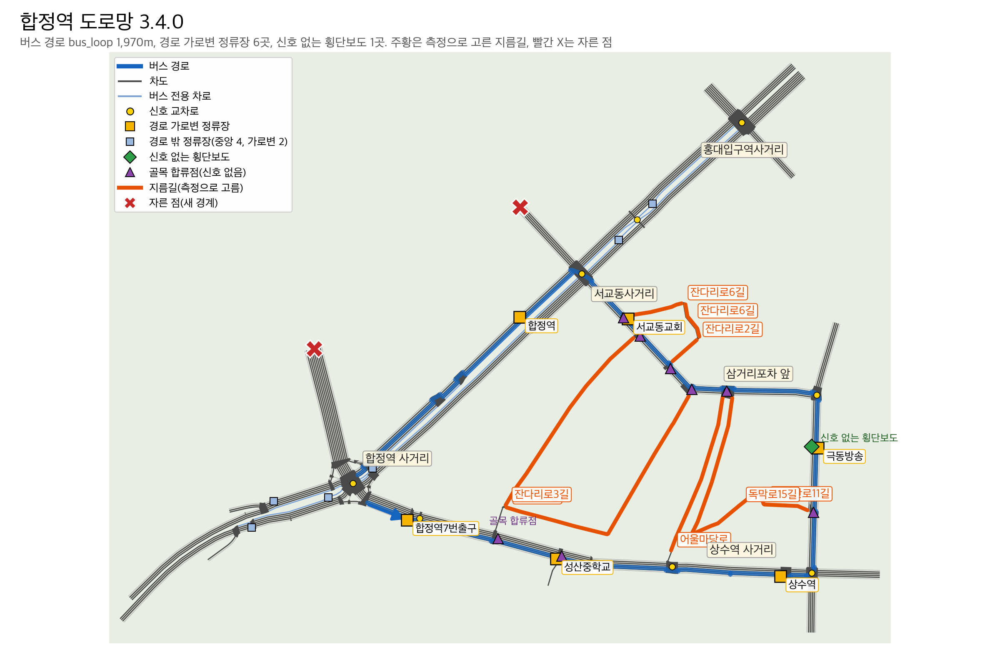

# 합정역 도로

합정역 일대 실제 도로를 SUMO로 옮긴 도로망이다. 원본 도로망은 서예인이 OSM을 바탕으로 만들었고(`seogyo-hongdae` 브랜치 `066e5b1`), `scripts/build_hapjeong.py`가 실제 지도와 대조해 고친 내용을 적용해 실행 도로망을 만든다. 서예인의 브랜치는 `main` 위에 쌓여 있다. 원본이 바뀌면 그 브랜치 위에서 `python scripts/build_hapjeong.py`를 다시 돌린다.

## 연구 시나리오와 도로

연구 경로 `bus_loop`(1,970m)는 서예인이 제안한 순환 경로다. 합정역에서 독막로를 따라 상수역까지 가서 와우산로로 좌회전하고, 잔다리로를 지나 서교동사거리(`J42`)에서 양화로로 좌회전해 합정역으로 돌아온다. 지금 도로망(3.4.0) 전체는 [references/hapjeong_map.png](references/hapjeong_map.png)에 있다. 아래 두 그림은 2.0.0 도로망으로 그렸다.

| 시나리오 | 도로에 있는 것 | 위치 |
|---|---|---|
| S1 정류장 출발 후 재합류 | 가로변 정류장 합정역7번출구(14-119) | 독막로 동행 `R69` |
| S2 정류장 직후 좌회전 연속 차선변경 | 정류장 상수역을 지나 상수역 사거리(`J82`)에서 좌회전하려면 왼쪽 차로로 옮겨야 한다. 독막로 `R111b`는 차도 3차로이고 2번·3번 차로가 와우산로로 좌회전한다. 가로변 1번 차로는 직진과 우회전만 된다 | 독막로 `R111b` 2번 차로 → `R112` |
| S3 정류장 접근 연속 차선변경 | 가로변 정류장 성산중학교, 극동방송, 서교동교회, 합정역(14-219) | `R71`, `R112`, `-R96`, `R54a` |
| S5 골목 차량 끼어들기 | 골목 여덟 곳에서 나온 차가 버스 경로에 신호 없이 합류한다. busy에서 합쳐서 시간당 약 218대다 | 합류점 `X_dongmak3`, `X_dongmak6`, `X_wausan11`, `J74`, `X_jandari7`, `X_jandari2`, `X_jandari3`, `J48` |
| S6 신호 없는 횡단보도 | 와우산로 중간 횡단보도. 차가 보행자에게 양보한다 | 극동방송 정류장 44m 뒤 |
| S4 정류장 앞 정차 차량 | 도로에는 따로 없다. 시나리오 쪽 이벤트다 | |

정류장은 Overpass(OSM)에서 받은 실제 정류장 점을 가장 바깥 차도 차로에 25m 길이로 놓았다. 점과 차로의 거리는 0.6~4.8m이고, 상수역만 14.1m다(인도 위 승강장 점). `map.json`의 `bus_stops`에 OSM 노드 id와 거리가 있다. 양화로 중앙버스차로 정류장 4곳(`source/stops.add.xml`)은 원본 그대로다.

## 골목

골목은 OSM 좌표 그대로 1차로이고, 이름이 "~길"인 골목은 30km/h, 서비스도로는 20km/h다. 모두 일방통행이고, 차가 실제로 다니는 방향만 있다. 골목의 안쪽 끝은 건물과 주차장에서 차가 나오는 출발점이다(`ALLEY_ORIGINS`와 `SHORTCUTS`의 `origins`).

| 골목(OSM 길 id) | 도로 id | 어디서 어디로 |
|---|---|---|
| 독막로3길(`172603989`) | `G3` | 양화로6길과 만나는 점 `Y2` → 독막로 합류점 `X_dongmak3` |
| 독막로6길(`223433270`) | `G12` | 골목 안쪽 `S2` → 독막로 합류점 `X_dongmak6` |
| 양화로6길 서쪽(`172603991`), 독막로7길(`172115945`) | `G4`, `G16` | `Y2` → `Y3` → 잔다리로 합류점 `X_jandari7` |
| 독막로3길 북쪽, 잔다리로3길(`172603995`) | `G17`, `G18` | `Y2` → 잔다리로 합류점 `X_jandari3`(서교동교회 정류장 바로 앞) |
| 어울마당로 | `G19` | `Y5` → 잔다리로 신호 횡단보도 `J74` |
| 어울마당로(`168229931`) | `G20`, `G21`, `G8`, `R120` | `J74` → 독막로(어울마당로 교차로). 잔다리로에서 독막로로 질러가는 길이다 |
| 와우산로13길(`172243759`), 독막로15길(`172245594`), 와우산로11길(`172245595`) | `G26`, `G27`, `G24` | `Y5` → 와우산로 합류점 `X_wausan11`(극동방송 정류장 63m 앞) |
| 잔다리로6길(`172111342`) | `G25`, `-G25`, `G22` | 잔다리로2길과 만나는 `N2` ↔ `N6` → 잔다리로 신호 횡단보도 `J48` |
| 잔다리로2길 | `G23` | `N2` → 잔다리로 합류점 `X_jandari2` |

3.4.0에서 차가 다니지 않는 차도를 지웠다. 지운 것은 "가지치기와 신호 정비 (3.4.0)" 절에 있다.

## 원본에서 고친 것

| 고친 것 | 이유 | 근거 |
|---|---|---|
| 제한속도 100·80km/h → 간선 50, 연결로와 이름이 "~길"인 이면도로 30km/h | 원본은 양화로·월드컵로·독막로 일부가 100km/h였다. 50km/h 골목 토막 끝에서 출발한 차가 바로 앞 횡단보도에서 보행자를 쳤다 | 안전속도 5030, OSM 독막로 maxspeed 50, `maps/paldalmun/source/speed_defaults.json` |
| J52·J56·J58(어울마당로·레드로드)을 한 교차로로 합치고 횡단보도 6개를 다시 놓음 | 11m 간격 세 교차로 사이 4m 구간에 차가 들어가지 못하고 교차로 안에 서 있다가 부딪혔다. 원본 충돌이 J58에 몰렸다 | 합친 뒤 이곳 충돌 0 |
| J56 신호 프로그램을 빼고 합친 교차로는 기본 신호 | 합치면서 연결 번호가 바뀌었다 | |
| J1 신호에서 중앙버스차로가 일반 차로로 합류하는 연결 2개를 양보 녹색(g)으로 | 같은 차로로 우선 녹색 두 개가 동시에 들어갔다 | SUMO 경고 "Unsafe green phase" |
| J3(연결로 R66이 양화로에 합류) 지퍼 합류 → 연결로 양보 | busy에서 합류부 정체가 풀리지 않아 순간이동이 났다 | 바꾼 뒤 순간이동 0 |
| 배경 차량 baseline 합계 900대/시간, 진입은 간선 도로 끝과 합류 골목 두 곳 | 50km/h에서 1,320대(팔달문 규칙 그대로)는 평균 주행 대수가 두 배가 되며 교차로 안까지 정체가 이어졌다 | 원본 생성기 설정의 `vehs_per_hour` 900 |
| 보행자 경로 다시 생성(시간당 600명, 최소 150m, seed 42) | 교차로를 합치면 원본 보행자 경로가 지나던 도로가 사라진다 | 원본 생성기 설정과 같은 값 |
| 서교동사거리(`J42`)에서 양화로를 건너는 횡단보도 두 곳을 보행자 전용 단계(34초, 앞뒤로 전적색 5초)로 옮김 | 이 횡단보도는 잔다리로 차량 신호와 같이 켜졌다. 잔다리로에서 좌회전한 버스가 교차로를 빠져나가는 자리에서 보행자와 부딪혔다 | 옮기기 전 버스 충돌 5번, 옮긴 뒤 0번(`scripts/audit_road.py`, 9회 실행). 전용 단계 앞에 전적색이 없을 때는 교차로 안에서 기다리던 좌회전 차가 보행자와 1번 부딪혔다 |
| 합정역 사거리(`J1`)에서 `R42` 1번 차로의 직진 연결을 지움(3.0.0). 지금은 빌드에서 하지 않는다 | `R42`의 1번·2번 차로가 둘 다 `R40` 1번 차로로 직진해 교차로 안에서 옆으로 부딪혔다. 서예인이 새 원본(`066e5b1`)에서 `R40`을 일반 3차로로 넓혀 세 차로를 1:1로 이었다 | 지우기 전 측면 충돌 1번과 `:J1_18_0` 급제동 8번, 지운 뒤 0번 |
| 경계 진입로 `-R97`을 10m에서 50m로 늘림(3.0.0) | 투입된 차가 10m 앞 빨간불에서 비상 정지했다. 3.1.0에서 이 구역을 잘라내 지금 도로망에는 없다 | 비상 정지 19번 → 0번 |
| 서교동사거리(`J42`)의 잔다리로 신호를 방향별로 나눔(이전 원본의 3.2.0). 지금은 빌드에서 하지 않는다 | 양방향이 같은 녹색일 때 교차로 안에서 기다리는 좌회전 차를 맞은편 직진 차가 들이받았다. 서예인이 새 원본에서 잔다리로 2번 차로를 좌회전 전용으로 바꾸고 좌회전 전용 신호 20초를 넣어 원본에서 막는다. 빌드의 나누기를 남겨 두면 그 20초가 10초로 깎인다 | 나누기를 뺀 최종 도로망에서 이 충돌은 300회 점검 중 0번 |
| 신호 없는 횡단보도(S6)를 건너는 보행자를 시간당 60명 따로 넣음(3.2.0) | 무작위 보행자 경로는 도로망이 바뀔 때마다 달라져, 지름길을 넣자 S6를 건너는 사람이 없어졌다 | 인원은 가정값이다 |
| 독막로를 나눌 때 사라지던 `J23` 서쪽 횡단보도를 다시 놓음 | 도로를 나누면 조각의 id가 바뀌어(`R71` → `R71.256`) netconvert가 그 도로를 건너던 횡단보도를 버린다 | 원본 신호 프로그램 20칸과 연결 수가 다시 맞는다 |
| 신호 프로그램을 쓰는 교차로는 연결 번호가 원본과 같은 연결을 가리키는지 빌드에서 검사 | 신호 프로그램은 연결 번호 순서로 적혀 있다. 원본이 바뀌자 `J1`의 양보 녹색 11번이 좌회전 연결을 가리켰다 | 칸마다 원본에서 같은 연결이 받던 신호를 옮겨 적고, 양보 녹색은 도로 이름(`B1`→`R41`, `B2`→`R40`)으로 찾는다 |

3.0.0에서 고친 여섯 곳은 기존과 수정 후를 나란히 그린 그림이 있다. 그림 아래에 문제, 수정, 결과를 세 줄로 적었다. `python scripts/render_fix_figures.py`로 다시 만든다.

| 구간 | 그림 |
|---|---|
| 서교동사거리(`J42`) 교차로 합치기 | [01_seogyo_junction.png](references/fixes/01_seogyo_junction.png) |
| 상수역 좌회전(`J82`) | [02_sangsu_left_turn.png](references/fixes/02_sangsu_left_turn.png) |
| 서교동사거리 보행자 전용 단계 | [03_seogyo_pedestrian_phase.png](references/fixes/03_seogyo_pedestrian_phase.png) |
| 합정역 사거리(`J1`) 차로 연결 | [04_hapjeong_junction_merge.png](references/fixes/04_hapjeong_junction_merge.png) |
| 경계 진입로 `-R97` | [05_entry_stub.png](references/fixes/05_entry_stub.png) |
| 독막로 `J23` 횡단보도 | [06_dongmak_crossing.png](references/fixes/06_dongmak_crossing.png) |

시도했다가 되돌린 것도 있다. 도착지를 도로 크기에 비례해 고르면 충돌 46번, 순간이동 24번이 났다. J8 좌회전 대기 위치(contPos)를 바꿔도 충돌 수가 같았다. 결정 과정은 로컬 기록 `.audit/hapjeong-road.tsv`에 있다.

## 북서쪽 자르기와 지름길 (3.1.0, 3.2.0)

3.1.0에서 도로망의 북서쪽을 잘라냈다. 월드컵로 `R61`은 합정역 사거리에서 200m, 잔다리로 `R92`는 서교동사거리에서 130m 지점(`CUT_worldcup`, `CUT_jandari`)에서 자르고 그 너머(`J49`, `J64` 일대)를 버렸다. 자른 점은 배경 차량이 드나드는 경계다. 도로는 138개에서 128개가 됐다. 버린 구역에 있던 `-R97` 진입로 연장은 함께 없어졌다.

3.2.0에서 버스 경로가 둘러싼 구역 안의 실제 골목(OSM) 두 개를 지름길로 살렸다. 골목과 같이 신호가 없다.

| 지름길 | 길(OSM 길 id) | 도로 id | 잇는 곳 |
|---|---|---|---|
| 독막로7길 | 독막로7길(`172115945`) | `G16` | 양화로6길(`Y3`) ↔ 잔다리로 합류점 `X_jandari7` |
| 잔다리로3길 | 독막로3길 북쪽(`172603989`), 잔다리로3길(`172603995`) | `G17`, `G18` | 양화로6길(`Y2`) ↔ 잔다리로 합류점 `X_jandari3`(서교동교회 정류장 바로 앞) |

고른 근거는 측정이다. 후보 세 개를 하나씩, 그리고 묶어서 임시 지도로 만들어 `scripts/shortcut_experiment.py`로 쟀다(교통량 busy, 규칙 버스 80회). 서예인의 새 원본(`066e5b1`) 위에서 다시 잰 값이다.

| 후보 | 골목에서 버스 방향으로 합류하는 차 | 버스 앞에 끼어든 차(S5) | 정류장을 지날 때 같은·옆 차로에 차 | 사건이 난 실행(300회 점검) | 결정 |
|---|---|---|---|---|---|
| 없음(3.1.0) | 10.0대/시간 | 0번 / 80회 | 94 / 479 | 11 / 300 | |
| 독막로7길 | 28.3대/시간 | 4번 / 80회 | 96 / 477 | | 채택. 합류가 가장 많이 는다 |
| 잔다리로3길 | 21.7대/시간 | 5번 / 80회 | 91 / 477 | | 채택. 서교동교회 정류장 바로 앞으로 합류한다 |
| 어울마당로 | 21.0대/시간 | 15번 / 80회 | 144 / 476 | | 보류 |
| 최종 도로망(독막로7길 + 잔다리로3길) | 34.0대/시간 | 6번 / 80회 | 101 / 476 | 6 / 300 | |
| 독막로7길 + 어울마당로 | 32.7대/시간 | 27번 / 80회 | 140 / 480 | 20 / 300 | |
| 셋 모두 | 43.7대/시간 | 28번 / 80회 | 164 / 480 | 10 / 300 | |

- 지름길이 없어도 합류가 시간당 10대다. 새 원본에 상수역 쪽 경계가 생겨 독막로 골목 차가 버스 방향으로 나온다(`X_dongmak3`, `X_dongmak6` 각 5대). 이전 원본에서는 0대였다.
- 독막로7길은 잔다리로 `X_jandari7`로 시간당 약 13대, 잔다리로3길은 `X_jandari3`로 약 11대를 더한다. 최종 도로망에서 끼어든 차 6번은 `X_jandari3` 4번, `X_jandari7` 2번이다.
- 어울마당로는 끼어들기와 정류장 주변 차량이 가장 많이 는다. 그래도 보류했다. 붙이려면 잔다리로의 신호 횡단보도 `J74`를 신호 없는 교차로로 바꿔야 하고, 그 자리에서 골목 차가 횡단보도에 내려선 보행자와 부딪혔다(300회 중 `J74` 충돌 9번, 셋 모두일 때 5번). 점검 버스의 평균 주행 시간도 458초에서 477초로 늘었다. `scripts/build_hapjeong.py`의 `ACTIVE_SHORTCUTS`에 `"eoulmadang"`을 더하면 켜진다.
- 끼어든 횟수는 표본이 작다. 어울마당로의 합류량이 같은 시간당 11대인 세 측정에서 15번, 25번, 25번이 나왔다. 합류하는 차의 수는 배경 교통만 한 시간씩 세 번 돌려 센 값이라 더 믿을 만하다.
- 끼어들기의 양을 정하는 것은 골목 유입량이다. 최종 도로망에서 골목에서 출발하는 차는 baseline 기준 합계 시간당 약 48대다(`ALLEY` 규칙). 더 자주 일어나게 하려면 유입량을 늘리거나 버스 접근에 맞춰 차를 넣어야 한다.

측정기 두 곳을 이번에 고쳤다. `scripts/scenario_occurrence.py`가 골목을 거치지 않고 합류점 교차로를 지나간 앞차를 끼어들기로 세고 있었다(고치기 전에는 지름길 없이도 12번). 그리고 S2를 서교동교회 쪽 도로 이름으로 판정하고 있었다. 새 원본에서는 버스가 상수역 직후에 차로를 바꾸므로, 다음 회전이 좌회전인 구간의 왼쪽 차로 변경으로 판정한다.

OSM 자료(`source/area.osm.xml`)는 와우산로 서쪽 130m까지만 있다. 와우산로 쪽 골목은 후보에 넣지 못했다.

## 시나리오를 늘리는 길과 교통 설정 (3.3.0)

3.3.0의 목표는 여섯 시나리오가 최대한 많이 나오는 도로다. 구간별로 교통량과 시나리오를 재고(`scripts/scenario_sections.py`), 가장 약한 구간을 고치고, 다시 재는 일을 다섯 번 되풀이했다. 길은 모두 OSM에 있는 실제 길이다.

| 더한 것 | 내용 | 측정한 효과 |
|---|---|---|
| 어울마당로 `G19`~`G21` | 독막로에서 잔다리로의 신호 횡단보도 `J74`까지. 방향별 일방통행 | 빼면 합류가 시간당 11.7대 준다 |
| 잔다리로6길 `G22` | 버스 경로 북동쪽에서 신호 횡단보도 `J48`로 들어온다. 서교동사거리 좌회전 대기 구간 앞이고 우회전만 한다 | 빼면 14.7대 준다 |
| 잔다리로2길 `G23` | 독막로7길과 잔다리로3길 합류점 사이로 나온다 | 빼면 23.0대 줄고, 좌회전 차로 변경 때 옆 차로에 차가 있는 경우가 25회에서 3회가 된다 |
| 와우산로11길 `G24` | 극동방송 정류장 63m 앞, 신호 없는 횡단보도 107m 앞으로 나온다. 나오는 방향만 있다 | 합류 +14.0대 |
| 잔다리로6길 남쪽 `G25`, 와우산로13길 `G26`, 독막로15길 `G27` | 막다른 끝으로 남던 잔다리로2길·6길·와우산로11길을 서로, 그리고 안쪽 골목망과 잇는다 | 막다른 지름길 0개. 시나리오 수치는 그대로 |
| 골목 유입 3배 | 간선 유입은 그대로 두고 골목에서 출발하는 차만 3배 | 합류 93.7 → 242.7대/시간 |
| 배경 차량 무작위 투입 | 고정 간격 대신 무작위 간격(`map.json`의 `flow_arrivals`) | 고정 간격은 seed가 달라도 같은 차를 만난다. 무작위는 끼어들기가 구간에 고루 퍼진다 |
| 신호 없는 횡단보도 보행자 4배 | 시간당 60명 → 240명 | 횡단보도 앞에서 보행자를 만난 에피소드 45/80 → 78/80 |
| 상수역·삼거리포차 앞으로 나가는 차의 몫 2배 | `R128`, `R129`, `R130`으로 가는 흐름 | 가장 한산한 구간 95 → 124대/시간 |

신호 횡단보도 `J74`, `J48`에는 신호를 그대로 둔 채 골목을 붙였다. 골목 차는 간선이 녹색일 때 양보하며 나오고, 황색 동안 황색, 보행 신호와 그 뒤 전적색 동안 적색이다. 신호를 없애고 붙였을 때는 `J74`에서 골목 차와 보행자가 300회 점검 중 5~9번 부딪혔고, 신호를 남긴 뒤로는 0번이다.

최종 도로망의 구간별 결과다(busy, 규칙 버스 80회, seed 500). 80회 모두 완주했다.

| 구간 | 버스 옆·같은 차로에 차가 있던 시간 | 정류장에서 옆에 차 | 시나리오 |
|---|---|---|---|
| 독막로 서쪽(합정역7번출구, 성산중학교) | 28% | 57 / 160 | 끼어들기 2번 |
| 독막로 동쪽(상수역) | 56% | 19 / 80 | S2 70회, 그중 옆 차로에 차 27회 |
| 와우산로(극동방송, 횡단보도) | 17% | 13 / 80 | 끼어들기 2번, 횡단보도 앞 보행자 78회, 건너는 중 3회 |
| 잔다리로 동쪽 | 26% | 정류장 없음 | |
| 잔다리로(서교동교회) | 23% | 43 / 80 | 끼어들기 13번 |
| 좌회전 대기(서교동사거리 앞) | 99% | 정류장 없음 | 끼어들기 17번 |
| 양화로(합정역) | 67% | 51 / 80 | |

3.2.0과 견주면 골목에서 버스 방향으로 합류하는 차가 시간당 34대에서 222대, 끼어들기가 80회에 6번에서 36~43번, 정류장에서 옆에 차가 있던 경우가 101/476에서 183/480이 됐다. 끼어든 차 43~46번 가운데 버스와 같은 차로로 들어온 것은 8번이다.

시험하고 넣지 않은 것은 다음과 같다. 버스전용차로를 일반 차에 열면 서교동사거리와 홍대입구역사거리에서 충돌이 났다(점검 6회에 18번). 신호가 버스차로 전용 단계를 전제로 짜여 있다. 전체 교통량 1.5배와 동서 골목(양화로6길) 출발은 정체가 생겼다(순간이동 38번, 12번). 독막로 남쪽 골목망에서 차를 출발시키면 `J8`, `J23`에서 골목 차와 버스가 부딪혔다. 와우산로13길의 나머지 구간은 극동방송 정류장과 횡단보도를 지난 뒤에 와우산로에 닿아 넣지 않았다.

3.3.0에는 차가 한 대도 다니지 않는 차도가 37개 있었다. 3.4.0에서 버스전용차로 6개만 남기고 지웠다.

## 가지치기와 신호 정비 (3.4.0)

3.3.0에는 문제가 넷 있었다. 차가 다니지 않는 차도가 37개였다. 300회 점검에서 사건이 난 실행이 17회였다. 버스가 서교동사거리 좌회전을 평균 92초 기다렸다. 규칙 버스가 제한 시간 500초를 9회 중 2회 넘겼다. 3.4.0은 길을 줄이고 신호와 차로를 고쳐 넷을 함께 다룬다.

| 고친 것 | 원인 | 측정 |
|---|---|---|
| 차가 0대인 차도 31개와 시간당 1대 미만인 2개 삭제. 골목은 모두 일방통행 | busy 교통을 한 시간 흘려 한 대도 지나지 않은 차도다. 골목의 반대 방향, 독막로 남쪽 골목망, 양화로6길 동쪽 구간, 원본의 30m 토막이다 | 차도 150개 → 114개. 0대 차도는 버스전용차로 6개만 남는다(`references/road_usage.json`). 합류하는 차는 시간당 222대 → 218대로 그대로다 |
| `J8`의 골목 진입로(`R116`, `G1`, `G2`) 삭제 | 독막로 동쪽 방향 차가 이 골목으로 좌회전해 되돌아 나왔다. 토막을 지워 교차로가 작아지자 이 좌회전 차의 대기 위치가 횡단보도 위가 됐다 | 300회 점검에서 `J8` 보행자 충돌 28번 → 0번 |
| 상수역 사거리 `J82`: 황색 뒤 전적색(3초, 남북 방향 뒤는 5초) | 황색 3초 뒤 바로 다음 방향이 출발했다. 교차로 안에서 맞은편을 기다리던 비보호 좌회전 차가 빠져나가기 전에 독막로 좌회전(버스 경로)이 들어왔다. 3.3.0의 충돌 5번이 모두 독막로 녹색 뒤 1.8~4.9초였다 | 이 교차로의 차 대 차 충돌 5번 → 0번(300회 점검) |
| `J82` 앞 27m 구간 `R111b`를 차도 2차로에서 3차로로 | 정지선 27m 앞에서 3차로가 2차로로 줄었다. 두 차가 한 차로에 나란히 끼인 채 우회전하다 교차로 안에서 서로를 막았고, 300초 뒤 순간이동했다. 한 장면을 재현해 뒤차를 지우면 앞차가 지나가는 것을 확인했다 | `J82` 우회전 순간이동: 가지치기만 했을 때 12번 → 0번 |
| `J82` 독막로 동행 녹색 25초 → 35초 | 줄이 길면 가로변 차로의 버스가 좌회전 차로로 옮기지 못한다 | 규칙 버스 완주 76 / 80 → 77 / 80. 차이가 작아 효과는 확인하지 못했다 |
| 서교동사거리 `J42`: 잔다리로 `R94`가 40초 동안 모든 방향으로 나가고, 맞은편 `-R92`가 15초를 따로 쓴다 | 직진·우회전 39초 뒤 좌회전 20초였다. `R94`는 1차로의 우회전과 2차로의 좌회전이 모두 많아, 줄이 88m 구간을 채우고 횡단보도 `J48`과 골목 `G22`까지 막았다 | 점검 버스 평균 주행 479초 → 444초. 규칙 버스의 좌회전 대기 92초 → 61초. `G22` 순간이동 2회 → 1회 |
| 삼거리포차 앞 `J83`과 `J42`에서 가로변 차로도 좌회전 | 좌회전이 2차로에서만 됐다. 가로변 차로를 달리는 버스가 좌회전 줄에 끼어들지 못하고 300초를 서 있었다(규칙 버스 12회 중 1회) | 버스가 가로변 차로로 달려, 골목 차가 버스와 같은 차로로 끼어든 횟수가 80회 주행에 2번 → 4~13번 |
| 횡단보도 신호 `J106`, `J48`: 보행 녹색 뒤 전적색을 8초, 10초로 | 보행 녹색 뒤 바로 차량 녹색이라 늦게 들어선 보행자가 남아 있었다 | 두 곳 보행자 충돌 4번 → 0번 |

결과를 3.3.0과 견준다. 시나리오는 busy 교통의 규칙 버스 80회(seed 500, 제한 600초), 점검은 quiet·baseline·busy × seed 0~99의 300회다.

| 지표 | 3.3.0 | 3.4.0 |
|---|---|---|
| 차도 수 | 150 | 114 |
| 차가 0대인 차도(버스전용차로 6개 포함) | 37 | 6 |
| 사건이 난 실행(300회 점검) | 17 | 7 |
| 순간이동이 난 실행(300회 점검) | 5 | 3 |
| 점검 버스 평균 주행 시간 | 479초 | 444초 |
| 규칙 버스 검증(`validate_road.py`, 제한 500초) | 7 / 9 완주 | 9 / 9 완주(380~433초) |
| 규칙 버스 80회 주행 완주 | 80 | 77 |
| 골목에서 버스 방향으로 합류하는 차 | 222대/시간 | 218대/시간 |
| 버스 앞 50m 안으로 끼어든 차(S5) | 36번 | 33번 |
| 좌회전 차로 변경(S2), 그때 옆 차로에 차 | 70회, 27회 | 47회, 5회 |
| 정류장에서 옆에 차 | 183 / 480 | 210 / 474 |
| 신호 없는 횡단보도 앞에 보행자(S6~) | 78회 | 72회 |
| 가장 한산한 구간의 교통량 | 122대/시간 | 135대/시간 |
| 가장 한산한 구간에서 버스 옆에 차가 있던 시간 | 17% | 30% |

나빠진 것이 둘 있다. 규칙 버스 80회 주행에서 3회가 끝까지 가지 못했다. 2회는 `R111b` 가로변 차로에서 좌회전 차로로 옮기지 못해 300초를 서 있었고, 1회는 제한 시간 600초를 넘겼다. `J8`의 골목 진입로를 지우자 되돌아가던 차가 상수역 사거리 좌회전으로 몰려 좌회전 차로가 붐빈다. 그리고 S2에서 옆 차로에 차가 있던 경우가 27회에서 5회로 줄었다. 버스가 `R111b`에 들어서며 교차로 `J107` 안에서 차로를 바꾸는 경우가 늘었고, 측정기는 도로 위의 차로 변경만 센다.

시험하고 넣지 않은 것은 다음과 같다. `J42`에서 단계 길이만 바꾸면(잔다리로 직진 20초, 좌회전 30초) 점검 버스가 486초에서 543초로 느려지고 골목 순간이동이 21번 났다. `R111b` 2번 차로를 좌회전 전용으로 두면 `J82`에서 정체가 났다(300회 점검 중 순간이동 3회). `R111b`를 2차로로 두고 차로가 줄어드는 `J107`을 지퍼 합류로 바꾸면 독막로에 정체가 생겼다. 골목 차가 간선의 모든 차로로 들어가게 해도 같은 차로 끼어들기는 늘지 않았다.

## 검증

`references/stability_validation.json`: seed 0·7·42 × quiet·baseline·busy, 1,800초. 배경 교통 9회 모두 충돌 0, 순간이동 0이다. 버스 ego는 `bus_loop`를 9회 모두 완주했다(380~433초, 제한 500초). 도로 안 평균 차량 수는 quiet 약 31대, baseline 약 67대, busy 약 90대다.

`references/road_audit.json`: 같은 9회에 SUMO가 모는 버스를 120초마다 넣은 `scripts/audit_road.py`의 결과다. 충돌 0, 순간이동 0, 비상 정지 0이고 버스 108대가 완주했다. 끝에서 나갈 연결이 없는 차로는 0개다.

같은 점검을 quiet·baseline·busy × seed 0~99로 300회 돌리면, 급제동을 뺀 사건이 난 실행이 서예인 원본 4회, 3.2.0에서 6회, 3.3.0에서 17회, 3.4.0에서 7회다. 3.4.0의 7회는 상수역 사거리 3회, 양화로 `R50` 대기열의 측면 충돌 2회, `R53d` 비상 정지 1회, 골목 `G22` 순간이동 1회다.

2.0.0 도로망(이전 원본 `ec6fbf6`)은 같은 점검에서 충돌 3번, 비상 정지 59번이었다. 비상 정지는 서교동사거리 진입로 `R55`(길이 0.2m)와 `-R97`에 몰렸고, 충돌은 모두 서교동사거리 횡단보도였다.

## 알려진 현상

- 황색 신호가 켜지는 순간의 급제동. 9회 실행에서 배경 차량의 급제동 83번이 남았다. 3.0.0의 한 실행(93번)에서 정지선에 걸린 급제동은 거의 모두 황색이 켜진 그 계산 스텝에 났다. 정지선 가까이 있던 차가 황색을 보고 9m/s²로 멈추는 SUMO 주행 모델의 동작이다. 충돌로 이어진 적은 없어 고치지 않았다.
- 중앙버스차로 때문에 좌회전 차로의 왼쪽에 직진 버스 차로가 있다(`R50`, `R55`, `R53d`). 서교동사거리는 버스 차로에 따로 신호를 준다. 홍대입구역사거리(`J96`)는 netconvert 기본 신호다.
- 버스는 서교동사거리(`J42`)에서 잔다리로 신호를 기다린다. `R94`의 녹색은 주기 182초에 40초다. 규칙 버스 80회에서 이 진입로에 서 있던 시간은 평균 30초이고, 좌회전 대기 구간 전체는 평균 61초다. 원본의 신호 시작 시각(`offset` 9초)은 버스가 180초에 출발할 때에 맞춘 값인데, 환경은 출발을 0~180초 흩뜨린다.
- 상수역 사거리(`J82`)에 드문 사건이 남는다(300회 점검 중 3회). 동쪽 진입로 `-R128`에서 우회전하는 차는 보행 신호와 같은 단계에 양보하며 돈다. 이 차가 횡단보도에서 보행자와 부딪히면 교차로 안에 서 버리고, 뒤따르는 좌회전 차와 버스가 300초 뒤 순간이동한다. 우회전을 보행 신호와 다른 단계로 떼는 수정은 해 보지 않았다.
- 규칙 버스는 `R111b`(27m)에서 가로변 차로를 좌회전 차로로 바꿔야 한다. 옆 차로에 줄이 서 있으면 못 바꾸고, 정지선에 멈춘 뒤에는 옆으로 움직이지 못한다(`lateral_model`의 `standing_speed` 0). 80회 주행 중 2회가 이렇게 300초를 서 있다 끝났다. 경로 추종 규칙(`env/route_policy.py`)은 차로가 끝나기 50m 앞에서야 옮기기 시작한다.
- 배경 차량과 보행자는 고정된 시각에 나온다. seed가 달라도 같은 시각에 같은 차와 같은 보행자가 나와, 드문 충돌이 같은 자리에서 같은 시각에 되풀이된다. 3.1.0의 11회 중 5회가 삼거리포차 앞(`J83`)에서 같은 보행자와 1,326초에 난 충돌이다. 그래서 환경이 ego 투입 시각을 에피소드마다 0~180초 흩뜨린다(`env/mdp_config.py`의 `warmup_jitter_steps`). 그래도 한 에피소드가 보는 교통은 같은 10분 안팎의 구간이라, 에피소드 수만큼 독립적인 표본은 아니다.
- 신호 타이밍을 바꾸면 드문 충돌이 다른 자리로 옮겨 간다. 차량 황색 뒤 횡단보도 녹색을 3초 늦추면 `J83`의 충돌은 없어지지만 사건이 난 실행은 4회에서 11회가 됐다(서예인 원본 기준, 300회). 이 수정과 `J82`·`J83`의 전적색은 되돌렸다.
- 양화로 `R50`(서교동사거리 앞, 3차로가 5차로로 넓어지는 123m)의 대기열에서 측면 충돌이 드물게 난다. 최종 도로망의 300회 점검에서 2회다. 멈춰 선 차 옆으로 뒤차가 비집고 들어가다 나는 SUMO 차로 내 주행 모델(SL2015)의 동작으로 본다(추정).

## 파일

| 파일 | 내용 |
|---|---|
| `map.json` | 연구 경로, 가로변 정류장, 배경 교통, 부속 파일 목록. `scripts/build_hapjeong.py`가 만든다 |
| `source/network.base.net.xml`, `source/signals.base.add.xml` | 서예인의 원본 도로망과 신호 프로그램. 빌드의 입력이다 |
| `source/network.net.xml`, `source/signals.add.xml`, `source/pedestrians.rou.xml` | 빌드가 만든 실행 도로망, 신호 프로그램, 보행자 경로 |
| `source/islands.add.xml`, `source/seams.add.xml` | 교통섬과 차로 이음선 표시 |
| `source/stops.add.xml` | 양화로 중앙버스차로 정류장 2곳 |
| `source/context.add.xml` | 건물·녹지 외곽선. 화면 표시용 |
| `source/area.osm.xml` | OSM 원자료 (© OpenStreetMap contributors, ODbL 1.0) |
| `generator/` | 원본 도로망을 만든 생성기(`osm_builder.py`와 그때의 `road_builder.py`, `road_config.py`). 수업 원본 코드 구조를 전제로 해서 이 저장소에서는 그대로 실행되지 않는다 |
| `references/hapjeong_road.png`, `references/hapjeong_scenario.png` | 지도 대조 그림과 연구 경로 그림 |
| `references/stability_validation.json` | `scripts/validate_road.py --map hapjeong`의 결과 |
| `references/road_audit.json` | `scripts/audit_road.py --map hapjeong`의 결과. 사건이 난 차로와 버스 주행 시간 |
| `references/road_usage.json` | 도로별 통행량(`scripts/road_usage.py`). 차가 다니지 않는 차도를 찾는다 |
| `references/hapjeong_map.png` | 지금 도로망 전체 그림(`scripts/render_map.py`) |
