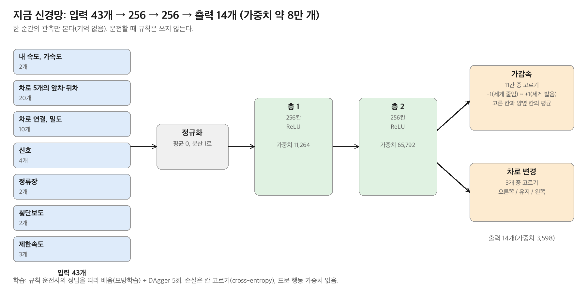
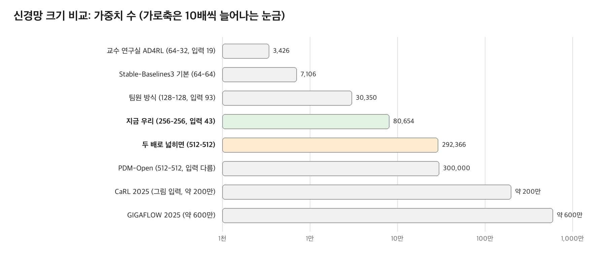
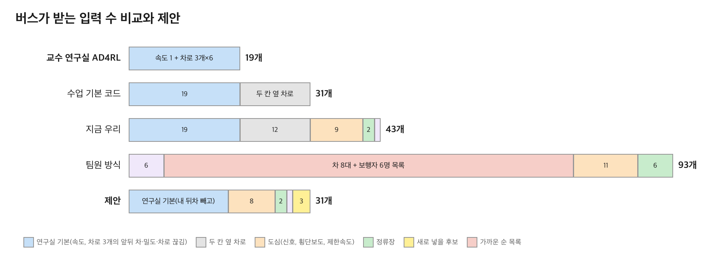
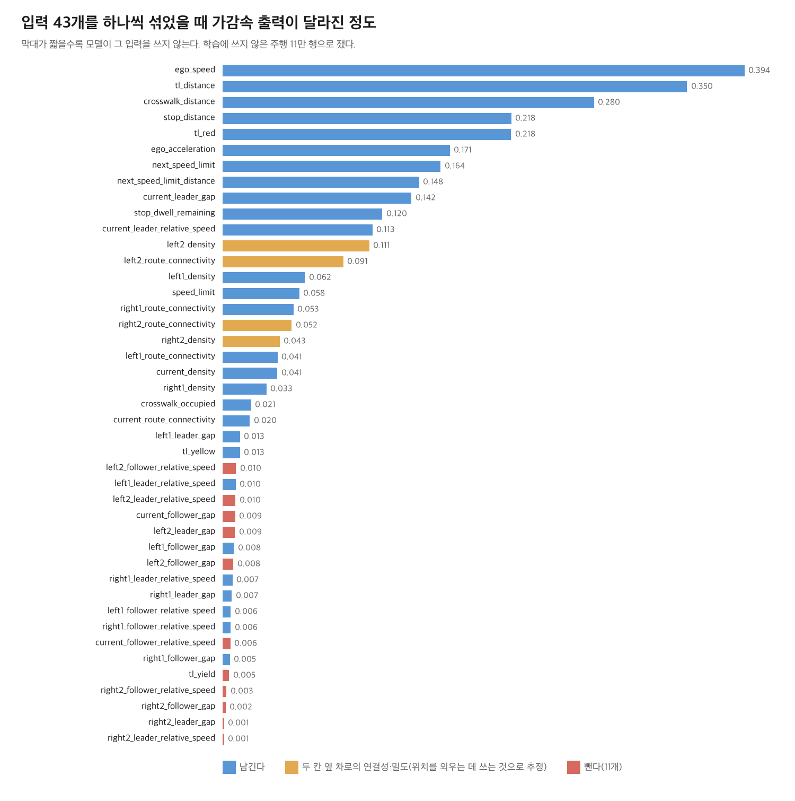

# 신경망 구조와 입력: 지금 상태, 선행연구 비교, 줄일 입력과 넣을 입력

2026-11-24 작성. 숫자 옆에 "측정"은 이 저장소에서 직접 잰 값이고, "조사"는 조사 에이전트가 논문 페이지를 열어 읽은 값이다.

## 결론

- **지금 신경망은 선행연구 가운데 중간 크기다.** 입력 43개 → 256 → 256 → 출력 14개, 가중치 약 8만 개다. 교수 연구실(64-32, 약 3천 개)보다 크고 PDM-Open(512-512, 약 30만 개)보다 작다.
- **크기를 두 배로 늘리는 것은 우선순위가 낮다.** 규칙 운전사를 따라 배우는 데이터에서는 작은 망에서 성능이 이미 멈춘다는 보고가 있고, PPO는 평범한 망을 키우면 오히려 무너진 사례가 있다(조사).
- **입력 43개 중 11개는 모델이 거의 쓰지 않는다(측정).** 두 칸 옆 차로의 앞뒤 차 8개, 내 뒤차 2개, 비보호 녹색 표시 1개다. 이 11개를 가리고 다시 학습해도 검증 손실이 같다(0.561, 원래 0.576). 실제 주행도 같은 seed 60번에서 58번 완주, 충돌 0으로 원래(56번, 충돌 2)보다 나쁘지 않다.
- **두 칸 옆 차로의 밀도·연결성 4개도 뺄 수 있다(측정).** 모델이 쓰기는 하지만, 가리고 다시 학습해도 검증 손실이 같다(0.561). 합쳐서 15개를 뺀다.
- **자기 가속도는 남긴다(측정).** 선행연구는 "자기 과거 행동"을 빼라고 하지만, 가리면 검증 손실이 0.618로 오른다. 규칙 운전사가 급한 가감속 변화를 막을 때 이 값을 읽기 때문이다.
- **새로 넣을 입력은 오차가 몰린 곳에서 골랐다(측정).** 모델이 규칙 운전사와 크게 어긋나는 행의 38%가 정류장 50m 안 접근이다. 후보는 정류장 근거리 거리, 더 멀리 보는 앞차 거리, 황색이 켜진 뒤 지난 시간 셋이다.
- **제안은 43개 → 31개다.** 15개를 빼고 3개를 넣는다. 실제 주행으로 확인한 뒤에 확정한다(6절).

## 1. 지금 구조

- **한 순간의 관측만 본다.** 지난 관측을 기억하지 않는다. 코드는 `algorithms/bc.py`의 `BCPolicy`다.
- **가감속은 11칸 중 하나를 고른다.** 값 하나를 내는 방식(MSE)은 "서기"와 "가기"가 갈리는 곳에서 그 중간값을 낸다. 칸 고르기는 한쪽을 고른다. 고른 칸과 양옆 칸만으로 평균을 내 값으로 바꾼다.
- **차로 변경은 셋 중 하나를 고른다.** 오른쪽, 유지, 왼쪽이다.
- **운전할 때 규칙은 쓰지 않는다.** 규칙 운전사는 학습할 때 정답을 붙이는 데만 쓴다.

## 2. 선행연구와 크기 비교

| 연구 | 입력 | 은닉층 | 가중치 수 |
|---|---|---|---|
| 교수 연구실 AD4RL | 숫자 19개 | 64-32 | 약 3천 |
| Stable-Baselines3 기본 PPO | - | 64-64 | 약 7천 |
| 팀원 방식 | 숫자 93개 | 128-128 | 약 3만 |
| **지금 우리** | 숫자 43개 | 256-256 | 약 8만 |
| Hoel 2018 차선변경 | 숫자 27개 | 512-512 | 약 28만(조사) |
| PDM-Open | 중심선 + 자차 | 512-512 | 약 30만 |
| CaRL 2025 | 위에서 본 그림 | 합성곱 망 | 약 200만 |
| GIGAFLOW 2025 | 숫자 목록 | 큰 망 | 약 600만 |

**숫자 벡터를 입력으로 쓰는 연구는 대부분 64~512칸 두 층이다.** 가중치가 100만 개를 넘는 연구는 그림을 입력으로 받거나 수십억 건의 데이터로 학습한다. 우리는 둘 다 아니다.

## 3. 키우거나 다른 구조로 바꿔 더 좋았던 사례

아래 표는 조사 에이전트가 논문 페이지를 열어 확인한 것이다. 학회명은 확인하지 못해 적지 않았다.

| 바꾼 것 | 사례 | 결과 | 우리에게 주는 뜻 |
|---|---|---|---|
| 폭·깊이 키우기(PPO) | Henderson 2018 | PPO Hopper 점수가 64-64에서 2790, 400-300에서 61 | 평범한 망을 키운 채 PPO를 돌리면 위험하다 |
| 폭·깊이 키우기(PPO) | Andrychowicz 2021 | 정책망은 너무 좁아도 넓어도 떨어진다. 가치망은 넓혀도 손해가 없다. 은닉층 2개면 충분하다 | PPO 때는 정책망은 그대로, 가치망만 키운다 |
| 폭 키우기(모방학습) | robomimic 2021 | 모방학습 단독은 용량을 키우면 나아졌다 | 512로 한 번 돌려 볼 근거 |
| 폭 키우기(모방학습) | Park & Levine 2026 | 사람 시범은 클수록 계속 좋아졌다. 규칙으로 만든 데이터는 256칸에서 멈췄다 | 우리 정답은 규칙 운전사라 뒤쪽에 가깝다 |
| 잔차 연결 + 층 정규화 | SimBa 2024, BRO 2024 | 평범한 망은 키울수록 나빠졌고, 잔차와 정규화를 넣으면 키울수록 좋아졌다 | 키운다면 이 구조와 함께 |
| 기억(순환망, 과거 쌓기) | de Haan 2019 | 과거를 보면 검증 손실은 좋아지는데(0.834 대 0.989) 실제 충돌은 늘었다(6.49 대 3.38) | 과거를 그냥 쌓지 않는다 |
| 기억 | Kuefler 2017 | 순환 구조는 모방학습(BC)에는 거의 효과가 없었다. 이전 행동 입력은 뺐다 | 자기 가속도 입력을 빼는 근거 |
| 차량별 공유 인코더 | Hoel 2018 | 충돌 없는 비율이 평범한 망 98%/86%, 공유 인코더 100%/100% | 차 목록을 입력으로 쓸 때만 해당. 우리는 차로 칸 방식이다 |
| 출력 방식 | IBC 2021, robomimic | 평균을 내는 출력은 여러 정답이 섞이는 과제에서 떨어진다(89.7 대 99.7) | 지금의 칸 고르기가 맞는 방향이다 |
| 입력 더하기 | robomimic 2021 | 날 입력을 더 붙이면 49~88% 떨어졌다 | 입력을 줄이는 근거 |
| 모델 고르기 | robomimic 2021 | 검증 손실로 고른 모델이 실제 최고보다 10~100% 나빴다 | 모델은 실제 주행으로 고른다 |

**정리하면 크기보다 입력과 고르는 방법이 먼저다.** 우리 실패는 황색 신호와 대기열 끝 접촉이다. 망이 작아서 생긴 실패라는 증거는 없다. 512칸 실험은 입력을 정리한 뒤 한 번만 돌린다.

## 4. 선행연구는 입력을 어떻게 골랐나

교수 연구실(AD4RL, O3RL)의 입력 19개와 그 이유는 아래와 같다. 자세한 출처는 [literature_survey.md](literature_survey.md) 3부에 있다.

| 입력 | 수 | 고른 이유 |
|---|---|---|
| 내 속도 | 1 | 가감속을 정하는 기본값이다 |
| 차로 3개(왼쪽, 내 차로, 오른쪽)의 앞차·뒤차 거리와 상대속도 | 12 | 차로 칸마다 자리를 고정하면 입력 순서가 바뀌지 않아 작은 망으로 배운다. 실제 센서가 보는 범위(30~60m)로 자른다 |
| 차로 3개의 밀도 | 3 | 앞차 한 대로는 알 수 없는 "저 차로가 더 잘 빠지는지"를 알려 준다 |
| 차로가 끊기는지 | 3 | 합류 구간에서 차로를 바꿀 이유를 알려 준다 |

**우리 43개는 이 19개에 세 묶음을 더한 것이다.** 두 칸 옆 차로 12개(수업 기본 코드에서 옴), 도심 정보 9개(신호 4, 횡단보도 2, 제한속도 3), 정류장 2개, 자기 가속도 1개다. 연구실은 고속도로라 도심 정보가 없다. 도심 9개와 정류장 2개는 우리 과제에 필요해서 넣은 것이다.

## 5. 줄일 입력: 직접 잰 결과

**방법은 순열 중요도다.** 학습에 쓰지 않은 주행 11만 행에서 입력 하나의 값을 행끼리 섞어 넣고, 모델의 가감속 출력이 얼마나 달라지는지 본다. 섞어도 출력이 그대로면 모델이 그 입력을 쓰지 않는다. 도구는 `research/av_bc_rl/feature_importance.py`, 결과는 `research/av_bc_rl/metrics/feature_importance_s1.json`이다.

묶음으로 섞은 결과(측정, 가감속 눈금은 -1~1):

| 묶음 | 가감속 출력 변화 | 차로 결정이 바뀐 비율 | 판단 |
|---|---|---|---|
| 신호 4개 | 0.435 | 1.65% | 남긴다 |
| 정류장 2개 | 0.312 | 0.77% | 남긴다 |
| 횡단보도 2개 | 0.295 | 0.20% | 남긴다 |
| 제한속도 3개 | 0.250 | 0.39% | 남긴다 |
| 차로 밀도 5개 | 0.202 | 0.79% | 가운데 3개만 남긴다 |
| 차로 연결성 5개 | 0.180 | 3.74% | 가운데 3개만 남긴다 |
| 내 차로 앞차 2개 | 0.177 | 0.19% | 남긴다 |
| 옆 차로 앞뒤 차 8개 | 0.033 | 2.20% | 남긴다(차로 변경에 쓴다) |
| 두 칸 옆 차로 앞뒤 차 8개 | 0.017 | 0.09% | **뺀다** |
| 내 차로 뒤차 2개 | 0.007 | 0.03% | **뺀다** |
| 비보호 녹색 표시 1개 | 0.005 | 0.01% | **뺀다** |

- **빼도 되는 11개.** 두 칸 옆 차로의 앞뒤 차는 버스가 한 번에 한 칸만 옮기므로 결정에 쓰이지 않는다. 뒤차는 버스가 뒤를 보고 속도를 정하지 않으므로 쓰이지 않는다. 비보호 녹색은 이 노선에서 거의 나오지 않는다.
- **옆 차로 앞뒤 차는 가감속에는 약하지만 남긴다.** 차로 결정의 2.2%를 바꾼다. 정답이 차로 변경인 행은 전체의 1.7%뿐이라 이 값은 크다.
- **두 칸 옆 차로의 밀도와 연결성은 없어도 된다.** 버스가 가지도 않을 차로인데 가감속 출력을 0.04~0.11 바꾼다. 구간마다 값이 달라 "지금 어느 구간인지"를 알아내는 단서로 쓰는 것으로 추정한다(직접 확인하지는 않았다). 가리고 다시 학습하면 다른 입력으로 같은 손실에 도달한다.
- **자기 가속도는 빼면 안 된다.** 선행연구는 직전 행동과 같은 정보라며 뺀다(de Haan 2019, Kuefler 2017, 조사). 우리 규칙 운전사는 가속도를 한 번에 조금씩만 바꾸는 제한이 있어서 지금 가속도를 읽는다(`env/route_policy.py`의 `longitudinal`). 이 입력이 없으면 정답을 맞힐 수 없다.

가리고 다시 학습한 결과(측정, 같은 데이터·같은 설정·40 에폭):

| 모델 | 보는 입력 | 검증 손실(마지막) | 새 seed 60번 주행 |
|---|---|---|---|
| 원래 | 43개 | 0.576 | 56/60 완주, 충돌 2, 적색 2 |
| 11개 가림 | 32개 | 0.561 | 58/60 완주, 충돌 0, 적색 2 |
| 15개 가림(11개 + 두 칸 옆 밀도·연결성 4개) | 28개 | 0.561 | 아직 안 함 |
| 12개 가림(11개 + 자기 가속도) | 31개 | 0.618 | 안 함(손실이 나빠 제외) |
| 16개 가림(위 둘 다) | 27개 | 0.630 | 안 함 |

**11개를 가린 모델은 실제 주행에서도 나빠지지 않았다.** 같은 seed 60번에서 58번 완주, 충돌 0이다. 원래 모델과의 차이(56 대 58)는 60번으로는 우연과 구분되지 않으므로 "더 좋다"가 아니라 "나쁘지 않다"로 읽는다. 정류장을 놓친 바퀴는 없었다.

검증 손실은 참고만 한다. 3절에서 본 대로 검증 손실이 같아도 실제 주행은 다를 수 있다. 판정은 주행 결과로 한다.

## 6. 새로 넣을 입력: 오차가 몰린 곳에서 고르기

**방법은 상황별 오차다.** 같은 11만 행에서 모델의 가감속이 규칙 운전사의 정답과 0.3 넘게 어긋난 행(전체의 2.7%)이 어떤 상황에 몰려 있는지 셌다. 결과는 `research/av_bc_rl/metrics/error_by_situation_s1.json`이다.

| 상황 | 전체 행 중 비율 | 그 상황에서 크게 어긋난 비율 | 큰 오차 중 차지하는 몫 |
|---|---|---|---|
| 정류장 50m 안 접근 | 9.3% | 10.9% | 37.9% |
| 서 있다가 출발해야 할 때 | 2.2% | 13.5% | 11.2% |
| 정답이 차로 변경 | 1.7% | 6.0% | 3.7% |
| 황색 신호 | 2.2% | 4.2% | 3.4% |
| 앞차 20m 안 | 14.5% | 3.7% | 19.8% |
| 아무 일도 없는 구간 | 26.2% | 0.4% | 4.1% |

후보 셋과 이유:

| 새 입력 | 이유 | 근거 |
|---|---|---|
| 정류장 근거리 거리(50m 안에서 0~1) | 지금 정류장 거리는 300m로 나눈 값이라 마지막 50m가 0~0.17 안에 눌려 있다. 정밀하게 서야 하는 구간에서 눈금이 가장 거칠다 | 큰 오차의 38%가 이 구간(측정) |
| 내 차로 앞차를 100m까지 보는 거리 | 지금은 50m까지만 본다. 시속 50km 버스가 편하게 서는 데 약 48m가 필요해 여유가 없다 | 새 seed 주행의 충돌 2건이 모두 대기열 끝 접촉(측정) |
| 황색이 켜진 뒤 지난 시간 | 한 순간만 보는 모델은 황색이 방금 켜졌는지 곧 끝나는지 모른다 | 적색 통과 2건이 황색 뒤에 일어남(측정). 효과를 잰 논문은 찾지 못했다(조사) |

- **셋 다 버스가 실제로 알 수 있는 값이다.** 정류장 위치는 노선 정보이고, 앞차 거리는 센서 범위이며, 황색 경과 시간은 신호등을 보고 있으면 셀 수 있다. 어느 차로로 가라는 지시는 없다.
- **정류장 입력이 버스의 특색이다.** 정류장 거리, 남은 정차 시간, 근거리 거리 셋이 승용차 연구에는 없는 입력이다.
- **넣지 않은 것.** 과거 관측을 통째로 쌓는 것은 3절의 이유로 뺐다. 승객 수나 배차 간격은 규칙 운전사가 쓰지 않아 따라 배울 정답이 없다.

제안하는 31개:

| 묶음 | 수 | 내용 |
|---|---|---|
| 연구실 기본 | 17 | 내 속도 1, 내 차로 앞차 2, 옆 차로 앞뒤 차 8, 차로 3개의 밀도 3, 차로 3개의 연결성 3 |
| 도심 | 8 | 신호 3(거리, 적색, 황색), 횡단보도 2, 제한속도 3 |
| 정류장 | 2 | 정류장 거리, 남은 정차 시간 |
| 자기 가속도 | 1 | 규칙 운전사가 읽는 값이라 남긴다 |
| 새로 넣음 | 3 | 정류장 근거리 거리, 앞차 100m 거리, 황색 경과 시간 |

## 7. 다음 순서

1. **11개, 15개를 가린 모델을 새 seed 60번으로 몰아 본다.** 원래 모델(56/60)보다 나쁘지 않으면 뺀다.
2. **새 입력 셋을 환경에 넣고 정답을 다시 붙여 학습한다.** 규칙 운전사는 예전 43개를 그대로 보고 정답만 낸다. 신경망만 새 31개를 본다.
3. **같은 seed 60번으로 비교한다.** 볼 숫자는 완주, 충돌, 적색 통과, 정류장 정차 수다.
4. **512칸 실험은 그 뒤에 한 번 돌린다.**

남은 위험:

- **입력을 바꾸면 지금까지의 모델과 데이터 형식이 달라진다.** 지금 43개 모델(최종 seed 176/180)은 그대로 두고 대비책으로 쓴다.
- **시간이 빠듯하다.** 1,000만 건 수집을 11/26에 시작해야 한다. 새 입력 실험이 그때까지 원래 모델을 넘지 못하면 43개 모델로 수집한다.
