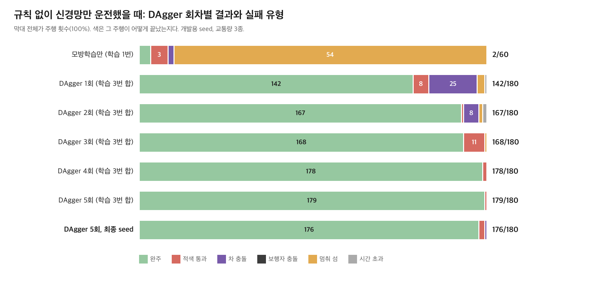
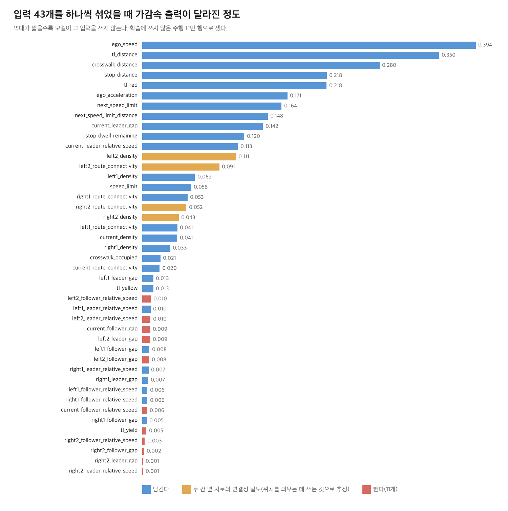
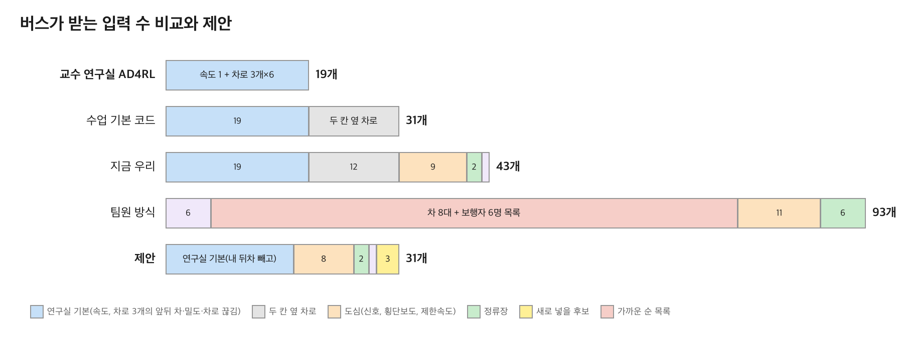

# 발표에 쓸 자료 (도로, 학습 모델 파트)

2026-11-24 작성. 11/28 발표에서 우리 파트가 보일 네 가지를 한곳에 모은다. 숫자는 모두 이 저장소의 평가 기록에서 계산했다.

## 결론

- **DAgger가 실패를 없앴다.** 규칙 없이 신경망만 운전했을 때 모방학습만으로는 60번 중 2번 완주했다. DAgger 10회 뒤에는 처음 쓰는 seed 300번 중 297번 완주, 충돌 0이다.
- **입력은 줄여도 된다.** 43개 중 15개는 모델이 쓰지 않는다. 오늘 받은 "신경망을 키우기보다 입력을 먼저 줄여라"는 피드백에 대한 측정 근거다.
- **데이터가 깨끗하다.** 보행자 순간이동, 경계 유턴, 겹쳐 선 대기열을 고쳤고, 수집 정책은 최종 seed 60번에서 충돌 0, 적색 통과 0, 순간이동 0이다.
- **영상이 있다.** 최종 모델이 교통량 1.5배에서 정류장 4곳을 서고 한 바퀴를 완주한 영상이다(`reports/videos/model_best_busy_lap.mp4`).

## 1. 실패 유형 분석: 모방학습만 했을 때와 DAgger 뒤

| 단계 | 주행 수 | 완주 | 적색 통과 | 차 충돌 | 멈춰 섬 | 시간 초과 |
|---|---|---|---|---|---|---|
| 모방학습만(학습 1번) | 60 | 2 | 3 | 1 | 54 | 0 |
| DAgger 1회(학습 3번 합) | 180 | 142 | 8 | 25 | 4 | 1 |
| DAgger 2회 | 180 | 167 | 1 | 8 | 2 | 2 |
| DAgger 3회 | 180 | 168 | 11 | 0 | 1 | 0 |
| DAgger 4회 | 180 | 178 | 2 | 0 | 0 | 0 |
| DAgger 5회 | 180 | 179 | 1 | 0 | 0 | 0 |
| DAgger 5회, 최종 seed | 180 | 176 | 3 | 1 | 0 | 0 |
| DAgger 5회, 새 seed(학습 1번) | 60 | 56 | 2 | 2 | 0 | 0 |
| DAgger 10회, 같은 새 seed(학습 1번) | 60 | 60 | 0 | 0 | 0 | 0 |
| **DAgger 10회, 처음 쓰는 seed 300번** | 300 | 297 | 1 | 0 | 2 | 0 |

- **모방학습만 하면 멈춰 선다.** 60번 중 54번이 "서 있기"를 엉뚱한 곳에서 내고 못 빠져나왔다. 규칙 운전사의 시범에는 그런 상황이 없어서 빠져나오는 정답을 배운 적이 없다.
- **DAgger 1회에 멈춰 섬이 사라지고 충돌이 드러난다.** 신경망이 직접 몰아 본 상황에 규칙 운전사의 정답을 붙여 다시 배운다. 움직이기 시작하니 다음 약점인 충돌(25번)이 보인다.
- **2~3회에 충돌이 사라지고 적색 통과가 남는다.** 3회에는 충돌 0, 적색 통과 11번이다.
- **4~5회에 적색 통과가 1~2번으로 준다.**
- **10회까지 돌리면 남은 실패도 사라진다.** 5회 모델이 56번 완주한 새 seed 60번을 10회 모델은 모두 완주했다. 처음 쓰는 seed 300번에서는 297번 완주(99.0%), 충돌 0이다. 300번 중 0번이면 실제 충돌률은 95% 확률로 1% 아래다.
- **최종 seed는 학습과 선택에 쓰지 않은 seed다.** 176/180(97.8%), 충돌률 0.6%로 수업 기준(5% 미만) 안이다. 따로 고른 seed 60번에서는 56번 완주, 충돌 2번(3.3%)이었다(진행 기록 23번). 300번으로 다시 잴 예정이다.

**발표에서 나올 질문과 답.** 오늘 다른 팀 발표에서 "DAgger에서 정답을 주는 주체가 누구냐"는 질문이 나왔다. 우리 답은 다음과 같다.

- 정답은 규칙 운전사(v6)가 준다. 버스와 같은 관측 43개만 보고, SUMO 내부 상태나 지난 관측은 쓰지 않는다.
- 규칙 운전사는 학습할 때만 쓴다. 주행할 때는 신경망만 부른다. SUMO 안전장치와 자동 차로변경도 꺼져 있다.
- 제출 데이터 1,000만 건은 학습한 신경망이 운전해서 모은다.

## 2. 입력 줄이기 실험

자세한 내용은 [network_architecture.md](network_architecture.md)에 있다. 발표에는 그림 두 장을 쓴다.

- **잰 방법.** 입력 하나의 값을 행끼리 섞어 넣고 모델 출력이 얼마나 달라지는지 본다.
- **결과.** 두 칸 옆 차로 12개, 내 뒤차 2개, 비보호 녹색 1개는 가리고 다시 학습해도 검증 손실이 같다(0.576 → 0.561). 11개를 가린 모델은 같은 seed 60번에서 58번 완주, 충돌 0이었다(원래 56번, 충돌 2).
- **새로 넣는 3개.** 모델이 규칙 운전사와 크게 어긋난 행의 38%가 정류장 50m 안 접근이었다. 정류장 근거리 거리, 앞차 100m 거리, 황색 경과 시간을 넣은 31개 안을 학습하고 있다.
- **팀 방식(93개)과의 관계.** 오늘 피드백은 입력을 30~40개로 줄이라는 것이었다. 31개 안이 그 범위에 든다.

## 3. 전체 주행 배속 영상

최종 모델로 만들었다. 파일과 장면 설명은 [videos/README.md](videos/README.md)에 있다. 발표에는 `model_best_busy_lap.mp4`(교통량 1.5배, 한 바퀴 750초를 66초로, 차로 변경 10번)를 쓴다.

- **담을 장면.** 정류장 4곳 정차, 적색 신호 정지와 출발, 차로 변경, 횡단보도 보행자 양보, 합정역 사거리 좌회전.
- **형식.** 한 바퀴 전체(약 6~8분)를 배속해 1분 안팎으로 만든다. 수업 요구는 30초 이상이다.
- **차로 변경 장면을 꼭 넣는다.** 오늘 피드백에서 "버스가 끝 차선으로만 달린다"는 지적이 있었다.

## 4. 도로 자연스러움 검증

수집 데이터에 억지 장면이 없도록 고친 것이다. 자세한 기록은 [progress_log.md](progress_log.md)의 "무엇이 이상했고 어떻게 됐나"에 있다.

| 이상했던 것 | 고친 방법 | 도로망 판 |
|---|---|---|
| 보행자가 순간이동함 | 보행 경로를 고침 | 3.15.0 |
| 배경 차가 지도 경계에서 유턴해 되돌아옴 | 경계 다섯 곳의 유턴 연결을 지움 | 3.16.0 |
| 좌회전이 너무 빠르고 각짐 | 앞뒤 차로에 접하는 곡선으로 바꿈 | 3.17.0 |
| 우회전 차와 횡단보도가 겹침 | 횡단보도 네 개를 0.5m 바깥으로 옮김 | 3.18.0 |
| 버스 노선이 닫히지 않음 | 합정역 사거리 좌회전 뒤까지 늘려 순환을 닫음 | 3.19.0 |
| 교통량이 적어 상호작용이 약함 | 배경 흐름 전체를 1.25배로 키움(시간당 1,326대) | 3.20.0 |
| 대기열 차가 비스듬히 겹쳐 섬 | 선 차의 옆 이동을 0으로 둠 | 환경 |
| 노선 끝 신호가 버스 관측에 빠짐 | 관측에 넣음 | 환경 |

- **결과.** 수집 정책(규칙 운전사 v5)은 최종 seed 60번에서 충돌 0, 적색 통과 0, 순간이동 0이다. 도로망 3.20.0에서 내가 다시 확인했다.
- **걸러내기.** `research/av_bc_rl/filter_episodes.py`가 실패, 시뮬레이션 이상(위치 점프, 차체 겹침), 어색한 장면이 있는 에피소드를 찾아 뺀다.
- **남은 것.** 진행 기록에 적어 둔 대로 회전 차 안에 든 보행자, J96 합류부의 배경 차 충돌 같은 작은 문제가 남아 있다.
